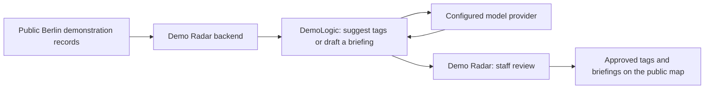

# DemoLogic

**Figuring out what Berlin’s demos have to say, one slogan at a time.**

DemoLogic is the research project and AI service behind [Demo Radar](https://demo-radar.com),
a live map of Berlin demonstrations. It interprets demonstration titles, suggests
topic tags for staff review, and prepares German daily briefings. Demo Radar
translates briefings with DeepL and handles review and publication in both languages.

The project compares simple rules, TF-IDF classifiers, natural-language inference
and hosted language models before choosing a service workflow. Suggestions remain
subject to reviewer approval. Tags describe topics; they do not verify a slogan’s
claims or judge its position.

## How it fits together



DemoLogic validates requests and saves answers, usage and recovery state. Demo
Radar owns event data, background jobs, staff permissions and publication. The
deployed tagging adapter uses Qwen on Hetzner with rubric v4. Gemini was evaluated
in research; a production Gemini adapter and route repair remain future work.

## Try it without private data or model calls

Requirements: [uv](https://docs.astral.sh/uv/) and Python 3.13; Docker for the API walkthrough.
From this checkout:

```bash
uv python install
uv sync --locked --group notebooks --group service
uv run --locked --group notebooks --group service pytest -q
docker build -t demologic:reproduction .
python3 scripts/smoke_service.py demologic:reproduction
```

The walkthrough uses invented responses and checks authentication, tagging,
daily drafts, saved-answer replay and restart recovery. It needs no provider key
or private dataset. **Demo mode is a software fixture, not a real model result.**
See the [complete reproduction guide](docs/reproducibility.md) for setup and expected output.

## What the research found

On the original **121-group final comparison**, F1 was **33.7% for regex,
39.7% for TF-IDF and 65.5% for Qwen**. No candidate met the combined targets of
80% precision, 80% recall and 95% coverage.

After rubric development, a separate **34-case fresh check** gave Qwen
87.0% precision / 73.4% recall and Gemini 87.5% / 76.6%; both had 97.1% coverage.
These are different studies, not one improvement curve. References were supplied
by **one reviewer**, and some require interpretation or extra context.
The small timing trial did not establish reliable staff time savings.

Read the [methodology and limitations](docs/methodology.md),
[original final results](docs/plan/final-evaluation.md) and
[fresh-case results](docs/results/fresh-v4-confirmation.md).
Raw datasets, reference labels, predictions and provider responses are private.
The public examples reproduce software behavior, not those private scores.

## Find your way

- [Documentation index](docs/README.md): architecture, API and research reading paths.
- [Notebook index](notebooks/README.md): each experiment’s purpose and required inputs.
- [Service API](docs/service-api.md): configuration, request contracts and safe recovery.
- [Service file tree](docs/service-api.md#code-map-and-checks): task assembly, providers and journal components.
- [Contributing](CONTRIBUTING.md): setup, checks and publication rules.
- [Security reporting](SECURITY.md): how to report a concern privately.

Code: [Apache License 2.0](LICENSE). Private data is not distributed with the code.
Third-party models and source material retain their own terms and attribution.

**Author: Roy Grossman.**
