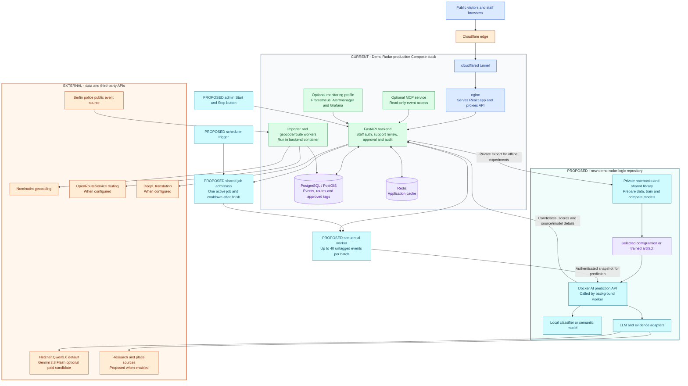
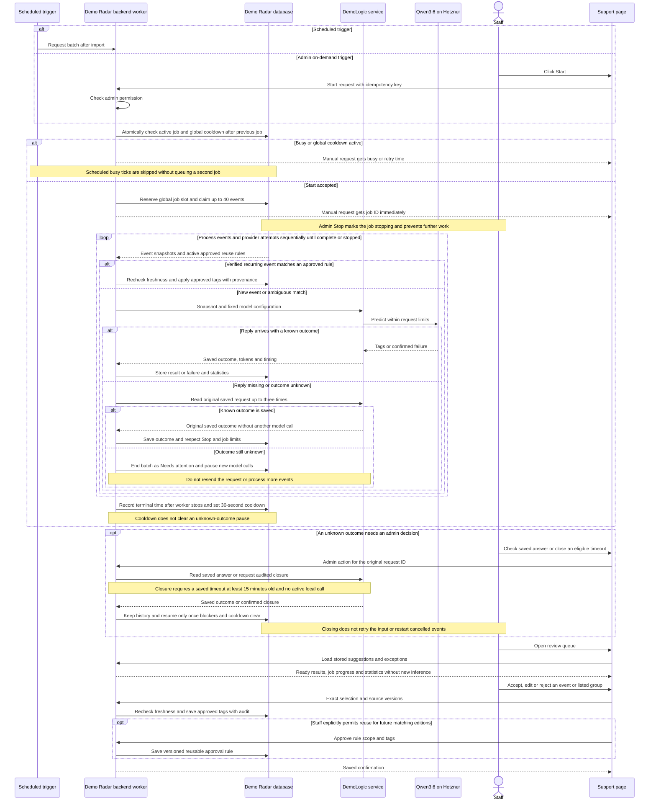
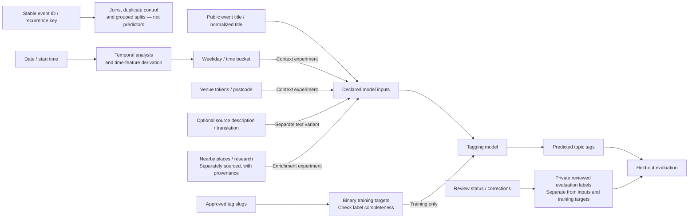
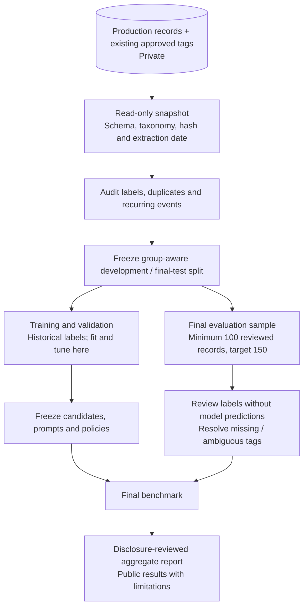

# ADR-0001: DemoLogic — Comparing Models for Demonstration Logic

This is a historical decision record. It preserves the original rationale,
alternatives, research constraints and dated changes; it is not the current
deployment guide. Earlier proposals, unchecked tasks, API examples and provider
prices describe their recorded stage and may have been superseded.

Start with the [current architecture](../architecture.md) and
[service contract](../service-api.md) for implemented behavior. The original
plan included approaches that were later paused or never implemented. In
particular, the generic job API examples below are not current service endpoints.
For byte-exact historical replay, use the [original research revision](../research-replay.md).

The 15 October editorial cleanup keeps technical decision history here and
course administration and weekly task lists in the issue tracker. Sections 2
and 13 retain their numbers to preserve historical references.

| Record | Value |
|---|---|
| Status | Historical proposal with dated decision updates; later implementation supersedes earlier proposals |
| Date | 2026-09-16 |
| Last technical checkpoint | 2026-10-10 |
| Editorial restoration | 2026-10-15; technical history retained, personal references redacted |
| Decision owner | Project maintainer |
| Planning horizon | Five weeks, including presentation; calendar start date to be confirmed |
| Delivery assumption | One participant; collaborators welcome but not required |
| Primary domain | NLP and multi-label classification for demonstration topic tagging |
| System scope | Existing Demo Radar applications and a new `demo-radar-logic` experiment/service repository |
| Implementation status | Start the capstone repository, notebooks, and shared modules from scratch. Obtain a fresh private production export; no old experiment files or fitted artifacts are required. The new repository and service are planned, not created by this ADR. |

## 1. Executive summary

Demo Radar's backoffice work includes investigating demonstrations, assigning topic tags, and correcting routes. The project author estimated 15–30 minutes per day for that combined work. This five-week capstone focuses on **tag suggestions**.

Experiments start in notebooks in a new repository. The sequence is notebook exploration and modeling, then evaluation and model selection, then an optional service. Service implementation does not run in parallel with exploratory modeling. Training uses a private export of Demo Radar records and existing approved tags. The final benchmark uses at least 100 separately reviewed demonstrations, aiming for 150; recurring editions stay together when splitting the data. Historical tags may contain mistakes, and even the reviewed sample may be too small for firm conclusions about rare tags. A small, preselected research experiment will test whether sourced evidence helps with unclear event names. Time/location context, nearby places, an extra classifier, and selective LLM escalation are extensions if capacity allows.

By the end of week 5, the capstone will compare a simple baseline, a TF-IDF classifier, one semantic model, the Jev decision model, and two LLMs on the same held-out set of at least 100 reviewed demonstrations. The report will show precision, recall, the share of demonstrations receiving a recommendation, response time, and full cost per attempted demonstration. It will recommend which workflow, if any, should be tried in Demo Radar.

In week 1, after checking the available data and provider costs, the reviewer will write down numerical minimums for precision, recall, and coverage and maximums for staff waiting time and cost. Those limits determine whether a workflow can be recommended for a trial and will be fixed before the final test. A simple classifier or continued manual tagging may be the right recommendation. Building a Docker AI service and connecting it to the support page is conditional on the research results and available time; it is **not required for capstone success**. If integration proceeds, Demo Radar remains responsible for authentication, showing suggestions, staff approval, and saving tags.

Public GitHub work will contain code, documentation, synthetic examples, and reviewed aggregate results. Production exports, row-level predictions, and fitted private artifacts stay local. Section 3 defines scope, section 7 the comparisons, and section 9 the decision criteria. The original delivery schedule is archived in the issue tracker. This opening proposal makes no claim of model results or time savings; later findings appear in dated updates.

## 2. Course administration

Course registration fields are archived in the project issue tracker. Original
section numbers are retained so references to technical decisions remain stable.

## 3. Context, decision drivers, and scope

### 3.1 Research questions

1. Does model complexity improve tagging over common-tag, keyword, and repeat-event baselines?
2. Does sourced research clarifying event names, aliases, or references improve results beyond event text alone? If time permits, do structured time, location, or nearby-place inputs help?
3. How do the Jev decision model and LLMs compare on tagging quality, cost, response time, and failure rate?
4. If time permits, can we get a better balance of tagging quality, cost, and speed by using a small classifier first and asking an LLM only when it is uncertain?
5. Do suggestions reduce review effort without introducing unacceptable incorrect or missing tags?

Our task is to use text to suggest topic tags for demonstrations — a form of natural language processing (NLP). We can tackle the same task with different tools: models that look at important words (TF-IDF), representations of text meaning (embeddings), or LLMs. In this project, “Multi-label” just means a demonstration can have more than one topic tag, such as environment and mobility.

### 3.2 Scope and priority

| Priority | Deliverable | Boundary |
|---|---|---|
| Core | Versioned private dataset, label audit, leakage-controlled splits | Reuse existing labels; no requirement to relabel 500–800 records |
| Core | Notebook comparisons of baselines, classical ML, a pretrained semantic candidate, Jev, and at least two LLMs | Exact hosted model IDs and budget are frozen before paid runs |
| Core | Bounded researched-evidence experiment | In week 1, freeze a numeric case ceiling and spend ceiling before research calls; use a preselected sample and shared evidence across judging models |
| Stretch (tagging) | Structured time/location comparison and nearby-place enrichment | A small F0-versus-F3 check is the first optional step; F4 requires separate place data and coordinates |
| Bounded extension | A second classical classifier and selective LLM escalation | Attempt after the primary model comparison; report separately if time permits |
| Core | Quality, cost, reliability, and error report; executive presentation | Report inconclusive and negative results honestly |
| Conditional implementation | Docker inference API and one demonstration of support integration | Begin after methods and their limitations are understood; API routes in this ADR are proposed |
| Stretch A | Compare LLMs for broken-route repair | Same service boundary; separate route dataset and metrics |
| Stretch B | Daily or weekly Berlin demonstration summary | Prompt plus supplied records first; MCP only if useful for tool access |
| Outside this capstone | General autonomous agent, LLM pretraining/fine-tuning, separate service frontend, automatic production tag approval | Requires a later decision |

The five-week schedule protects final evaluation and presentation time. If implementation cannot fit, deliver a documented contract and local prediction demonstration, explicitly reporting that service integration remains incomplete.

## 4. Decisions and alternatives

| ID | Decision | Rationale/consequence |
|---|---|---|
| D01 | Develop and evaluate in notebooks before serving models | Limits infrastructure work before there is evidence of value |
| D02 | Use private production records with existing tags as training targets | Makes the project feasible for one person; requires label-quality checks |
| D03 | Keep model complexity and input richness as separate experimental axes | Avoids attributing better information to a better model |
| D04 | Include Jev and LLM/provider comparisons in core research | Accuracy and operating cost are central questions, not a bonus |
| D05 | Start a new repository named demo-radar-logic with new notebooks and shared Python modules | Establishes an independent capstone implementation without inherited code, Git history, experimental data or artifacts; experiment logic begins in notebooks; only the selected approach is later extracted for serving |
| D06 | Deploy selected inference workflows in one private Docker service if time permits | Independent dependencies and model versions without a separate frontend |
| D07 | Keep authentication, candidate display rules, approval validation, and production writes in the existing Demo Radar backend; keep the review UI, candidate presentation, and staff approval interaction in the existing Demo Radar frontend/support page   | Preserves application ownership and staff control |
| D08 | Allow validated decision-threshold overrides in prediction requests | Supports experiments without making display filtering a service responsibility |
| D09 | Publish reusable code while keeping production data and fitted private artifacts local | Open collaboration does not require publishing private tagging work |
| D10 | Preserve manual approval and explicit attribution | A model recommendation is not authority to change a record |

### 4.1 Other approaches and why they were not chosen

- **Freshly label a large public dataset:** would require manually assigning and checking topic tags from scratch, exceeding the solo five-week annotation budget. Reuse historical labels with a reviewed evaluation sample; keep public collection optional for contributors using their own labels.
- **Use only LLMs:** prompts make prototyping quick without training a task-specific model.
  This would leave untested whether small trained classifiers can match their tagging quality at lower cost and latency.
- **Use only classical ML:** classifiers learn tagging patterns from existing labeled examples and can run locally.
  This would leave untested whether LLMs handle ambiguous wording better or benefit from researched evidence explaining unfamiliar references.
- **Build the service first:** means building the Docker API and connecting it to Demo Radar before checking whether the existing tags are reliable enough for training and whether models produce useful tag suggestions. This risks spending time on integration before knowing whether the predictions are good enough to use. Instead, the capstone will check the data and compare models in notebooks first, then build the service only if the results justify it and time permits.
- **Add AI dependencies directly to the main backend:** means installing the libraries needed to run models and call LLM providers inside Demo Radar's existing backend. This is possible, but changing those libraries could require rebuilding and redeploying the main backend, and dependency conflicts or heavy model workloads could affect normal application requests. Instead, the proposed Docker AI service keeps those libraries and model execution separate. The backend requests tag suggestions through an internal API, while continuing to handle authentication, staff approval, and database writes. AI libraries and models can then be updated independently, provided the API remains compatible.
- **Build an agent or a new frontend:** unnecessary for the defined sequence of collection, prediction, review, and approval.

### 4.2 Trade-offs and limitations

- **Independent service, additional operational work:** keeping AI dependencies separate makes model updates easier, but each prediction now crosses a network boundary. Requests can time out or fail even when the main application is working. The backend and AI service must also agree on request fields, response formats, tag catalog versions, and score meanings. If the service is implemented, it needs compatibility checks, bounded retries, and clear failure messages; staff must still be able to tag demonstrations manually when suggestions are unavailable.
- **Private data, limited external reproducibility:** keeping production records, reviewed labels, and fitted artifacts local protects private tagging work. However, external contributors cannot rerun the exact benchmark using public code alone. Synthetic examples can demonstrate the workflow, and contributors can run it on their own labeled data, but neither reproduces the private results. Recording snapshot hashes, splits, dependencies, and experiment settings supports internal reproduction without publishing the data.
- **Review effort and uncertainty:** review at least 100 held-out demonstrations and plan for 150. This increases the review workload but broadens evaluation coverage. Rare tags may still have too few positive examples—or none—to support reliable conclusions. Report sample sizes, per-tag counts, and uncertainty where meaningful; small score differences should not be presented as proof that one model is better.

The final report must explain these limitations and how they constrain the recommendation, distinguishing measured findings from questions that require more data or operational testing.

## 5. Architecture and ownership

### 5.1 Application and deployment diagram

**Historical design:** current/proposed labels in this diagram refer to the
original planning stage. See the [current architecture](../architecture.md) for
delivered responsibilities and the selected-model service.

This is the production deployment shown in `docker-compose.prod.yml` which exists in the `/demo-radar/` app, plus the proposed capstone components. Blue entry and frontend components and green backend components already exist in Demo Radar; teal marks proposed capstone work, while orange marks external services. In production, Cloudflare Tunnel reaches nginx; nginx serves the built React application and forwards `/api/` to FastAPI. The importer and its geocoding/route workers run with the existing backend container, not as new capstone services.



Color key: **blue** = browser entry and frontend delivery; **green** = Demo Radar backend processes; **purple** = stored data or model artifacts; **orange** = external sources and third-party services; **teal** = proposed capstone notebooks and AI components. The box titles also mark current and proposed parts for readers viewing the diagram without color.

The solid arrows describe data flow, not deployment permissions. The backend creates private exports for offline notebooks; selected settings or a trained artifact later feed the proposed AI service. A backend worker prepares suggestions for untagged events, triggered by a schedule or an admin-only support action. Both paths share one persisted global job slot; all starts wait through a shared 30-second cooldown after the previous job finishes or is confirmed stopped. Each job processes events and provider calls sequentially. Demo Radar stores job state, suggestions and explicit reusable approval rules. Staff read prepared results and review exceptions; matching verified recurring events can inherit tags from an active human-approved rule. Only the Demo Radar backend writes tags, after freshness and rule/approval checks. The AI service has no production database credentials. Neither browsers nor the existing MCP endpoint call hosted models in this design. Optional monitoring and MCP profiles are existing Compose options; scheduled tagging, reuse rules and DemoLogic integration are proposed additions.

### 5.2 Responsibility matrix

| Component | Owns |
|---|---|
| Demo Radar frontend/support | Admin-only Start/Stop button, stopping/cooldown and statistics display, ready suggestion queue, group and reusable-rule approval |
| Demo Radar backend | Staff auth, authorization, source snapshot, candidate display filtering/ranking/count, shared scheduled/manual admission, one active job and cooldown, event lookup, deterministic reuse rules, stored suggestions/statistics, freshness checks, audit and production writes |
| Tagging notebooks/shared library | Dataset preparation, experiment configuration, fitting, thresholds, evaluation, error analysis and report generation |
| AI service | Validate inputs, run inference, return attempt-level tokens/timings and attribution; later provide semantic match proposals from supplied candidates; request budgets and retries |
| Provider or local model | A versioned inference implementation; not the final approval authority |
| Existing geocoder/router | Coordinates, route geometry, and validation if the route stretch goal proceeds |

The service returns raw per-tag scores and score semantics. Demo Radar's backend owns the previously discussed display cutoff and top-five rule; these values are not embedded in model code or the AI contract. The comparison policy normally recommends up to two tags and retains additional qualifying tags tied at second place, as defined in section 9.2. It can also abstain. A model decision threshold and a display cutoff are distinct controls. This evaluation decision does not change Demo Radar's current two-tag save limit.

### 5.3 Background tagging and review sequence



New model predictions need reviewer approval. Automatic tagging initially means reusing an explicitly approved decision for a verified recurring event. The same normalized title alone is insufficient when organizer/series identity or purpose is ambiguous. Keep dated events separate; do not turn topic similarity into event identity. Suggested groups require staff confirmation, and approving one event does not silently approve future editions. Meaningful title changes, conflicting approvals or changed policy invalidate automatic reuse. Corrections expose affected assignments for review.

Qwen3.6 is the default on the confirmed free Hetzner account; Gemini 3.8 Flash is an explicitly selected paid alternative. Opening the review page does not buy inference. Background failures and empty answers remain visible, and staff can tag manually while other jobs are pending. The [DR-27 recommendation](../plan/service-recommendation.md) defines matching limits, job ownership and staff-effort measures. This sequence supports both scheduled and admin-triggered background work. DR-72 implements the backend for review; staff screens and approved reuse remain separate tasks. A repeated start cannot queue a second active job. The shared 30-second cooldown begins when the job finishes or is confirmed stopped and blocks both scheduled and manual starts. The support control cycles Start, Stop, Stopping, cooldown, then Start. Normal completion goes directly to cooldown. Persist and recover the job slot across replicas/restarts. Do not start a replacement until the old worker is confirmed stopped.

Deterministic title/series lookup and reuse eligibility belong to Demo Radar. Future semantic comparison of differently worded titles belongs to DemoLogic, using candidates supplied by the backend. Model scores propose matches; staff-approved rules and the backend decide reuse. Topic clusters do not merge distinct events. See [matching ownership and runtime statistics](../plan/service-recommendation.md).

## 6. Data strategy and privacy boundary

### 6.1 Primary dataset

Use the existing read-only Demo Radar export as the foundation. It currently produces a deterministic `dataset.jsonl`; derive a local CSV for notebook convenience if needed. A format conversion does not change data ownership or publishing permissions.

Create a new export for the capstone. The capstone starts fresh and does not rely on data files, predictions, or trained models from earlier experiments. Record when the new data export was created and its hash (a digital fingerprint used to identify the exact file). Use this export to recreate all experiment files, predictions, and trained models. This experimental reset does not mean deleting production records or discarding approved production tags.

| Field group | Role | Treatment |
|---|---|---|
| Public event title / normalized title | Initial text input | Preserve German characters; fit learned vocabulary only on training data |
| Date, start time, weekday, time bucket | Context and split metadata | Use coarse time features for the planned feature experiment; retain date for temporal analysis |
| Venue tokens and postcode | Controlled context inputs | Test separately and together with text |
| Stable event ID and recurrence key | Join, duplicate control and split grouping | Exclude identifiers from predictors |
| Approved tag slugs | Multi-label targets | One binary column per supported tag; absence is assumed negative only after checking label completeness |
| Review status and corrections | Private evaluation-label audit | Keep separately from model inputs and historical training targets |
| Optional source description/translation | Separately declared text variant | Not guaranteed in the current export; record provenance and coverage |
| Nearby places/research | Enrichment variant | Requires a separate sourced preparation step; not already present in the export 

The field-level flow below distinguishes information a model may use from training labels, split metadata, and evaluation-only corrections. Optional descriptions, translations, nearby places, and research are separately declared experiments, not assumed contents of the export.



The target taxonomy **v2** contains 12 topic labels. The migration is prepared in both repositories; deployment and activation are separate from this ADR decision. Historical exports use taxonomy v1.

- environment
- mobility
- housing
- work
- social-issues
- education
- lgbtq
- international-politics
- human-rights
- politics
- culture
- religion

`Other` is a product fallback and is excluded from the present model export. The [topic-tagging rubric](../tagging-rubric.md) is **rubric-v2**, approved on 1 October 2026, for the same 12 tags in **taxonomy v2**. Pride and LGBTQ equality or rights support `lgbtq` + `human-rights`; an accessibility protest focused on debating or changing a German bill supports `human-rights` + `politics`. A general request to officials alone does not add `politics`. Earlier reviews and experiments retain their recorded rubric-v1 reference. Review affected labels and version approved changes before comparing every candidate against v2; do not silently relabel the final set or use it for tuning. These rule changes do not alter the production catalog. Existing production assignments contain up to two topic labels.

**Decision, 25 September 2026:** replace `conflict` with `international-politics`, combining war/peace and international crises with political affairs of other countries. Narrow `politics` to German domestic politics. International political context may accompany a second topic: political prisoners in China receive `international-politics` and `human-rights`; a foreign anti-LGBTQ+ law can receive `international-politics` and `lgbtq`. Merely being near an embassy does not establish a topic. German foreign policy, including arms exports, belongs under `international-politics`; a separate domestic governance demand is needed for `politics`. Healthcare access and funding belong under `social-issues`.

The automatic migration is one map: `conflict → international-politics`. It preserves other labels, source text, event IDs, and split membership. Existing `politics` assignments cannot all be remapped: some concern German domestic politics and some need reclassification. The broader international definition can also affect records previously tagged only as human rights or another subject. These are review questions, not string replacements. Renaming historical labels does not make them independently reviewed v2 reference labels.

Demo Radar prepares a database migration for assignments, topic memory, and proposal references, and retires the old catalog entry. DemoLogic retains v1 loading and offers a dry-run-first command that writes a separate v2 copy with matching hashes and counts. Existing snapshots and results remain reproducible under v1. No migration is run on production as part of this preparation. See the [migration guide](../taxonomy-migration.md) for commands, ordering, and recovery. Apply one agreed taxonomy/reference-label version to every candidate in a comparison; finish affected reference-label review before final evaluation.

The export excludes untagged events, `other`-only records, deleted events by default, routes, coordinates, raw police payloads, staff/accounts, audit text, operational provenance, and telemetry. This means the labeled dataset does not represent every difficult support case. Report that selection bias. If feasible, add a small separately reviewed challenge sample of previously untagged or unfamiliar events; do not mix deliberately enriched challenge cases into representative headline metrics.

### 6.2 Publication and provider boundaries

| Public GitHub materials | Private/local materials |
|---|---|
| Source code, data schema, setup instructions, and experiment settings without secrets | Production exports and CSV files made from them |
| Real public-source event examples and notebook demos, where source terms permit redistribution and attribution is included; synthetic examples as a fallback | Private labels and reviewer corrections linked to real events; public availability of event details does not make these annotations public |
| Tag definitions approved for publication | Predictions for individual events, source excerpts, and research linked to private cases |
| Summary charts and findings checked before publication | Trained models, learned word lists, caches, and provider logs based on private data |
| Optional tool for collecting public data, with source credits | Credentials and private model files mounted into the service |

Public code is the intended collaboration model. Existing repositories are not made public or pushed as part of writing this ADR. Before any repository publication, check history and notebook outputs as well as current files. Do not place private fitted artifacts in a public Docker image; mount them from private storage. Third-party pretrained weights retain their own licence/distribution conditions.

Hosted-model runs receive only the inputs declared for the selected experiment: public tag definitions and approved event text, optional time/location context, source descriptions or translations, sourced nearby-place descriptors, researched evidence, and permitted few-shot examples. LLM calls additionally receive their task instructions and output schema; Jev receives its fixed tag questions. **Do not send the production database, private target labels, reviewer corrections, audit records, or private history**. Use synthetic/public examples for few-shot prompts unless separately choosing to share specific labeled examples with a provider. Cache outputs privately. Record which fields leave the local environment and the configured provider.

A public Berlin-source collector can help contributors obtain their own event records, subject to source terms and attribution. It cannot provide the tags the reviewer assigned privately. Also, the public event list changes over time, so downloading it later may not give contributors the same records used in this experiment. Document this limitation rather than promising exact external reproduction.


### 6.3 Preparation and label review



The plan uses **100 reviewed final-test demonstrations as a minimum and 150 as the target**. Check available independent groups and label counts in week 1, then freeze the chosen sample size before model-result inspection. If fewer eligible records exist, document the shortfall and revise the plan explicitly rather than counting duplicate editions as extra independent evidence. More records improve coverage, but neither 100 nor 150 guarantees adequate power for all 12 tags.

**DR-40 decision, 28 September 2026:** Count one representative per saved event group
in the primary title-only comparison. The locked assignments contain 2,626 training,
659 validation and 149 final occurrences, representing 732, 188 and 123 groups.
The primary experiment therefore uses **732 / 188 / 123 records**. The reviewer reviewed all
149 final occurrences; the 123 groups meet the minimum of 100, while falling below
the planning target of 150 independent event types. No group is moved or replaced.
This correction follows a duplicate audit before final model scoring.

Choose the earliest dated occurrence, breaking date ties by event ID. Preserve the
preselected review record in each of the 40 validation pilot groups. Selection never
uses labels or model performance. Retain the chosen original title and its historical
tags for development; do not union or majority-vote differing tags. Historical label
disagreements in 42 training and four validation groups remain a documented limitation.
All source occurrences, title variants and reviews remain private and intact.
The selection manifest maps selected IDs to all member IDs and supplies a version
and fingerprint for every candidate report. Final human labels remain outside tuning.

Rerun baselines and classical models on matching representatives. Keep older
occurrence-based reports as earlier experiments, not directly comparable results.
The repeat-history simulation may still use dated occurrences, with separate metrics.
Future changes to this policy require a new selection version and consistent reruns.

At an illustrative two minutes per record, reviewing 100–150 records takes roughly 3 hours 20 minutes to 5 hours, excluding research and resolving difficult labels. Time an initial batch to replace this assumption. Report the final number of records, distinct recurrence groups, and positive examples per tag. Validation-label review is additional to this final-test sample and must not consume it. An optional collaborator can independently label a subset, but the solo plan does not depend on one. With one reviewer, state that reference labels reflect one person's interpretation.

Existing approved tags are historical supervision, not automatically verified ground truth. Incorrect assignments introduce label noise. Check whether absent tags are genuinely absent or simply unassigned. Record uncertain/unresolvable reference cases and report their count; do not silently force a label or drop hard cases after seeing predictions.

## 7. Experimental design

### 7.1 Candidate models

These are proposed candidates, not claimed winners or promises of current provider availability. Freeze exact model/revision IDs, dependencies, access limits, and dated prices before running comparisons. No provider prices are assumed in this ADR.

The IDs below are experiment labels, not provider model IDs or topic tags. The letter identifies the method family; the number distinguishes candidates within that family, not their quality or rank.

| ID labels | Meaning | What the method can do | Main limitation |
|---|---|---|---|
| B0–B2 | Baselines | Suggest common tags, match predefined keywords, or reuse earlier assignments for known titles/series | Limited ability to handle unfamiliar wording or unseen events |
| C1–C2 | Classical text classifiers | Learn associations between words/character patterns and approved tags; suggest multiple tags for new records | Require labeled training examples and may miss meaning beyond learned text patterns |
| S1–S2 | Semantic models | Use pretrained language representations: S1 compares text with tag descriptions without task-specific training; S2 supplies meaning-based features to a trained classifier | Semantic similarity does not guarantee a correct tag; S2 still requires labeled training examples |
| J1 | Jev decision model | Makes typed, probability-bearing decisions from the supplied event and fixed tag questions; does not need task-specific training | Hosted, new, and unable to research or write explanations; its probability claims require validation on our data |
| L1–L3 | Large language models (LLMs) | Interpret event text and tag definitions, use supplied context/evidence, and return structured suggestions | Can produce unsupported or invalid answers; research requires a separately configured workflow |
| H1 | Hybrid workflow | Use a classifier first and escalate uncertain cases to an LLM | Depends on a validated escalation policy; combines classifier and LLM costs and failure modes |

### Candidate details and priorities

| ID | Candidate | Inputs and purpose | Priority |
|---|---|---|---|
| B0 | Always suggest the most common tag | Count tags in the training data, then suggest the single most common tag for every event without reading its title. For example, if `politics` is most common, always suggest `politics`. This simple baseline shows how well we can score without understanding any event; ML and LLM results must be compared against it to show added value. | Core |
| B1 | Suggest tags using keyword rules | Use simple handwritten rules, for example: if the title contains “Radwege”, suggest `mobility`. Define and freeze the rules using development data only, without inspecting the final test. This checks whether inexpensive, understandable rules are already sufficient, or whether trained models and LLMs improve on them. | Core |
| B2 | Reuse tags from previously seen titles or recurring events | Look for an earlier training record with the same normalized title or belonging to the same recurring series, then reuse its approved tags; if no match exists, make no suggestion. Implement this lookup in the new repository. This checks how much tagging can be handled by remembering previous assignments rather than interpreting new text. Evaluate reuse of known series separately from genuinely unseen events, using only earlier training assignments, so remembering a repeat is not mistaken for understanding a new event. | Core |
| C1 | Word and character TF-IDF + one-versus-rest logistic regression | Small trained multi-label baseline with validation-selected thresholds | Core |
| C2 | TF-IDF + one-versus-rest linear SVM | Compare decision boundaries with the same information and split; raw margins are not probabilities | Bounded extension |
| S1 | Multilingual zero-shot NLI candidate | Evaluate `MoritzLaurer/mDeBERTa-v3-base-mnli-xnli` as an initial candidate; independently verify and pin the revision and dependencies in the new repository | Core semantic comparison |
| S2 | Multilingual sentence embeddings + linear classifier | Convert event titles into numerical representations of meaning (sentence embeddings) using a pretrained multilingual encoder, then train a linear classifier on these representations and approved tags. Test whether this helps recognize similar topics expressed with different words by comparing tagging quality against TF-IDF. | Bounded extension |
| J1 | Jev hosted decision model | Use the same F0 event text and published tag definitions as the primary hosted comparison. Ask one independent yes/no tag question per approved tag, then use validation data to select the recommendation threshold. Store the returned probability for each tag, exact Jev revision, request shape, latency, failures, and dated cost. Do not ask Jev to produce explanations or collect evidence. | Core hosted decision-model comparison |
| L1 | Economical hosted LLM through Groq | Earlier proposal names `openai/gpt-oss-20b`; verify availability and price, then freeze an actual model ID | Core LLM candidate |
| L2 | Gemini model | Same-input tagging comparison; separately evaluate research-enabled workflows | Core LLM candidate |
| L3 | Hetzner-hosted or another local/hosted LLM | Add only if account access, model identity, and budget permit | Optional third LLM |
| H1 | Classifier with selective LLM escalation | Evaluate quality, coverage, and total cost against always-LLM operation | Bounded extension after candidate selection |

Provider and model are different variables. The same weights served by different providers principally test serving characteristics; different models test model capability. Record both. Ollama is an optional serving tool, not a classifier family or a mandatory dependency.

### 7.1.1 Jev scope and boundary

Jev is included because its purpose closely matches repeated tag decisions: it accepts supplied state and bounded questions and returns typed choices or probabilities, rather than generating prose. It is a **hosted zero-shot decision-model candidate**, not a trained classifier, a semantic embedding model, or an LLM. Its addition does not change the capstone's main question: we still test whether added model complexity produces enough practical value for Demo Radar.

The core Jev experiment is deliberately small and fair. It receives the F0 original title, the same versioned tag definitions used by the other hosted candidates, and one independent question for each tag: “Does this demonstration support the tag `<tag>`?” This allows more than one tag to be suggested. A single multi-choice question would make tags compete with each other and would be a poor fit for multi-label tagging. The validation notebook selects Jev's threshold; the final test only applies that frozen rule.

Jev does not replace Gemini or another LLM for researching an unfamiliar event, repairing a route, or writing a reason a staff member can read. It may later be given a frozen F5 evidence packet as a separately labelled workflow extension, but that is not required for the core comparison. Jev predictions are evaluation outputs only: they are never added to the training labels or used to train a local model. If Jev access, its API, or its documented model version is unavailable in week 3, record the attempted scope and the reason rather than silently substituting a different model.

### 7.2 Input variants and ablations

F stands for “features”: the information given to a model. F0–F5 label the input variants below. We change the information while keeping the evaluation records and method fixed to see whether it helps. This is called an ablation test. F0 is the basic tagging input; F5 supports the core researched-evidence question. F1–F4 are optional context experiments, not requirements for the final benchmark.

| ID | Available information | Comparison |
|---|---|---|
| F0 | Original title | Common initial baseline |
| F1 | Title + weekday/time bucket | Marginal value of time |
| F2 | Title + venue tokens/postcode | Marginal value of location |
| F3 | Title + time + location | Combined context |
| F4 | F3 + sourced nearby-place descriptors | Additional value and errors from proximity; never infer a topic from proximity alone |
| F5 | Original source + frozen researched evidence | Additional value and cost of research, including names, aliases, and missing context |

Use identical rows when comparing feature variants and report missing-enrichment coverage. Record place-source/version, retrieval date, matching method, and distance rule. Coordinate lookup is a separately approved enrichment step; coordinates are not present in the existing export. Do not fit transformations on the complete dataset before splitting.

Train C1 on F0 for the core classical comparison. If time permits, compare F0 with F3 on the same validation records; split F3 into F1 and F2 only when that result raises a useful question. Attempt F4 only after the core comparisons and presentation material are secure, because it needs a separate coordinate/place-data preparation step. Use a preselected validation subset for F5 to control research cost. LLM-only source descriptions or translations are separately named variants. Comparing a title-only model against a researched LLM answers a workflow question, not a pure model question.

Use the same evidence packet for different judging models. Evidence gathering and judging are separately configurable roles; they need not use different providers. Gemini is the initial research preference from prior discussions, while routine judgment should use the least costly candidate that satisfies measured quality needs.

### 7.3 Splits and leakage controls

We need to test whether a model can tag demonstrations it has not learned from. If it sees the test answers during development, its final score can look better than its real ability. This accidental access to answers is called **data leakage**.

Divide the dataset into three sets, each with a different purpose:

| Set | How we use it |
|---|---|
| Training | Teach the classifier using event information and existing tags. Fit text features, such as the TF-IDF vocabulary, on these records only. |
| Validation | Try models, prompts, and thresholds, then choose the settings that work best. Training and validation together are our development data. |
| Final test | Measure the chosen approach on records that did not guide those choices. Use the separately reviewed tags to check its predictions. |

There are three rules for keeping this comparison fair:

1. **Give every candidate the same split.** Save a new private list of which events belong to each set, together with the dataset version and settings needed to reproduce the split. For the main test, keep editions of a recurring demonstration in the same set. For example, placing one weekly bicycle demonstration in training and another edition in the test could reward memorization. Check similar titles and aliases when grouping events, and document uncertain matches. Where practical, choose recent events for the final test.
2. **Keep the answer separate from the prediction request.** Approved tags are needed to train a classifier and evaluate its output, but the event being predicted must not arrive with its answer attached. The same applies to reviewer corrections and previous explanations that reveal the answer. LLM examples and approved history must come from development records; research can retrieve public event information but cannot read private test labels. Keep those labels off public pages during the experiment.
3. **Use the final test after making the model choices.** Do not use its results to select prompts, features, or thresholds. If we later improve a model after studying its test mistakes, preserve the original result and describe the improvement as a follow-up experiment. A sample already used to guide earlier work cannot serve as an untouched final test.

Recognizing repeat events is useful too. Evaluate that separately by asking whether tags from earlier editions help predict later ones. Report this as a **known-series test**, distinct from the main test of how well models handle **unseen series**.

### 7.4 Fair hosted-model and cost comparisons

This comparison asks: **when hosted candidates receive the same event information and tag definitions, which gives better suggestions, and at what cost?** Give each model the same event fields, approved tag definitions, evidence where the workflow uses it, and a task-appropriate answer format. For example, if Gemini collects background information, save that evidence once and give the same saved packet to each LLM judge. This prevents one model from winning simply because it received more information.

The following is an illustrative JSON request to our **shared LLM adapter**, using synthetic event text. It is not a universal provider API: the adapter translates it into the selected provider's request format. The model ID is an experiment alias resolved to a recorded provider model/revision. The adapter loads the complete approved catalog named by `tag_catalog_version` and includes its definitions in the model's prompt.

```json
{
  "experiment_id": "same-input-llm-validation-001",
  "model_id": "L1",
  "tag_catalog_version": "v2",
  "instruction": "Return the approved topic-tag candidates supported by the event and supplied evidence. Explain each candidate briefly and provide its score using the configured scoring convention. Include any candidates tied at second place. The adapter applies the recorded threshold and tie policy to select recommendations. If evidence is weak, explain the uncertainty. Do not invent facts or tag names.",
  "input": {
    "event": {
      "id": "synthetic-demo-001",
      "title": "Für sichere Radwege"
    },
    "evidence": []
  },
  "research_enabled": false,
  "expected_output": {
    "suggestions": "Array of objects with tag, score, reason, and evidence_ids; self-reported scores are not calibrated probabilities",
    "uncertainty": "Explanation of missing information or an empty string"
  }
}
```

Run this request again with `model_id` set to `L2`, keeping the other fields unchanged. The empty evidence list makes this a title-only comparison. For the research experiment, populate it with the same saved excerpts and source links for both models. The adapter validates the answer against a real JSON schema; the `expected_output` above describes the requested fields for readability.

Jev needs a different request shape because it returns decisions instead of prose. The following is an illustrative request to the shared adapter, not a copy of a provider API. The real request includes every approved tag; three are shown only to keep the example readable.

```json
{
  "experiment_id": "jev-title-only-validation-001",
  "model_id": "J1",
  "tag_catalog_version": "v2",
  "input_variant": "F0",
  "event": {
    "id": "synthetic-demo-001",
    "title": "Für sichere Radwege"
  },
  "tag_questions": [
    {"tag": "mobility", "question": "Does this demonstration support the tag mobility?"},
    {"tag": "environment", "question": "Does this demonstration support the tag environment?"},
    {"tag": "housing", "question": "Does this demonstration support the tag housing?"}
  ]
}
```

The adapter records Jev's answer for every tag question and applies the threshold selected on validation data. It returns the same normalized candidate format used for all models: tag, raw score, score type, and whether the tag was recommended. Jev does not supply the written reasons requested from LLMs; the support UI must show that difference honestly rather than inventing an explanation.

Separately, test whether changing the prompt helps: compare a basic instruction, an instruction with tag definitions, and one with a few allowed development examples. Choose the prompt using validation results, then leave it unchanged for the final test. Record any adjustments needed for a particular provider. If budget permits, repeat a preselected small validation sample to check whether a model gives stable answers; do not repeat only its disappointing answers.

Keep a private record of every attempt so we can trace a result back to its inputs and price:

| Record | Why we need it |
|---|---|
| Experiment, event/group IDs, dataset/split fingerprints, input variant, and reference-label version | Identify exactly which records and answers were compared |
| Actual provider/model/revision, prompt/evidence fingerprints, and effective decision policy | Reproduce the setup and identify changes between runs |
| Suggested tags, raw scores where available, score type, and errors | Evaluate the answer and investigate mistakes |
| Duration, attempts, cache reuse, input/output tokens, research fees, and available billing information | Measure speed and total cost, including failed or retried calls |

Report two costs when evidence is shared. **Full workflow cost** includes collecting the evidence and judging the event, as if that model were used on its own. **Additional comparison cost** counts only the extra judging call when the evidence already exists. For example, if research costs €0.02 and each judge costs €0.01, a standalone workflow costs €0.03; adding a second judge costs another €0.01. These are illustrative amounts, not provider prices.

Include billed failures and retries. Record the currency and price date, and distinguish money actually spent from estimated operations without free credits. Mark missing usage as unavailable rather than inventing a value. For local models, record hardware, loading/inference time, and hosting assumptions even when there is no per-token bill. Keep limits on output tokens, parallel calls, research, and retries consistent and recorded so differences in spend can be explained.

## 8. Notebook plan

The ten numbered notebooks are a proposed reading and execution order for the new `demo-radar-logic` repository. They answer one research question at a time; reusable loading, feature, prediction, and scoring code belongs in the shared package described in section 10. The notebooks record inputs, versions, decisions, and results. They do not contain private rows or saved provider responses in their public GitHub outputs. Later notebooks may reuse frozen outputs from earlier ones rather than repeating paid calls.

### 8.1 `01_data_snapshot_and_quality.ipynb`

Load a fresh, local export from Demo Radar and verify that its schema and tag catalog match the expected versions. Count usable records and inspect missing titles, dates, locations, identifiers, and approved tags. Show a few private examples locally to understand the data, but clear those outputs before publication. Save a dataset fingerprint, field-quality report, and explicit inclusion rules for later notebooks. If the export is absent or invalid, stop with a clear instruction; a synthetic example is a separate demonstration mode, not a replacement for real evaluation data.

### 8.2 `02_label_audit_eda_and_splits.ipynb`

Examine tag frequencies, co-occurring tags, inconsistent or missing assignments, and repeated demonstrations. Use title similarities and available recurrence identifiers to keep related editions together, then create and save the private training, validation, and untouched final-test assignments described in section 7.3. Define the held-out review sample before model results are inspected: at least 100 demonstrations, aiming for 150. Record which reference tags the reviewer has reviewed, which remain historical assignments, and where rare tags are too scarce for strong conclusions. Later notebooks read the saved split rather than generating their own.

### 8.3 `03_simple_baselines.ipynb`

Measure what can be achieved without a trained language model. Compare the most-common-tag rule, a small set of documented keyword rules, and reuse of approved tags from earlier occurrences of the same known event. Fit or write the rules using training and validation records only, and measure their quality, coverage, and runtime using the shared evaluation code. Report results for previously seen series separately from unseen demonstrations. This notebook sets a concrete standard that more complex methods must improve on; the outcome is a baseline comparison and examples of where each simple rule fails.

### 8.4 `04_classical_text_models.ipynb`

Compare two versions of logistic regression: one reads word TF-IDF features and the other adds character fragments. Both use the same original titles, historical training labels, and saved split. This small comparison asks whether the extra text features improve results enough to justify their size; it does not require running two models together in a future service. Each version learns a separate yes/no classifier for every tag, allowing several tags for one demonstration. Choose each recommendation threshold on one set of validation event types, then check it on different validation event types. Compare with the simple baselines on matching records and report per-tag errors, coverage, runtime, and model size. The 40 reviewed pilot labels provide an extra development check but have already informed rubric decisions. Keep fitted models and row-level reports private. A linear SVM is optional after the core work is on track; no API is built during this modeling step. The [current comparison guide](../methodology.md#comparison-stages) gives the review steps.

**Optional title-feature experiment (DR-41):** When time allows, Notebook 04 can compare single words against the existing words-plus-pairs model, and separately test removal of narrowly defined schedule text. Change one feature choice at a time while keeping the classifier, training representatives, and validation division fixed. Choose each cutoff on the tuning portion only. Record quality, coverage, runtime, and limitations in a separate private report and the presentation insights log. This remains exploratory development work; it does not use final-test labels or automatically replace the selected artifact.

### 8.5 `05_context_and_nearby_places.ipynb` — optional

This is a stretch notebook and can be skipped without blocking notebooks 06–10. If there is time, start with a small F0-versus-F3 comparison using fields already in the private export: title, weekday, time bucket, venue tokens, and postcode. Add the context as named text tokens (for example, `weekday=5`, `time_bucket=15:00`, `postcode=10117`), train the same TF-IDF classifier, and compare predictions on the same validation demonstrations. Test F1 and F2 separately only if we need to know whether time or location caused a change. F4 is a further stretch: obtain event coordinates through a prepared read-only lookup, match them to a chosen public place dataset within a documented distance, and add descriptors such as `near=embassy`. Record the source, matching rule, missing matches, and preparation cost. A nearby embassy is context, not proof of the demonstration's topic. No LLM is required for these structured-field tests; research into names and event history belongs in notebook 08.

**DR-19 implementation, 29 September:** Notebook 05 now performs the bounded F0-versus-F3 comparison using the original word TF-IDF logistic-regression settings. Context uses namespaced underscore tokens so weekday, time bucket, venue and postcode remain identifiable to the word tokenizer. Missing values have explicit markers; all representatives remain in the comparison. Fit on training records, choose each cutoff on the same 94 tuning records and check on the other 94. Verify F0 against the saved Notebook 04 report. Record per-tag results, reviewed-pilot metrics, changed predictions, context availability, runtime, input fingerprints and split IDs. This is exploratory development evidence, not a final-test or unseen-venue evaluation. F1/F2 separation and F4 nearby-place enrichment remain unimplemented stretch work. See the [current comparison guide](../methodology.md#comparison-stages).

### 8.6 `06_semantic_models.ipynb`

Evaluate a pretrained multilingual zero-shot NLI model using the approved tag descriptions, with its exact model revision pinned before the run. If time and resources allow, add sentence embeddings with a small trained classifier as a bounded extension. Use the same splits and source fields as the classical comparison so any difference reflects the method rather than extra information. Measure tag quality, coverage, speed, and hardware needs, and inspect German wording or unfamiliar names that change the answer. Carry forward only candidates that add useful evidence to the overall comparison.

**DR-18 implementation, 28 September 2026:** S1 uses `MoritzLaurer/mDeBERTa-v3-base-mnli-xnli` at revision `8adb042d524ecd5c26d3e3ba0e3fbcf7e2d0864c`. Its [pinned model card](https://huggingface.co/MoritzLaurer/mDeBERTa-v3-base-mnli-xnli/blob/8adb042d524ecd5c26d3e3ba0e3fbcf7e2d0864c/README.md) lists MIT licensing. The selected files total 561,966,216 bytes. Notebook 06 uses fixed German tag sentences based on rubric-v1, local CPU inference in float32, and no task-specific fitting. It selects a cutoff on the same 94 validation representatives and checks it on the other 94. The reviewed pilot is reported separately. NLI receives tag definitions while TF-IDF learned from historical training labels; the event input stays title-only, but this comparison tests the complete methods rather than architecture alone.

The notebook records support-versus-contradiction scores, neutral outputs, truncation, runtime, process memory, and input fingerprints. Private per-event caching supports interrupted runs and marks reused timing measurements explicitly. Public CI tests the score calculation and development-data boundary with synthetic examples; downloading weights and evaluating the private benchmark remain local operations. Install the optional `semantic` dependency group to run it. Results and the review checklist belong in the [current comparison guide](../methodology.md#comparison-stages).

**Bounded follow-up, 29 September:** Notebook 06 also tests one revised `human-rights` hypothesis and removal of that candidate before tag selection. Other tag scores, data splits, and reference labels stay unchanged. Report both the original 12-tag task and a diagnostic excluding human-rights from both predictions and references, without dropping events. Preserve the original baseline and select cutoffs only on the tuning subset. This is an experiment with model instructions and selection, not a taxonomy change. Results and limitations are recorded in the [current comparison guide](../methodology.md#comparison-stages).

**Language diagnostic, 29 September:** Compare the current model on German text, the same model on fixed English translations of titles and hypotheses, and `Sahajtomar/German_Zeroshot` at revision `d5b0a26665b8538bcb3faa1e63a634cca4c8ee1b` on German text. Start with ten synthetic examples and inspect all three NLI outputs. The shared diagnostic cutoff is not validated for the new setups. Because the German candidate showed a useful difference, extend that candidate with the original hypotheses to the existing 94/94 development split, choosing its own cutoff. Preserve the original baseline and all reports. These are exploratory comparisons, not final-test results or evidence that language alone caused the difference. The German model card does not declare a license; do not assume deployment or redistribution permission from this local experiment. Notebook 06 sections 15–18 explain the inputs, results and limits.

### 8.7 `07_llm_comparisons.ipynb`

Compare Groq and Hetzner on the same original titles. Screen three prompts (tag names, definitions, and definitions with invented examples) on 20 fixed tuning records. Select by micro F1, preferring the simpler prompt for a tie, then check the selected prompts on the separate 94-record development half. Show quality, coverage, failures, request time, token use, a graph, and disagreements with historical labels. Compare earlier saved strict-two predictions on those same check records. Keep all reference tags local and exclude the final benchmark. Start with the confirmed free-tier accounts; cached results support reruns without new requests.

**Implementation, 30 September:** Notebook 07 is an executable LLM experiment. HTTP, validation, private cache and bounded retries live in `notebooks/tools/hosted.py`; prompts, selection and evaluation remain visible in notebook cells. Local keys and run controls come from a Git-ignored `.env`, with a committed `.env.example`; only non-secret settings are recorded in reports. Synthetic connection checks passed for both providers. Both providers completed all 20-record prompt screens and the same 94-event development check against historical labels. Groq had 69.3% precision, 62.2% recall, 65.6% F1 and 96.8% coverage; Hetzner had 65.6%, 66.1%, 65.9% and 97.9%. Neither met the agreed 80% precision and recall targets. Groq needed 97 rate-limit retries during checking; Hetzner needed none. These results remain development evidence, not final-test accuracy. See the matched private report cited in the [current comparison guide](../methodology.md#comparison-stages).

**Development review companion, 1 October:** `07a_development_reference_review.ipynb` implements DR-43. It verifies the approved private reference and preparation/report fingerprints, recalculates all eight saved candidates on 19 accepted development cases, and compares historical versus reviewed answers in a table and F1 chart. One unclear case is excluded; accepted interpretations and source-match warnings remain visible. Reference `dr43-reviewed-v1` records rubric-v2 and reviewer decisions, not a claim of uniform source verification. No inference, retraining or final-test tuning occurs. The [recorded pivot insight](../presentation/insights.md) explains label changes, rule changes, missing context and remaining model/reference disagreements. This bounded review does not estimate production label-error rates.

**Separate Jev notebook:** `07b_jev_decision_model.ipynb` is planned under DR-20 and is not implemented yet. It will ask independent per-tag questions, choose a score threshold on the tuning half, and evaluate on the same check half. Its probability-based decisions need their own explanations and results. Jev access does not block Notebook 07.

**Alternative-model companion, 1 October (DR-45):** `07b_hetzner_model_comparison.ipynb` compares `Qwen/Qwen3.6-35B-A3B-FP8` and `Qwen3.8-27B` on Hetzner using the same ten preselected reviewed development titles, rubric-v2 instructions and generation settings. Both are rerun, without search, to isolate the model difference. Save paired predictions, aggregate quality, request timing and token usage; keep raw records private. Qwen3.8-27B raises precision but lowers recall, F1 and coverage through two extra abstentions. This bounded diagnostic does not justify replacing the existing candidate or establish general model quality. The separate GPT-OSS search comparison remains unchanged. Results and review steps are in the Week 3 plan.

### 8.8 `08_research_evidence_comparison.ipynb`

Test the extra value of looking up names, aliases, or previous events when the source title is unclear. In week 1, choose and record the maximum number of validation cases and the research spending limit after checking the available ambiguous cases and provider costs; do not add cases because early results look promising. Collect evidence packets with links and retrieval dates for that preselected subset, then give the same saved packet to each judging model. Compare each model's title-only and evidence-informed answers on the same demonstrations, noting unsupported claims, extra time, and full cost. The subset is deliberately selected for ambiguity, so report this as an exploratory workflow result, not a general improvement rate for all demonstrations.

**Implementation, 1 October (DR-22):** Use one model, `openai/gpt-oss-120b` on Groq, with search off versus search on. The search-on request both researches and returns topic tags; there is no separate Qwen judge. Keep the same ten preselected development titles, rubric-v2 prompt, generation settings and reviewed answers in both conditions. Five cases needed background and five were title-sufficient controls. Only browser tool availability and the corresponding search-first/title-only instruction change. Validate tags locally because browser search cannot use Groq Structured Outputs. Save actual tool traces, source URLs, model identity, tokens and original request time. The previous two-model trial and its five completed searches remain archived, not reused as input. The reviewer approved the simpler comparison. Twenty answers, at most sixty HTTP starts including retries, with successful responses cached. Internal browser operations are provider-controlled. Use the confirmed free-tier account; the $10 research allowance remains within $50 overall, and paid use needs priced enforcement. No final-test data. Jev remains paused. [Groq browser search](https://console.groq.com/docs/tool-use/built-in-tools/browser-search).

**Completed result, 1 October:** All ten paired cases finished. GPT-OSS-120B search-off achieved 66.7% precision, 57.1% recall and 61.5% F1; search-on achieved 61.5%, 57.1% and 59.3%. Both had 100% coverage. Search did not improve this bounded comparison, so it is not recommended as the default on this evidence. This is not a general verdict on search: the sample is small and previously reviewed, and each arm ran once. Account credentials changed after thirteen successful responses; timing and quota observations span accounts. Notebook 08 and the Week 3 plan document the changed predictions, source-review steps and limitations.

### 8.9 `09_thresholds_and_hybrid_policy.ipynb`

Use validation results to choose each model's recommendation thresholds, applying the agreed rule that normally retains up to two tags and includes qualifying ties at second place. Also measure when the model offers candidates without a recommendation. This threshold selection is needed for the core comparison. If time permits, test when a cheap classifier should ask an LLM for help by comparing classifier-only, always-LLM, and selective escalation on the same events. Report tag quality, the share of events receiving recommendations, review effort where measured, waiting time, and full cost including evidence and retries. Keep each model's score meaning and threshold separate as explained in section 9.2. Freeze the chosen policies here; the final-test notebook must not tune them further.

### 8.10 `10_final_benchmark_and_recommendation.ipynb`

Run the previously selected candidates, prompts, and policies once on the untouched final-test set and compare them with reviewed reference tags. Present overall and per-tag results, coverage, uncertainty, runtime, reliability, and total cost, including any failed attempts. Separate the representative final set from a deliberately difficult challenge sample and distinguish reviewed labels from unreviewed historical assignments. Record important errors and the limits of the sample before recommending a classifier, LLM, hybrid approach, or continued manual tagging. Produce publication-safe aggregate tables and figures, with private row-level results kept local for audit.

## 9. Evaluation and success criteria

### 9.1 Metrics

| Dimension | Measures and interpretation |
|---|---|
| Correct/missing labels | Precision, recall, and F1; per-tag counts and confusion matrices. Report unsupported metrics as undefined rather than hiding zero-support tags. |
| Recommendation policy | Evaluate the threshold and tie rule in section 9.2. Recommendations may contain zero, one, two, or more qualifying tied tags. Count each output size, invalid tag names, and events with no recommendation. Coverage is the share of events receiving at least one recommendation. Exact-set match measures how often all reference tags, with no extras, are recommended. |
| Candidate usefulness | Recall@k / hit@k for the backend's chosen display policy, clearly distinguished from final recommended-tag quality |
| Context benefit | Paired differences on identical records and error examples where context helps or misleads |
| Review effort | Acceptance without editing, edit rate, and time on a predefined small review study. Counterbalance ordering or disclose learning effects. |
| Reliability | Schema validity, failure/timeout rate, partial results and recovery behavior |
| Runtime | Median latency; tail latency only with sample size disclosed; cold versus warm local inference |
| Economics | Full cost per attempted event and per accepted suggestion, including research/retries; review time reported separately unless an hourly cost assumption is supplied |
| Uncertainty | Sample/group counts, per-tag support, and group-aware confidence intervals where meaningful. Small samples cannot establish small differences reliably. |

The private reviewed final-test set has a minimum of 100 demonstrations and a planning target of 150, chosen before final-result inspection. It supports a benchmark, not a guaranteed statistical ranking of all models or rare labels. Headline results use a representative held-out sample; **enriched** rare/hard cases appear in a separate challenge report. Metrics against unrevised historical labels are explicitly called agreement with historical assignments.

For example, suppose a classifier returns scores for every tag, but its selected policy recommends only tags scoring at least 0.65, normally retaining two and including any qualifying second-place ties. If 80 of 100 events receive a recommendation, coverage is 80%. The other 20 still count when calculating how many reference tags were missed (recall). Otherwise, a model could look successful by answering only easy cases. If an event's reference tags are `mobility` and `environment`, recommending only `mobility` earns partial credit in tag-level metrics but is not an exact-set match. All numbers in this example are illustrative.

### 9.2 Decision and threshold policies

**Agreed output rule, 25 September 2026:** first discard candidates that fail their model's recommendation threshold, then rank the remaining candidates by that model's unrounded score. Keep up to two, plus every additional candidate whose score exactly equals the second-ranked score. For example, qualifying scores of 0.90, 0.80, and 0.80 retain three tags. Scores of 0.90, 0.80, and 0.79 retain two. Near-ties do not count under the initial policy. Apply the same rule to every candidate that provides scores, recording each score's meaning. If a candidate cannot provide scores, disclose that the numeric tie policy is unavailable; do not fabricate them.

Reference labels may include three or more equally central topics when evidence supports each, independently of model scores or the reviewer's uncertainty numbers. Evaluate the tie-inclusive policy and a strict two-tag variant against the same complete reference labels and report their results separately. For the strict variant, break exact score ties using the stable tag-slug order so reruns agree. Report how often more than two tags are recommended and count every extra recommendation in precision and recall. The production save limit and implementation of these policies remain separate from this capstone decision.

A classifier can return candidate scores without recommending a tag when none passes its decision rule. This is called **abstaining**. The support page can still show those candidates for review, and an LLM should still explain its best-supported suggestions when uncertain. Abstaining does not mean silently hiding the event or its candidates.

The **decision threshold** is the score a tag must reach to become a recommendation. For example, scores of 0.82 for `mobility` and 0.58 for `environment`, with a threshold of 0.65, produce only a `mobility` recommendation. Raising the threshold usually reduces the number of suggestions and may reduce mistakes, but can also miss correct tags. Try thresholds on validation data to measure that trade-off. Start with one threshold for a model; use different thresholds for individual tags only if there are enough validation examples to support those choices.

Scores from different models are not automatically comparable. An LLM saying “0.8 confidence” is describing its own answer; it has not demonstrated that eight out of ten such answers are correct. An SVM score measures distance from its decision boundary and may even be negative. NLI scores measure support for a proposed text/label relationship, while a classifier's probability estimate comes from its fitted model. Therefore, a threshold that works for one candidate may be unsuitable for another. Compare their actual correct and incorrect tags against the reviewed labels, rather than choosing whichever model reports the highest score.

**Calibration asks whether a probability score is trustworthy.** Imagine that a classifier assigns `mobility` a probability close to 0.8 for 100 demonstrations. If roughly 80 of those demonstrations actually have the `mobility` reference tag, that score agrees with what we observe. If only 60 do, the model is overconfident for that group. These numbers are an illustration, not a required sample size or a measured result.

Calibration learns an adjustment from examples like these. It might turn an overconfident raw score of 0.8 into a probability closer to 0.6. This does not teach the model new facts about the demonstration or guarantee a better tag; it aims to make the probability more honest. A threshold answers “should we recommend this tag?”, while calibration asks “does this probability match how often the tag is actually present?”

Treat calibration as an optional experiment where the model supports it and we have enough labeled examples. Learn the adjustment from a reserved part of the development data, using records the classifier did not train on. Check it on different records and compare adjusted with unadjusted scores. Keep the final-test answers out of this adjustment. If the dataset is too small to support that extra check, report the original score type without claiming it is a reliable probability.

The API may accept a supported threshold override and must return the effective value/policy. The backend's display filtering is separate and is applied after the service returns raw candidates. Raising or lowering a display cutoff **must not** silently change the model's evaluated recommendation policy.

**Recorded requirements, 25 September 2026:** at least 80% micro precision,
80% micro recall and 95% coverage for the same policy; under five minutes per
demonstration; at most USD 1 per attempted demonstration and USD 50 total paid
API spend. Research was limited to 20 validation cases and USD 10 within that
total. The retained final sample had 149 dated records; later grouping and
duplicate corrections are documented in the dated final-comparison updates.
These were project targets, not measured results or universal standards.

In week 1, we should record what would make a model useful enough to integrate into the support page. The acceptance criteria need to answer four practical questions:

| Criterion | Decision to record before the final comparison |
|---|---|
| Tagging quality | How many wrong suggestions and missed reference tags are acceptable, measured through precision and recall? |
| Coverage | What minimum share of demonstrations should receive a recommendation? |
| Waiting time | How long can a staff member reasonably wait for a suggestion or comparison? |
| Cost | What spending limit is acceptable per attempted event and for the experiment as a whole, including research and retries? |

The original weekly benchmark plan (archived in the issue tracker) recorded these numerical limits and measurement rules, including the delegated recall decision, total API budget, research case/spend ceilings, and the retained final-test sample. Keep approved values unchanged for final evaluation. This prevents us from lowering the requirements simply because a favored model missed them. The older offline experiment used 90% label precision and 50% coverage; these are background examples, **not agreed capstone targets or measured results**.

If no candidate meets the agreed requirements, the capstone still produces a useful result: it explains the trade-offs and recommends keeping manual tagging for now. Completing the research does not require deploying a model that fails the agreed quality or cost requirements.

### 9.3 Definition of done

- [ ] Versioned schema, taxonomy, private snapshot hash and documented inclusion/exclusion rules.
- [ ] Reproducible group-aware splits and at least 100 separately reviewed final-test demonstrations, targeting 150, with per-tag/group counts and limitations or an explicitly documented data-availability shortfall.
- [ ] Completed baselines, classical comparison, at least one semantic candidate, Jev, and at least two LLM model comparisons; any access failure is disclosed as incomplete scope.
- [ ] Researched-evidence experiment on a preselected validation subset within the numeric case and spend ceilings frozen in week 1; report its limited scope and any optional context comparisons separately.
- [ ] Validation-selected thresholds/policies and one preserved final benchmark.
- [ ] Quality, cost, latency, reliability, and error report with no invented results.
- [ ] A documented recommendation for classifier, LLM, hybrid, or continued manual operation.
- [ ] Explicit statement that the research conclusion meets the capstone objective regardless of whether a Docker service or support-page integration is built.
- [ ] Public-ready code/docs/synthetic demonstration and cleared private notebook outputs; no claim of exact public reproduction of private-label results.
- [ ] Executive deck, technical ADR, reproducible demo and rehearsal.
- [ ] If implemented: a verified Docker API, same artifact used offline/online, clear errors and one reviewed integration demonstration.

## 10. Repository and notebook structure

Keep the existing `demo-radar` application repository and start a new repository named **`demo-radar-logic`** for notebook experiments, shared data checks and scoring, and a later optional service. The capstone starts fresh: it does not fork or migrate the old tagging repository, inherit its Git history, or import its experiment outputs. All code repositories are intended for GitHub collaboration, but creating or publishing one is a later implementation action. Do not create another network service just for the small classifier.

Build the capstone notebooks directly under `notebooks/` with the execution order and purposes in section 8. Keep experiment-specific rules, feature construction, model fitting, prediction loops and comparisons in visible notebook cells. Share stable input validation and metric definitions under `src/demo_logic/`. Repeated notebook table display, fingerprint checks, and human-readable review exports belong in `notebooks/tools/`, so a notebook can call each utility in one line. Synthetic tests protect score arithmetic and split boundaries without downloading models. After evaluation identifies an approach worth using, extract its preprocessing and prediction logic into modules for the optional service. Do not build the service alongside exploratory modeling.
**Notebook tools:** `display.py` formats tables; `hashes.py` verifies files and fingerprints settings; `reports.py` finds a compatible saved experiment and puts its predictions in the correct event order; `review.py` exports private disagreements for review. These helpers handle repeated mechanics. They do not select models, tune cutoffs, fit classifiers, or change labels. The folder tree below lists the implemented files.

>The old `demo-radar-tagging` experiment can inform the research questions but is not a required checkout, package, or artifact source.

The existing Demo Radar exporter supplies the agreed private dataset through a versioned file contract.

### 10.1 Fresh repository setup

> Historical boundary: `demo-radar-tagging` was an earlier playground; this capstone started independently in `demo-radar-logic`.

| Area | Capstone starting assumption | Required preparation |
|---|---|---|
| Repository and Git history | New demo-radar-logic repository | Initialize independently with README, license decision, ignore rules, and project configuration |
| Source modules and tests | New implementation | Define the dataset contract and build tested loading, splitting, prediction, and evaluation modules |
| Notebooks | New numbered notebooks | Document dependencies and execution order; run with a fresh kernel |
| Data and split manifests | Old experimental data is gone | Obtain a fresh read-only production export, audit it, and generate new splits |
| Reports and predictions | No old output is an input to the capstone | Regenerate from the new snapshot and frozen configurations |
| Fitted models and caches | No task-specific old state is assumed available | Refit models and regenerate feature/evidence caches with explicit version keys |
| Third-party pretrained weights | Downloadable dependencies, not artifacts fitted for this project | Fetch the pinned revision if the local cache is absent |

The initial notebook must stop with a clear preparation instruction if the fresh dataset is missing. It must not silently load an old fallback file, download production data, or substitute synthetic data for a real benchmark. Synthetic examples remain an explicitly selected public demonstration mode. Each subsequent notebook checks the snapshot/configuration identity of its inputs before reuse.

These are planning instructions for the new repository. Updating this ADR neither creates the repository nor deletes files in the old experiment or production application.

### 10.2 Existing application and new capstone repository

> Historical boundary: `demo-radar-tagging` was an earlier playground; this capstone started independently in `demo-radar-logic`.
```text
demo-radar/                         # Existing application repository
├── frontend/                       # Public map and support interface
├── backend/                        # API, auth, ingestion, approval, geocoding
│   └── tagging_dataset_export.py   # Existing read-only export entry point
├── docs/adr/                       # Decision records, including this ADR
└── docker-compose*.yml             # Proposed optional AI service integration

demo-radar-logic/                   # New, independent capstone repository
├── README.md                       # Research questions, setup, privacy boundary
├── pyproject.toml                  # New package and development configuration
├── uv.lock                         # Proposed reproducible dependency lock
├── .gitignore                      # Exclude private data, outputs and secrets
├── .github/workflows/
│   ├── ci.yml                      # Checks on pull requests and main-branch changes
│   └── cd.yml                      # Conditional versioned Docker release/deployment
├── notebooks/
│   ├── tools/                     # Notebook utilities; no model training or service code
│   │   ├── __init__.py            # Public helper imports
│   │   ├── display.py             # Escaped tables and comparison-row formatting
│   │   ├── hashes.py              # File verification and experiment fingerprints
│   │   ├── reports.py             # Match report inputs and align predictions by event ID
│   │   ├── review.py              # Private NLI disagreement review export
│   │   ├── hosted.py              # HTTP, response checks, private cache and input loading
│   │   └── config.py              # Local settings; credentials kept separate from reports
│   ├── 01_data_snapshot_and_quality.ipynb
│   ├── 02_label_audit_eda_and_splits.ipynb
│   ├── 03_simple_baselines.ipynb
│   ├── 04_classical_text_models.ipynb
│   ├── 05_context_and_nearby_places.ipynb  # Optional stretch notebook
│   ├── 06_semantic_models.ipynb
│   ├── 07_llm_comparisons.ipynb
│   ├── 07a_development_reference_review.ipynb  # DR-43 paired answer-key comparison
│   ├── 07b_hetzner_model_comparison.ipynb      # DR-45 paired Qwen comparison
│   ├── 07b_jev_decision_model.ipynb  # Planned separately under DR-20
│   ├── 08_research_evidence_comparison.ipynb
│   ├── 09_thresholds_and_hybrid_policy.ipynb
│   ├── 10_final_benchmark_and_recommendation.ipynb
│   ├── 11_api_cost_audit.ipynb
│   ├── 12_gemini_search_comparison.ipynb
│   ├── 13_gemini_required_evidence.ipynb
│   ├── 14_gemini_broader_comparison.ipynb
│   └── 15_demo_radar_gem_search.ipynb
├── src/demo_logic/ # Data checks and metrics; selected model logic added later
│   ├── __init__.py
│   ├── dataset.py                  # Schema, loading and data validation
│   ├── splits.py                   # Group-aware train/validation/test splits
│   ├── models/                     # Reserved for selected models after evaluation
│   ├── features/                   # Reserved for selected preprocessing after evaluation
│   ├── providers/                  # Extract stable provider code after experiments
│   ├── evidence/                   # Extract stable evidence code after experiments
│   └── evaluation/                 # Metrics, cost, robustness and policy runners
├── service/                        # Qwen/v4 API, attempt journal and maintenance
│   ├── app.py, lifecycle.py        # HTTP application assembly and resource lifetime
│   ├── config.py, contracts.py     # Settings and shared request/response schemas
│   ├── errors.py                  # Shared public error messages
│   ├── api/                       # Routes, authentication and exception handling
│   ├── inference/                 # Attempt coordination and response construction
│   ├── persistence/               # SQLite journal, admission and saved results
│   └── providers/                 # Provider interface, factory and concrete adapters
├── configs/                        # Versioned model, prompt and experiment specs
├── scripts/                        # Preparation, optional public collector, demos
├── tests/                          # Schema, leakage, metrics, adapter contracts
├── examples/synthetic/             # Public end-to-end runnable fixtures
├── data/                           # Initially no old data; new private export/splits
├── reports/                        # Freshly generated private benchmark outputs
├── artifacts/                      # Newly fitted private models and vocabularies
├── docs/                           # Reviewed public findings and presentation
└── Dockerfile                      # Conditional inference image; no private artifacts
```

The notebook list defines questions and responsibilities, not ten equally large builds. Keep each experiment readable from top to bottom in its notebook. Share only stable helpers during exploration; extract selected model code when moving to serving, preserving the fitted preprocessing pipeline. Establish and lock dependencies for the new project; add an inference-specific lock/image only when serving is justified. Reproducibility means a fresh clone runs from the documented private export or an explicitly selected synthetic example, without the old tagging repository or its files.

**CI/CD responsibilities.** Continuous integration (CI) checks that contributed changes work before they are merged. Continuous delivery/deployment (CD) packages a tested service version and controls how it reaches a running environment. CI starts with the notebook project; CD becomes relevant only if we build the optional Docker service.

| Workflow | Trigger | What it does |
|---|---|---|
| CI | Pull request or change to the main branch | Install locked dependencies, run formatting/lint checks and unit/contract tests, and execute a small synthetic notebook smoke test with a fresh kernel. Check that public notebooks have cleared outputs and tracked files respect the data/artifact ignore rules. | |
| Deployment — conditional | Explicit release promotion | Deploy that image to the configured test environment alongside Demo Radar, mount the selected private model artifact, and check readiness plus a synthetic prediction. Require approval before promotion to production and retain the previous image/artifact versions for rollback. |

Public CI uses synthetic data and mocked provider responses. The full private benchmark and paid LLM experiments run separately under their recorded budgets; a pull request must not automatically trigger either. Keep production exports, learned private artifacts, and credentials out of GitHub logs and Docker images. Deployment supplies artifacts through private mounts and credentials through protected secrets. Notebook changes alone do not trigger deployment. This adds a small release path to the optional service, not another application or frontend.

## 11. Proposed API contract — conditional implementation

The routes below are design proposals, not existing endpoints. Start with a synchronous prediction route called by a background Demo Radar worker. Demo Radar persists scheduling, claims and results, so staff never need to hold a browser request open for inference. Add service-owned durable jobs only if inference or research itself requires them; a cron trigger does not require a second queue inside DemoLogic.

| Route | Purpose | Delivery priority |
|---|---|---|
| `GET /healthz` | Process liveness | Minimal service |
| `GET /readyz` | Local model/config readiness without charging external providers | Minimal service |
| `GET /v1/models` | Available model IDs, versions, score types, supported inputs, and threshold policies | Minimal service |
| `POST /v1/tag-suggestions` | One bounded prediction using a selected model and explicit input snapshot | Minimal service |
| `POST /v1/jobs` | Start tagging comparison, evidence, or later route/summary workflow; return 202 and job ID | If long-running workflows are implemented |
| `GET /v1/jobs` | List authorized jobs across all states, with filters and pagination | With jobs |
| `GET /v1/jobs/{job_id}` | Status, per-candidate progress and completed results | With jobs |
| `POST /v1/jobs/{job_id}/cancel` | Stop queued work/future retries; cannot retract an already billed provider call | With jobs |

No approval/write endpoint belongs to the AI service. Demo Radar uses its own application endpoint to save approved tags after checking permissions and source/catalog versions.

### Demo Radar admin job routes

The scheduled worker and the admin-only support button share one backend admission path. Proposed application routes below are separate from DemoLogic's `/v1` endpoints; confirm route naming during implementation.

| Proposed Demo Radar route | Purpose |
|---|---|
| `POST /api/support/tagging/jobs` | Start one bounded job; admin authorization and idempotency required. Return `202` with job ID, `409` and existing job when busy, or `429` with `Retry-After` during global cooldown after a finished/stopped job. |
| `POST /api/support/tagging/jobs/{job_id}/stop` | Admin-only idempotent stop of the named job, including stalled/idle jobs. Return `202` while stopping or `200` if already terminal; retain saved results and existing terminal times. |
| `GET /api/support/tagging/jobs` | Paginated history, active job and global `next_start_available_at`. |
| `GET /api/support/tagging/jobs/{job_id}` | Progress, outcomes, timestamps and job statistics. |
| `GET /api/support/tagging/jobs/{job_id}/stats` | Versioned private JSON export with summary and paginated attempt records for analysis outside DemoLogic. |

All these routes enforce admin permission in the backend. One job may be queued, running or stopping globally; each event/model call runs sequentially. Both trigger paths share atomic persisted admission. Persist `next_start_available_at` as the confirmed terminal time plus 30 seconds, including success, partial completion, failure, empty batches and admin stops. Scheduled ticks skip while active or cooling down; manual starts return busy/retry responses. Rejected calls, idempotent start replays and repeated stop calls do not reset cooldown.

The support control cycles **Start → Stop → Stopping → 30-second cooldown → Start**. Stop prevents new events/calls/retries and wakes idle/backoff waits. Retain finished results. Start the cooldown only when the worker has stopped or its execution ownership has been safely revoked, with in-flight local work canceled or bounded by its timeout. Stale heartbeat alone does not authorize freeing the slot. If safe termination cannot be established, show recovery required and keep starts blocked. A previously sent provider request can still complete or be billed remotely; preserve unknown usage and prevent late results from reviving the job or writing tags. Stop targets a job ID so a stale page cannot stop a newer job.

The agreed inference mode is one-shot per event, without a persistent LLM conversation. Each accepted trigger is also a one-shot batch of up to 40 selected events. The worker uses independent model requests per demonstration, preserving the evaluated prompt behavior. Demo Radar stores job and event history for replay, corrections and analysis; this history is not automatically model context. A single execution worker and an LLM conversation thread are different concepts. A future event-scoped follow-up could supply context for short titles, unfamiliar names or named people. It requires a new prompt/configuration and separate evaluation. Missing-context signals and staff judgment should guide review; model self-confidence alone is insufficient (DR-62 missed 19 of 27 disagreements). This future option does not enable search or conversation history in the initial worker.

### 11.1 `POST /v1/tag-suggestions`: get one model's answer

Use this endpoint when the selected model can answer within a short, bounded request, such as a local classifier reading an event title. The Demo Radar backend sends the event snapshot and selected model ID to the AI service. The service validates the input, runs that model, and returns the suggestions in the same HTTP response. A successful response is `200 OK`; it contains the result, not a job to poll.

For example, the scheduled backend worker selects an untagged demonstration. The following synthetic classifier request illustrates the generic contract; the Qwen default instead uses its evaluated LLM configuration without a numeric classifier threshold:

```json
{
  "request_id": "example-request-001",
  "model_id": "tfidf-logistic-capstone-v1",
  "taxonomy_version": "v2",
  "source_version": "example-source-v1",
  "input_variant": "F0",
  "event": {"id": "synthetic-demo-001", "title": "Für sichere Radwege"},
  "decision_policy": {"threshold": 0.65, "base_tag_limit": 2, "include_cutoff_ties": true}
}
```

In this proposed contract, `base_tag_limit: 2` means two recommendations before ties. With `include_cutoff_ties: true`, additional qualifying tags tied at second place are included; this is not a hard maximum of two. The strict two-tag comparison uses `include_cutoff_ties: false`. These fields describe the planned service, not an already implemented API.

Normally, the caller can leave out the threshold and let the service use the setting selected during model evaluation. If we want to try a different setting, the request can supply one threshold for all tags or, where the model supports it, separate thresholds for individual tags. It must choose one form so the service does not have to guess which takes precedence.

The service checks that the requested setting makes sense for the selected model. For example, a probability threshold must be between 0 and 1, but an SVM's raw score can use a different range. If a setting is unsupported or invalid, return `422` with an explanation of what to change. The response always states which threshold or decision rule was actually used, making comparisons and later troubleshooting possible.

The demonstration identifier belongs in both prediction and job requests as `event.id`. It tells the backend which demonstration the result belongs to; `request_id` identifies the particular attempt. Treat the event ID as tracking information, not a predictive feature. In contrast, the demonstration's **suggested topic tags belong in the response**. Its existing approved tags stay in Demo Radar and must not be supplied as answers to the model. The allowed tag names and definitions are selected through `taxonomy_version`.

The response includes `event_id`, request/source/catalog versions, actual model identity, all valid raw candidates with `score_type`, `recommended_tags`, effective policy, abstention reason, evidence references, uncertainty, latency, usage/cost availability, and warnings. For example, a synthetic result could contain `"event_id": "synthetic-demo-001"` and `"recommended_tags": ["mobility"]`. Scores need not sum to one. Do not return invented confidence numbers when a model has no meaningful score. Textual reasons and evidence are optional for classifiers; do not fabricate explanations from an unrelated model.

Every provider attempt also returns a versioned statistics record: job/event/attempt IDs, provider and requested/returned model, start/finish timestamps, monotonic duration, status/error, retry number and provider request ID where available. Preserve raw provider usage plus input/output/total and cached/reasoning counts when reported; unavailable counts are null. Record whether reasoning and cache counts are subsets to avoid double counting. Capture failed-call usage when available. The backend persists these records and job queue/elapsed times; exports allow independent analysis and later pricing by request date and model. Cost estimates are optional derived fields, with price version/currency, separate from raw usage. Cache hits reference the original attempt and do not recount its consumption; approved-rule reuse records no new provider call. Aggregate known usage with a missing-usage count and expose it in the support job panel.

The backend stores the returned candidates and model identity for later display. New predictions become final tags only after staff approve them. Approved recurring-event rules are a separate backend path that can reuse a prior human decision without a new prediction. Calling the AI endpoint alone never changes a demonstration. Invalid requests return a clear validation error; a timeout or provider failure returns an explicit error using the handling in section 12. Work that needs extended research or several models belongs in a job instead of silently continuing after this request times out.

### 11.2 `POST /v1/jobs`: start work that takes longer

Use a job when comparing several models or collecting evidence could take longer than a normal request. The backend submits the work once, and the service immediately returns `202 Accepted` with a job ID. This means the work has been accepted, **not that the suggestions are ready**. The backend checks `GET /v1/jobs/{job_id}` for progress and results, allowing the support page to show completed models while others are still running.

An illustrative comparison request using synthetic text is:

```json
{
  "request_id": "example-comparison-001",
  "kind": "tag_comparison",
  "model_ids": ["L1", "L2"],
  "taxonomy_version": "v2",
  "source_version": "example-source-v1",
  "input_variant": "F5",
  "event": {"id": "synthetic-demo-001", "title": "Für sichere Radwege"},
  "evidence_mode": "collect_once_and_share",
  "decision_policy": {"use_each_model_default": true}
}
```

These proposed fields tell the service to gather evidence once and pass the same packet to both configured judging models. `L1` and `L2` resolve to the recorded models listed by `GET /v1/models`. Each model uses its own validated recommendation settings; the request does not force one numeric threshold onto incompatible score types. Research, token, retry, and spending limits come from the versioned service configuration described in section 12.

An illustrative acceptance response is:

```json
{
  "job_id": "example-job-001",
  "event_id": "synthetic-demo-001",
  "status": "queued",
  "status_url": "/v1/jobs/example-job-001"
}
```

Use `queued` while waiting to start and `running` while collecting evidence or calling models. A finished job is `succeeded` when all requested results are available, `partial` when some succeeded and others failed, or `failed` when it produced no usable result. Each model's result includes its identity and the same prediction details described in section 11.1; failed candidates include their error. This lets the support page display one model's tags even if another provider is unavailable.

Cancellation first produces `stopping`, prevents new work and future retries, and produces `canceled` only after local execution has stopped. It cannot undo a provider call already sent or its charge; retain completed results and recorded costs. Persist job progress so a service restart does not discard successful evidence collection or restart the entire comparison.

The main backend checks that the caller owns the job and calls the AI service with service authentication. A random job ID alone does not grant access. Use an idempotency key to recognize repeated submission of the same request and avoid creating duplicate jobs. A completed result can be reused only when its input, model, prompt, evidence, taxonomy, and decision policy match. New predicted tags from jobs require approval in Demo Radar. Automatic approved-rule reuse is a separate backend path; a completed model job cannot authorize itself for reuse.

The notebooks contain their experimental prediction logic and call shared scoring helpers. After model evaluation and selection, the chosen logic can be extracted into reusable modules and exposed through these HTTP endpoints. The service is a subsequent phase, conditional on the findings and remaining time.

### 11.3 `GET /v1/jobs`: see active and finished work

This endpoint provides a job history, including work that has not started, work in progress, and work that has finished. By default, return jobs across these states: `queued`, `running`, `stopping`, `succeeded`, `partial`, `failed`, and `canceled`. Cooldown is shared admission state, not another in-progress job. Return the newest jobs first, in pages, rather than loading the entire history in one response. The list covers retained jobs that the caller is authorized to see; it is not a public list of every user's work.

Allow filtering by one or more states, demonstration ID, job kind, and creation-date range. For example, `GET /v1/jobs?status=queued&status=running&limit=20` lists active work, while `GET /v1/jobs?event_id=synthetic-demo-001` shows retained jobs for that demonstration, regardless of state. Use an opaque `cursor` to request the next page; a missing status filter means all states, not just running jobs.

Each list item includes its job ID, event ID where applicable, kind, requested models, status, creation/update times, and a short progress or error summary. Return a `next_cursor` when more records are available. The support page can then open `GET /v1/jobs/{job_id}` to fetch the full results, including each model's suggested tags, scores, and evidence. Both endpoints enforce the same ownership and staff-access rules through the main backend.

## 12. Errors, retries, outages, and budgets

Initial scheduled or admin-triggered trials process at most 40 demonstrations per batch, one active job globally and sequential provider calls. Both trigger paths wait 30 seconds after a job finishes or is confirmed stopped, enforced by persistent backend state. Use one model by default, count retries and optional comparisons separately, and retain cumulative token/spending limits across cron ticks and restarts. Record batch usage and dashboard observations in existing reports/Jira; do not add a separate accounting document or require a complete historical invoice reconstruction before agreeing the service design. Verify these operational limits before live trials.

Define limits in experiment/service configuration. Initial defaults below are proposals for week 4 validation, not provider guarantees. Record attempts and failures in cost comparisons.

| Condition | Required handling |
|---|---|
| Invalid input, unknown tag/model, incompatible threshold | Fail clearly without provider retries; validate before calling |
| Authentication/permission or hard quota/billing failure | Stop and show an actionable status; no repeated calls |
| Transient 429 | Respect provider `Retry-After` or documented reset; bounded backoff with jitter; pause if wait exceeds deadline |
| Missing reply, timeout or unconfirmed provider outcome | Read the original saved request up to three times. If still unknown, end the batch and pause new model calls. Do not resend inference. |
| Invalid model JSON / schema | At most one explicit repair call within the same overall budget; then fail that candidate |
| Missing/contradictory research | Return unresolved questions/uncertainty; at most one bounded follow-up research step |
| One comparison candidate fails | Preserve successful results; expose failure for that candidate; no whole-comparison restart |
| Repeated identical route proposal | Stop that route attempt; retries must not re-buy unchanged failed semantic output |
| Provider outage | Pause affected provider; no silent switch to another model or a higher price |
| Admin cancellation | Stop future work, confirm execution has stopped, retain results, then begin global cooldown |
| Planned restart | Enter maintenance, drain the current request, confirm its result/usage is saved, end the batch, then restart; see below |
| Crash or forced restart | Check saved answers using the original request IDs. Unfinished records require investigation; restarting does not authorize a new model call. |

Start with a 10-second connection timeout, a 60-second judging-call timeout, a 120-second research-call timeout, and a 10-minute maximum job deadline, then validate against actual accounts. Backoff may start at 5–10 seconds and 10–20 seconds, respecting longer provider reset instructions. For the current 40-event worker, allow one in-flight provider request globally, one selected model and at most three total attempts per event, including transport retries and at most one JSON repair. This gives an absolute batch ceiling of 120 attempts; time, token and cumulative spending limits can stop it earlier. Normal operation needs at most 40 calls, and approved-rule reuse needs none. This replaces the earlier eight-call proposal for single-event comparisons, which was not a suitable whole-batch limit. Persist attempt counts before dispatch and preserve exhausted retry allowances across restarts and later jobs. Enforce configured provider request/token pacing before each call; one-at-a-time execution alone does not enforce per-minute limits. Search and automatic second-model calls remain disabled in the initial configuration.

**Planned restart:** Demo Radar first enters shared maintenance mode, blocking both triggers and new provider dispatch (also enforced by DemoLogic). Finish the current request within its deadline and confirm its response and usage are persisted before service shutdown. End an unfinished batch as `partial` with reason `planned_restart`; otherwise use its normal terminal outcome. Confirm the worker has stopped, then begin the 30-second cooldown. Restart the inference service, check readiness without a model call, and remove maintenance only after successful recovery. Start remains disabled until maintenance is cleared and cooldown has elapsed. Remaining eligible events can be selected by a later trigger without repeating saved results. Admin Stop takes precedence and follows cancellation rules.

Configure shutdown grace to cover the request deadline plus bounded persistence time. If the process crashes, times out or is forcibly killed, retain uncertain attempts for reconciliation or an explicit retry decision; do not assume a provider request was canceled or unbilled. Prevent the old worker from sending or writing before admitting another job. The [DR-27 recommendation](../service-api.md#what-happens-if-the-connection-drops) describes the operational sequence. These are implementation requirements, not controls already running in production.

A simple circuit breaker can pause a provider after five transient failures in two minutes, probe after 60 seconds, and increase the pause up to five minutes. Avoid provider calls in readiness checks. A lost response may still be billed, so local idempotency prevents duplicate jobs but cannot guarantee exactly-once external charging. Approval writes in Demo Radar must be idempotent and recheck source freshness.

## 13. Delivery planning

Weekly task lists and course scheduling are archived in the project issue tracker.
The technical scope and constraints remain in this ADR.

## 14. Stretch goals

### 14.1 Route repair comparison

Reuse the AI service for source-supported ordered waypoints. Compare a small fixed set of broken routes across selected LLMs with identical source context and the same Demo Radar geocoder/router. Google's Gemini is the initial research-capable candidate, not an assumed winner. Measure source fidelity, correct endpoints/order, geographic preview validity, staff acceptance, distinct attempts, and total cost.

For each broken route, allow at most three distinct route proposals in total. After a proposal fails the geographic or source checks, give the model the specific failure and ask for a corrected proposal. For example, explain that a named waypoint could not be resolved or that the proposed order contradicts the source. If the model repeats the same failed waypoint sequence, stop rather than spending more tokens on an unchanged answer.

Handle connection problems separately from route corrections. If a provider returns a temporary 500 error, retry that call within section 12's limits; there is no new route proposal to evaluate yet. A successfully returned but incorrect route consumes one of the three proposal attempts. Both kinds of attempt count toward the overall call, time, and spending limits.

The routing engine may find a drivable or walkable path that is still not the demonstration's intended route. Therefore, check the proposed waypoint order against the source and show the resulting route on the Demo Radar map. Staff approves the preview before the main backend saves it. Keep the broken-route examples and reviewed route answers in a separate evaluation dataset, because correct endpoints and waypoint order require different checks from topic tagging.

### 14.2 Daily or weekly summary

Start with supervised daily drafts generated from fixed snapshots of public demonstration records. This follows the daily scope agreed in DR-33 on 10 October; the original weekly proposal remains deferred.

First, choose the date range using Berlin local time and collect the records for that period. Give the model those records with an instruction describing the intended audience, length, and required information, such as dates, locations, and demonstration topics. Ask it to attach event IDs and source links so a reviewer can check each entry. Where the source marks an event as canceled, the summary should say so; if collection is incomplete, disclose that limitation rather than claiming a complete list.

Evaluate the summary by comparing it with the supplied records. Check that dates and locations are correct, that expected events are represented, and that the same event is not listed twice. For a deliberately selective summary, state the selection rule and check whether the model followed it. Also review whether the writing is clear and useful. The model must not invent attendance figures, organizers' intentions, or what happened at an event when the records do not contain that information.

A **prompt** is the instruction telling the model what summary to write. **MCP** is an optional way to give it a reusable tool for fetching the records, for example, a read-only tool that returns demonstrations between two dates. We can start by supplying the saved records directly in the prompt; add MCP only if testing retrieval through a tool adds value. Either approach still needs the same factual checks, and model comparisons should use the same saved input records.

The capstone experiment produces a draft summary for review. Running it on a schedule, sending it to subscribers, or publishing it automatically would be additional product work requiring a separate scope decision.

## 15. Risks and unresolved decisions

| Risk/question | Response or decision deadline |
|---|---|
| Dataset too small or few positives for some tags | Week 1 counts; retain full catalog visibility but explicitly limit per-tag conclusions |
| Historical label noise or incomplete second tags | Review held-out labels independently of predictions; report reviewed versus historical-label metrics |
| A model remembers a recurring event, making its test score look better than its ability on new events | Keep editions of the same series in one data split for the main test. Report recognition of known series separately. If earlier test results already influenced model choices, select an untouched final-test sample. |
| Location creates spurious associations | Same-input ablations and targeted error review; proximity never becomes a reference label |
| Research gives later candidates more information | Separate model comparisons from workflow comparisons and account for collection cost |
| Private data appears in Git, notebooks, images, or fitted artifacts | Public synthetic demo; clear outputs; review release contents/history; private artifact mounts |
| Provider access/pricing changes, including unavailable Jev access | Freeze actual model IDs, limits, and dated prices before runs; record Jev as incomplete if unavailable and keep two accessible LLMs as the core roster |
| A higher reported score is mistaken for a more accurate model | Compare predictions against reviewed tags. Return the score type and the rule used to recommend tags, and select thresholds separately for each model on validation data. A score of 0.8 from one model is not necessarily more reliable than 0.7 from another; see section 9.2. |
| Five-week scope exceeds solo capacity | Stop adding candidates after week 3; protect evaluation/deck; defer API depth and stretch goals |
| Live demo fails | Use synthetic examples and clearly labeled saved outputs; distinguish replay from a live call |
| Exact weekly capacity, start date, spend ceiling, and course rubric are unknown | the reviewer records them in week 1; until then, use relative weeks and conservative bounded experiments |

Open decisions are implementation details or evaluation thresholds, not reasons to restart the agreed scope. Record resolved values in the experiment configuration and append a dated ADR decision-log entry.

## 16. Relationship to existing documents and change control

This ADR is the proposed source of truth for the **capstone scope** once the reviewer accepts it. It does not rewrite existing code or retroactively change previous experiment results.

- The earlier support-AI recommendation describes a broader product rollout. For this capstone, notebook-first work, optional API delivery, backend-owned display filtering, and private production-label training take precedence over conflicting earlier planning passages.
- The new demo-radar-logic repository is independent of the old experiment. Previous code, acceptance gates, and results are background only, not inherited implementation or defaults. Earlier exposure to results still informs the choice of a genuinely untouched holdout even when starting a new repository.
- The current title-only confidence safeguard for context-assisted suggestions is an existing v1/product rule. The capstone can measure context-only gains in labeled offline experiments, but does not change production behavior. Report results with/without such a guard as distinct policies if relevant.
- Privacy and retention instructions in the exporter and tagging repository continue to apply. Exact reproduction of private results by external contributors is not promised.
- New production rollout, automated approval, dataset publication, or expanded routing/summary delivery warrants a later decision record.

## 17. Changes
| Date | Change |
|---|---|
| 2026-09-16 | Initial consolidated ADR: five-week capstone, private historical labels with bounded review, expanded notebook comparisons, conditional service, and presentation plan. |
| 2026-09-16 | Clarified repository reuse with old experimental data gone: inventory/adapt existing code, create a fresh production export, and regenerate all capstone splits, results, and fitted artifacts. No production deletion is implied. |
| 2026-09-16 | Consolidated the separate executive briefing into section 1 and removed the duplicate Markdown document. Executive slides remain a presentation companion. |
| 2026-09-17 | Superseded the repository-reuse decision: start demo-radar-tagging-capstone from scratch. Raised final-test review to a minimum of 100 demonstrations, targeting 150. Removed raw semicolons from sequence messages to fix GitHub Mermaid parsing. |
| 2026-09-18 | Clarified the current production architecture and proposed capstone connections in section 5.1. Added a detailed notebook plan as section 8 and renumbered later sections and references. Added a diagram color key and clarified how notebook 05 tests structured time, location, and optional nearby-place inputs. |
| 2026-09-18 | Reclassified notebook 05 and F1–F4 context experiments as stretch work. Kept the bounded researched-evidence comparison in the core scope. |
| 2026-09-18 | Sharpened the five-week capstone promise and separated research success from optional deployment. Required a numeric evidence case/spend ceiling before research calls; moved SVM and hybrid escalation to bounded extensions. |
| 2026-09-22 | Added Jev as a core hosted decision-model candidate for title-only multi-label tagging. Defined independent per-tag questions, validation-selected thresholds, provider boundary, measurement requirements, and the limit that Jev does not replace LLM research, route work, or written explanations. |
| 2026-09-22 | Renamed the capstone project DemoLogic and its new repository to `demo-radar-logic`; retained `demo-radar-tagging` references only for the older playground repository. |
| 2026-09-25 | Aligned taxonomy-v2 examples and the rubric freeze plan. Accepted qualifying exact ties at second place, retained evidence-supported reference labels beyond two, and kept the strict two-tag comparison separate. Linked the agreed numerical requirements in the Week 1 plan; remaining recall and budget choices await the reviewer’s answers. |
| 2026-09-25 | Clarified notebook-first execution: experiment logic stays visible in notebook cells; shared data checks and metrics remain reusable. Service implementation follows completed evaluation and model selection. |
| 2026-09-25 | Recorded 80% micro recall as a project-specific target selected under the reviewer’s delegation, the USD 50 API budget, and USD 100 reported coding-subscription expenditure as separate overhead. The reviewer confirmed keeping 149 final-test records within the agreed 100–300 range and allocating up to USD 10 to research; the initial research ceiling is 20 validation cases. Recorded pilot completion with retained reviewer/rubric disagreements. |
| 2026-10-01 | After the project review, pause new model experiments for DR-43: review 20 development cases, including agreement controls. Preserve saved predictions, version approved reference corrections and compare all candidates on the same cases. Keep final-test answers out of tuning. Presentation sources use Markdown and SVG in Git; generated PDF/PPTX exports belong under ignored `artifacts/presentations/`. |
| 2026-10-01 | The reviewer approved rubric-v2 overlap rules under DR-43: Pride/LGBTQ rights also support human-rights; a protest explicitly focused on a German bill or law can also support politics. Keep taxonomy v2 and historical results unchanged; review affected labels and version the reference before rescoring all candidates. |
| 2026-10-01 | Completed the bounded DR-43 pivot with the reviewer’s 19 accepted decisions and one unclear exclusion. Added Notebook 07a and an approved private reference version; compared all eight saved candidates without retraining, retained evidence/rule limitations, and recorded presentation findings. Planned candidate work can resume. |
| 2026-10-01 | The reviewer approved DR-44: ten seeded random development-check cases outside the first 20, with predictions hidden during review. Report the follow-up separately and pooled with selection caveats; preserve previous references and keep Jev on hold until the check is complete. |
| 2026-10-01 | Completed DR-44 with nine accepted random follow-up cases and one unclear exclusion. Notebook 07a reports all eight candidates separately and on 28 pooled accepted cases. Results are mixed; neither hosted model meets both quality targets on the pool. References are versioned and prior data/results preserved; bounded pivot check is complete. |
| 2026-10-01 | Simplified DR-22 to GPT-OSS-120B alone, search off versus search on. Four pairs completed; remaining requests paused by a Groq free-tier rate limit. Preserve prior setup traces, and do not claim a complete quality result. |
| 2026-10-01 | Prioritized DR-22 over Jev: a ten-case paired Qwen experiment using frozen researched evidence and rubric-v2. Added Notebook 08 with replay defaults, provenance, free-tier-only controls and bounded attempts. Live results pending explicit payload approval. |

## 18. Sources and related materials

Repository evidence inspected for this ADR; provider specifications and prices have not been reverified here.

- [DemoLogic overview](../../README.md), [public synthetic workflow](../reproducibility.md) and [private data preparation](../data-preparation.md).
- Demo Radar maintains its own `README.md`, `docker-compose.yml`, `docs/tagging-dataset-export.md`, `backend/services/tagging/dataset.py` and `backend/services/tagging/defaults.py`. These paths belong to the separate Demo Radar checkout; they are not files in DemoLogic.
- Demo Radar’s `docs/support-ai-recommendation-2026-09-11.md` is earlier product-design background in that separate checkout.
- [TypeSafe: Introducing System One Models & Jev](https://typesafe.ai/blog/introducing-system-one-models-and-jev) and [official API reference](https://api.typesafe.ai/docs): Jev's early-access decision-model interface, question types, and provider claims. Verify the model ID, limits, and dated price immediately before experiments.
- Private sibling repository `demo-radar-tagging/README.md`: existing offline notebooks, model configuration, repository holdout, and privacy boundary. No GitHub URL is assumed or invented.
- Private course repository and materials: `living-wiki/README.md`; week 05 evaluation metrics; week 08 ML project assignment; week 10 NLP, prompting and RAG; week 11 evaluation/statistical comparison. These support the vocabulary and workflow, not a claim that the capstone rubric requires every experiment listed here.
- [Mermaid sequence message escaping](https://mermaid.js.org/syntax/sequenceDiagram.html#entity-codes-to-escape-characters): raw semicolons separate statements. Section 5.3 uses ordinary wording without raw semicolons in message labels.

Diagrams use Mermaid, so GitHub and compatible Markdown viewers can render editable source directly. Tables and adjacent prose retain the meaning when a viewer does not support diagrams.

## Decision update — 1 October 2026: final comparison preparation

Select production regex, word + character TF-IDF logistic regression and `Qwen/Qwen3.6-35B-A3B-FP8` without search for the core final comparison. Preserve the saved rules, trained artifact and 0.30 classifier cutoff. The newer Qwen rubric-v2 prompt has a ten-case development check; larger earlier comparisons used older prompts and must not be presented as results for that exact configuration. GPT-OSS-20B stays in reserve; Jev stays paused. No hybrid is required.

Notebook 09 now replays the development comparison, audits disagreements and checks a private candidate contract. It does not tune on final data. Notebook 10 remains the next implementation step after rule/reference decisions. The reserved benchmark has 123 fixed event-group representatives from 149 reviewed occurrences. Earlier final labels were approved under rubric-v1; reconcile affected labels independently before final inference under the approved rubric.

Report a matched strict-two comparison and a separate exact-tie view for scored candidates. Preserve failures, abstentions, versions and original inference costs. The ten-case audit raises five rule/reference questions; twelve additional development-only rubric examples are optional. No accepted answers were changed and no final-test inference was run during preparation. Full procedure: [final evaluation plan](../plan/final-evaluation.md).

### Completed review update — 1 October 2026

The reviewer accepted the three-model shortlist and completed the five reference decisions plus twelve additional development reviews. Rubric-v3 records the antiracism, basic-income/work and homelessness-support boundaries. Unknown `building` labels were explicitly confirmed as `housing`; original review text is preserved privately. Some accepted answers retain source or rule limitations, which must be disclosed rather than counted as independently verified truth.

Notebook 09 replays the unchanged ten-case answers and scores the additional reviewed examples using saved predictions. Hosted candidates are compared only on their common available subset; older prompts are named explicitly. Before final inference, independently reconcile affected final labels under rubric-v3 and development-validate the updated Qwen prompt. Optional search for Qwen uses external retrieval and verified evidence; native Hetzner web search is unverified. The title-only candidate remains the accepted baseline.

### DR-47 — Qwen search-results experiment, 1 October 2026

Added `08a_qwen_search_results.ipynb` as a bounded development follow-up before DR-25. It reuses proven browser-search outputs from the earlier GPT-OSS run, excluding generated tags and reviewer notes, and compares Qwen3.6 with/without those results under rubric-v3. Both arms share model, prompt, temperature, token limit and strict-two policy. This requires external retrieval, not native Hetzner search.

Title-only F1 was 81.5%; search-results F1 was 66.7% on ten shared development examples. The retrieved context had 95 titles/URLs but zero snippets, so the conclusion concerns search-result context only. Retain title-only Qwen. The corrected title-only rubric-v3 prompt now has a ten-case development check; it still requires a pinned final configuration and independent final-reference reconciliation. Preserve the failed initial schema experiment and all request costs. DR-25's final benchmark remains unrun.

## Decision update — 1 October 2026: completed final benchmark (DR-25)

Notebook 10 runs the three accepted configurations on 121 eligible groups. The original selection has 123 groups; two confirmed duplicates of development events were excluded with reviewer approval before inference. Five rubric-v3 reference additions were approved before predictions. Original records remain preserved. The candidate contract was pinned before final-reference inspection; no final-result tuning occurred.

Final precision / recall / F1 / coverage: production regex **50.0 / 25.4 / 33.7 / 64.5%**; word + character TF-IDF **60.2 / 29.6 / 39.7 / 60.3%**; title-only **Qwen/Qwen3.6-35B-A3B-FP8: 73.2 / 59.3 / 65.5 / 100.0%**. All Qwen requests succeeded without retries. Median response time was 1.14 seconds; invoice cost remains unverified on the authorized free-tier account.

No candidate meets the agreed precision, recall and coverage targets together. Keep reviewer approval. Qwen is the strongest reviewed-suggestion candidate in this comparison; service prototyping requires an explicit revised objective rather than claiming the existing quality gate passed. Preserve the final results, label limitations and uncertainty; do not retune on these answers. [Final report and review steps](../plan/final-evaluation.md) supersede pending-final statements in the earlier dated entries above.

## Decision update — 2 October 2026: bounded lower-cost follow-up

The reviewer accepted DR-25 and DR-47. Preserve their final and development results. A new exploratory comparison may test GPT-5.4 mini with search off/on before considering Sol or Gemini Flash. Astra is not required. New models are not silently added to the completed final benchmark.

Notebook 11 audits provider attempts. Shared infrastructure in `notebooks/tools/costs.py` counts logs and reserves worst-case charges persistently, with tests in `tests/test_costs.py`. The guard enforces $50 total, $10 research, $5/run and $1/event only when an adapter reserves before sending. The paid search adapter remains pending. The reviewer confirmed $0 prior Groq/Hetzner charges; missing usage and legacy provenance remain explicit. A synthetic OpenAI test hit exhausted credits; no demonstration data was sent. Full status and review instructions are in the Week 3 plan and Notebook 11.


## Decision update — 2 October 2026: Gemini first (DR-48)

The approved follow-up now starts with `gemini-2.5-flash`, with Google Search off/on. OpenAI remains paused after its exhausted-credit response. Notebook 12 starts with the ten reviewed development cases used by Notebook 08a, rather than twenty, to reuse the existing comparison and stay within the conservative $5 reservation limit. The title, rubric-v3 instructions and two-tag policy are identical across arms; only tool availability changes. Search is not forced: report actual provider search traces separately from enabled calls.

Prompts, case selection, comparisons and plots remain in the notebook. `notebooks/tools/gemini.py` handles HTTP, tag validation, private caching and pre-request budget reservations. Search calls reserve the full model input-window ceiling, bounded output and a grounded-prompt charge using dated paid pricing, even when free allowances may apply. Reservations are not invoice costs. Errors pause the batch; completed invalid answers count as failures. Exact caches permit replay without new calls.

This small, repeatedly reviewed development sample is exploratory. Title-only input can make event matching ambiguous, and a citation does not prove the correct event was found. The completed final benchmark remains unchanged. Decide whether an OpenAI comparison adds value after reviewing the Gemini results; do not expand models automatically.

**Initial run status:** 13/20 tagging answers are cached; the daily Gemini quota paused further calls. None of the six completed search-enabled tagging answers actually searched. Finish after the provider reset before drawing quality conclusions. The synthetic search check succeeded. See the Week 3 plan for replay and resume instructions.


**Completion update, 2 October (supersedes the initial partial status):** the paid Google/Gemini account allowed the seven missing requests to complete. Both arms reached 66.7% precision, 71.4% recall, 69.0% F1 and 100% coverage on ten development cases. None of the ten search-enabled tagging responses actually searched. Preserve this tool-availability result; it is not an evaluation of retrieved evidence. Keep Qwen's existing recommendation and investigate required retrieval separately before adding a stronger model or OpenAI. Notebook 12 is ready for Human Review; final benchmark results are unchanged.


## Decision update — 2 October 2026: required evidence and three Gemini judges (DR-49)

Notebook 13 follows the accepted DR-48 result. Gemini 2.5 Flash researches each of the same ten development titles without receiving labels or rubric instructions. An evidence packet requires a completed response, actual Google Search queries and provider citations. A model's claim to have searched is insufficient. Invalid evidence is rejected; the event remains with an explicit title-only fallback so difficult cases are not silently dropped. This fallback was specified before judging. Infrastructure failures pause the experiment.

Freeze one evidence packet per event and use it for all three judging models: `gemini-2.5-flash`, `gemini-3.8-flash` and `gemini-3.5-flash-lite`. Each is compared with and without that evidence. This isolates the usefulness of shared evidence and the judging model. It does not compare the newer models' native search capabilities. Input is still title-only before enrichment; source identity/date matches remain uncertain and visible. Neither the final benchmark nor reviewed labels change.

The notebook contains prompts, selection, prediction loops, quality plots, per-event cost tables and evidence review. `notebooks/tools/gemini_evidence.py` shares HTTP/cache, provenance and pricing mechanics. Dated prices are $0.30/$2.50 per million input/output tokens for 2.5 Flash and 3.5 Flash-Lite; $0.75/$3.75 for 3.8 Flash through 31 December 2026. Retrieval uses only 2.5 Flash, priced conservatively at $0.035 per grounded prompt. [Google pricing](https://ai.google.dev/gemini-api/docs/pricing).

Budget reservations retain the $50 project, $10 research, $5/run and $1/event limits. Completed calls with known usage may now receive an immutable, evidenced upper-charge settlement, preserving the original reservation. Failures and missing usage keep their full ceilings. This prevents full-context reservations from incorrectly consuming the entire allowance after tiny successful calls. Settlements and concurrent reservation checks share SQLite transactions. They are accounting bounds, not invoice refunds.

Cost reporting uses conservative gross USD bounds, including reasoning/tool tokens and retrieval. Each evidence-assisted deployment scenario bears its full retrieval cost; experiment totals count shared retrieval only once. Retries and diagnostic failures remain included. The user's reported EUR dashboard charge is separate from estimates; no currency conversion or free allowance is assumed. Unknown costs are not shown as zero.


**DR-49 completion:** all sixty judging responses are retained, with one incomplete 2.5 Flash response counted as an empty prediction. Nine of ten research packets have search traces and citations; the remaining event uses an explicit no-evidence fallback. F1 title-only / evidence workflow: 2.5 Flash 71.4% / 73.3%; 3.8 Flash 80.0% / 76.9%; 3.5 Flash-Lite 75.9% / 74.1%. No configuration meets all agreed quality gates. Evidence is not consistently beneficial. Keep 3.8 Flash title-only as a development candidate, not a final winner; defer OpenAI until a broader development check is justified. Notebook 13 records cost per event, failure accounting and source limitations. The full 72-attempt study has a conservative $1.498763 upper cost, not an invoice charge. The final benchmark is unchanged.


## Decision update — 2 October 2026: broader title-only comparison (DR-50)

Notebook 14 compares Gemini 3.8 Flash, Gemini 3.5 Flash-Lite and Qwen/Qwen3.6-35B-A3B-FP8 on all 188 existing development event representatives. Each receives the same title-only rubric-v3 instructions and strict two-tag output policy; Qwen is rerun because its older comparison used different instructions. Provider-specific reasoning settings remain explicit. No search is used. Show all-development historical agreement, the existing 94-event historical check, and the two current reviewed development subsets separately. Do not describe historical labels or small selected review subsets as a new gold standard.

Before inference, fix the Gemini selection rule: highest micro F1 on the established 94-event check, then recall, then lower mean conservative cost. The selected configuration is saved before reading the final reference in this notebook. Run that candidate on the unchanged 121-group approved reference and compare with the original saved candidates. This is a post-hoc follow-up because earlier final results have already been inspected, not a new independent final test. Original benchmark files and labels remain unchanged; no retuning from follow-up scores.

Paid Gemini calls retain the $50 total, $5/run and $1/event guards. Title-only calls consume the total allowance, not the separate research allowance. Record original request latency, failures, provider usage and conservative per-event USD estimates. These estimates are not invoices. The user reported €0.25 in Google's dashboard and a separate $5 OpenAI top-up; do not double-count the Google observation over requests already accounted for. OpenAI calls are outside DR-50.


**DR-50 result:** Flash-Lite was selected by the predeclared 94-event historical-check F1 rule (70.6%, versus Gemini3.8 68.9%). The two current reviewed development subsets instead favored Gemini3.8, showing that reference quality still affects model selection. The selected Lite's post-hoc 121-group result was P71.6/R61.4/F1 66.1/coverage98.3; original Qwen's F1 was 65.5. Neither meets all targets. Retain reviewer approval and do not describe the small gain as a clear deployment improvement. The original benchmark remains unchanged; Gemini3.8 has no final-reference result in this study. Cost upper bound for the 497 Gemini requests is $3.347148; Qwen used 188 free-account calls. Three malformed responses across models are retained as failed predictions. Notebook 14 contains summaries, comparisons, graphs and per-event cost tables.


**3 October, DR-51 — reviewed-reference diagnostic:** Notebook 14 also scores the saved predictions separately against the 40-case pilot and current 10- and 12-case reviews. These contain 57 unique events, including five pilot/ten-case overlaps with three conflicting reference answers. Earlier pilot answers are not automatically rubric-v3. Do not pool or silently replace them. Gemini3.8 leads on both newer reviewed subsets; Qwen leads on the pilot. This is diagnostic evidence about reference consistency, not a retrospective change to DR-50 selection or proof of a deployment winner. No labels or final results changed; no new API calls.


## Decision update — 3 October 2026: adapt the Demo Radar Gem (DR-52)

Notebook 15 uses the user-selected Gemini 3.8 Flash with native Google Search off/on. Preserve the source Demo Radar Gem in `notebooks/prompts/demo-radar-tagging-gem.md`. Adapt its older Pride example and give the complete current rubric-v3 definitions/overlap rules precedence. Include its general examples and retain reason, confidence, needs_review and proposals in JSON. Confidence is uncalibrated and does not control scoring. Do not send current tags, reviewed answers or topic memory.

Both conditions receive original title, date, start time, postcode and venue-token location hints. Raw routes and addresses are unavailable in the capstone snapshot and are not invented. Score the 40 pilot, 10 reviewed and 12 reviewed groups separately; deduplicate their five shared IDs to 57 unique paired requests. Preserve the three known conflicting pilot/current answers. No pooled result, relabeling or final-test inference. This tests a changed workflow against Notebook 14, not the isolated effect of a prompt change; the paired search comparison keeps other settings fixed.

Verify actual search execution through provider traces and citations, independently of its reason text. Search-on quality includes all planned cases, even when the model does not search. Inspect exact-event/date relevance before treating citations as correct evidence. Synthetic setup calls are excluded from quality metrics but included in spend.

Native 3.x search has provider-managed per-query billing. Notebook 15 reserves an operational allowance before each call, then reconciles a conservative estimate from actual reported tokens and search queries. The allowance is not a provider-enforced hard charge ceiling; the prompt's query limit is also not enforcement. Persist responses before reconciliation, preserve unknown charges and stop further calls if usage is missing or reconciliation fails. Existing total/research/run/event budget checks still apply before each send. Do not clamp known usage to the reservation or assume free search allowances when reporting conservative costs. `notebooks/tools/gem_profile.py` handles transport, parsing and audit; the prompt, experiment and comparisons remain in the notebook.


**DR-52 outcome:** all 57 pairs completed. Search-on did not improve aggregate F1 for any of the three reviewed groups; retain search-off as the simpler supported option. Notebook 15 and the insights log record the scores, failures and limitations.


**DR-53 — matched Qwen extension:** Notebook 15 sections 7–9 run Qwen/Qwen3.6-35B-A3B-FP8 on the confirmed free Hetzner API against the same 57 unique events (62 review entries), with the same adapted Gem instructions and search off. This is hosted, not local inference. Preserve the three separate reference groups and all original labels. Compare deployable configurations, explicitly recording Qwen's temperature-zero/thinking-off settings versus Gemini defaults. No new Gemini calls or final-test use are needed.


## Decision update — 5 October 2026: practical trial preparation (DR-57)

Prepare Qwen/Qwen3.6-35B-A3B-FP8 on Hetzner and gemini-3.8-flash using the existing Notebook 14 title-and-rubric configurations, with search off and at most two suggestions. Exact public payloads and the rubric fingerprint are preserved in `notebooks/prompts/practical-tagging-v1.json`; the reviewer approved v1 on 5 October. [The practical trial plan](../plan/practical-tagging-trial.md) defines review steps, transport differences and the handoff to DR-58. Model quality targets remain unchanged; practical time savings are an additional measure. Reference reconciliation remains DR-55 work, and service implementation follows the trial decision.

The practical run follows DR-55 reference reconciliation and DR-26 rescoring, with DR-56 independent review where available. DR-24 supplies cost/timing evidence. Search-off is the approved initial comparison, not a decision to reject all contextual research: record human lookups and their time, then define and evaluate any targeted search fallback separately. A rubric change requires a new approved request version.


## Decision update — 5 October 2026: tie policy and reviewed task order

The reviewer requests up to three LLM suggestions when a third topic is equally central and supported. DR-57 v1 remains the approved strict-two historical configuration; DR-60 prepares a new request/parser version and a paired comparison before the practical trial. LLM tag-only outputs have no numeric scores, so an equal-support judgment must not be presented as an exact score tie or calibrated confidence. Require an explicit tie flag and brief title evidence for three tags, reject more than three, and review semantic correctness separately from schema validity. The existing scored-classifier tie rule and full reviewer reference labels remain preserved. No production save limit changes in this work.

The order is DR-55 reference decisions → DR-26 rescoring of unchanged predictions → DR-60 output-policy comparison → DR-58 practical trial → DR-27 service decision. DR-24's cost/timing reconciliation runs alongside the reference work. This distinguishes answer-key changes from new prediction behavior. Do not infer third tags from saved two-tag answers. Keep original benchmark results and configurations intact; changed instructions use a new version.

The reviewer is currently the only reviewer. DR-56 is deferred under backlog epic DR-54 and does not block progress. Document single-reviewer uncertainty; neither Codex assistance nor a second pass by the reviewer establishes independent human agreement. Service implementation remains sequential after the trial decision. The [current comparison guide](../methodology.md#comparison-stages) supersedes earlier scheduling notes in the experiment history.

### 5 October — Reconciled development comparison (DR-26)

`notebooks/16_reconciled_reference_comparison.ipynb` uses the versioned DR-55 reference to rescore saved predictions without new model calls. There are 56 accepted development answers and one unresolved exclusion. Twelve configurations have full coverage of those IDs; a separate 32-event intersection includes two older hosted configurations. Keep model and prompt names explicit, preserve existing output policies, and never compare scores across differently sized tables as if they were paired.

The notebook reports micro precision, recall, F1, coverage, per-tag support, historical-versus-reviewed scores, reference limitations, and available original request timings and cost estimates. The aggregate report is `docs/results/reviewed-comparison.md`; row-level inputs and results remain under ignored `reports/`. Earlier final-benchmark results and the later follow-up are displayed separately and unchanged. This repeatedly reviewed, single-reviewer development set does not become a fresh final test. DR-24 accounting remains a dependency; DR-60 tests the proposed third-tag rule separately.

**DR-61 follow-up, 5 October:** preserve `dr55-reviewed-v1` and record the completed review separately as `dr61-reviewed-v1`. Four accepted answers change; two additional unclear events are excluded, leaving 54 accepted development events. Notebook 16 section 8 holds these IDs fixed for before/after scoring. Contextual reviewer interpretations retain evidence limitations. No general rubric change or new model calls follow from these decisions. The earlier final benchmark remains unchanged.

### 5 October — Third-tag policy experiment (DR-60)

Notebook 17 (`notebooks/17_tag_limit_comparison.ipynb`) compares saved `practical-tagging-v1` predictions with new `practical-tagging-v2` predictions on the same 54 accepted DR-61 development events. Qwen/Qwen3.6-35B-A3B-FP8 on Hetzner and gemini-3.8-flash receive titles and the unchanged rubric excerpt, with search off. The new contract allows three distinct tags only with an explicit qualitative tie and a title-grounded reason. The original two-tag parser and approved request file retain their defaults.

A second calculation removes the third tag from each new response. This separates its direct contribution from changes to the first two suggestions. Reusing older v1 calls saves cost but introduces inference-date/provider variability; the comparison does not isolate tag count from the changed output instruction and required explanation. The targeted, repeatedly reviewed, single-reviewer sample is not a fresh final test.

Requests, references and tie explanations remain private under `reports/tag-policy/v1/`. Public results belong in `docs/results/tag-policy.md`. The run reserves a maximum $3 within the shared $50 capstone guard. The user's €1.86 monthly spending observation is recorded separately, without currency conversion or double-counting it in the USD estimate ledger. Production save limits remain unchanged. Review the policy outcome before DR-58.

### 6 October — Practical review trial (DR-58)

Notebook 18 (`notebooks/18_practical_tagging_trial.ipynb`) prepares 20 new event types from a privately saved current public Berlin feed. A frozen title registry excludes previous experiment wording; conservative text similarity also separates selected cases. Length-stratified selection and rotating assignments produce 7 manual, 7 Qwen3.6 and 6 Gemini 3.8 Flash reviews, with each event shown once. This is a small unpaired, single-reviewer usability study; length matching cannot ensure equal topic difficulty or personal unfamiliarity.

Use approved `practical-tagging-v1.json`, title plus rubric and search off. Model preparation precedes human timing. A notebook widget reveals each event on Start, excludes pauses, records context lookup within active time, and saves one private answer without overwriting earlier reviews. Review controls live in `notebooks/tools/trial_review.py`; sampling, inference and analysis remain visible in the notebook.

The main outputs are active effort, unchanged acceptance, correction counts, unresolved cases, context use, familiarity, model failures, original request latency and estimated cost. Any agreement metrics against assisted final answers are explicitly descriptive and do not replace independent quality measures. All 20 reviews are complete and DR-58 is closed by the reviewer. Topic overlap and unequal use of human search limit the comparison; it does not establish a speed advantage. The output informs DR-27 after DR-62 and DR-24 accounting. Private data stays under `reports/practical-trial/v1/`; the public plan provides review instructions.


### 6 October — Uncertainty warnings and targeted search (DR-62)

Notebook 19 (`notebooks/19_confidence_and_targeted_search.ipynb`) audits saved Gemini 3.8 Flash v1 answers on the 54 accepted DR-61 development cases. A separate call sees the original title, saved tags and unchanged rubric excerpt, but no reference answers. It reports whether suggested tags are supported and whether important topics may be missing. Medium or low on either question produces a review warning. This retrospective self-assessment is not a calibrated probability or evidence that the original response warned the user.

Freeze the diagnostic prompt, input fingerprints and exploratory search gate before inference. Report disagreements caught, missed, warnings on reference matches, failed requests and review workload. Search is considered only if warnings catch at least half of reference disagreements, flag fewer than 80% of cases, and concentrate disagreements more than unflagged cases. At least one missing-context warning is required. These thresholds are experiment choices, not established standards or production acceptance criteria.

If the gate passes, select up to eight flagged missing-context events by a fixed hash order without reference labels. Send the same title, date and location to both new Gemini calls; only native search availability changes. Preserve provider search traces and inspect event/date relevance. Compare missing and extra tags, regressions, latency and estimated cost. This selected subgroup and repeatedly reviewed development reference cannot establish general performance or causal human time savings.

The versioned prompt lives in `notebooks/prompts/confidence-diagnostic-v1.json`; raw answers remain private under `reports/confidence-review/v1/`. Notebook 19 owns experiment logic; shared response validation and budgeted transport remain under `notebooks/tools/`. Default execution replays saved responses. The run uses a $3 ceiling within the existing $50 project, $10 research and $1 per-event guards; estimated charges remain separate from the user's €2.10 dashboard observation.

After the diagnostic and conditional search step, discuss next steps before closing DR-24 or DR-27. Do not start service implementation automatically. Embedding-assisted grouping remains future NLP work; similarity proposes related topics, not proof of identical events.


**DR-62 result:** 54/54 assessments completed. Ten warnings caught eight of 27 reference disagreements; 19 disagreements remained unflagged. The predeclared search gate failed, so no targeted-search requests were made. Self-assessed certainty is not approved for skipping review or automatic search routing. Keep the [aggregate result](../results/confidence-diagnostic.md) and discuss the next step before closing DR-24 or DR-27.


**Decision-explanation follow-up:** Notebook 19 sections 6–7 rerun eight zero-overlap cases with the same rubric and search off, adding short decision explanations to the output. Seven predictions remain unchanged; one changes. Reference labels and original scores remain fixed. Missing context, category boundaries and possible rule misapplication are documented separately. These explanations concern new responses, not the original calls' unrecorded reasoning. No rubric change is approved by this diagnostic alone.


### 6 October — Full rubric and background knowledge (DR-63)

Before revising rubric definitions, compare the saved Gemini 3.8 Flash and Qwen/Qwen3.6-35B-A3B-FP8 predictions with new calls on all 188 development titles. The user explicitly requested the complete current rubric Markdown as context, together with permission to use existing model knowledge. Notebook 20 (`notebooks/20_background_knowledge_comparison.ipynb`) reads and fingerprints that document. A wrapper gives current version 3 decisions precedence over historical notes. Search remains off; model settings and the two-tag output policy remain fixed.

The old requests supplied only a rubric excerpt and said to use only the title. This comparison changes both rubric completeness and permission to use background knowledge. It cannot attribute results to either factor alone. No definition or reference label is edited. Calls also occur at different times, allowing provider/model variation. Background knowledge is not verified external evidence.

Report the 54 accepted reviewed references separately from historical-label agreement across 188 titles; keep three unresolved reviewed cases out of reviewed quality scores. Show changed predictions, paired improvements and regressions, per-tag omissions/extras, coverage, failures, latency and cost. One old Qwen response was invalid and remains an explicitly recorded empty prediction. These are familiar development cases, not an untouched final test.

Raw responses and contracts remain private under `reports/background-knowledge/v1/`. The paid classification run has a $4 ceiling within existing project/per-event guards; confirmed-free Hetzner calls remain separately identified. The latest user-reported pre-run dashboard total is €2.32. Use the result to decide the rubric/prompt repair plan before closing DR-24/DR-27.

**DR-63 result:** on the 54 accepted reviewed development cases, Gemini precision/recall/F1/coverage are 84.0%/71.6%/77.3%/96.3%, compared with 82.9%/65.9%/73.4%/92.6% previously. Qwen reviewed F1 is effectively unchanged (74.9% to 74.7%). Gemini historical-label F1 across 188 is also almost unchanged. Retain full-rubric Gemini as a development candidate pending review; do not attribute the gain to background knowledge alone, change reference answers to match it, or claim final-test improvement. See [the aggregate report](../results/background-knowledge.md) for failures, limitations, and proposed next steps.

### 6 October — Independent quality audit (DR-64)

The [data science and LLM audit](../audits/2026-10-06-tagging-quality-audit.md) verifies saved metrics and distinguishes reference exceptions, missing information, prompt delivery and model errors. It recommends one bounded improvement cycle before the service decision, retaining the agreed 80% precision, 80% recall and 95% coverage targets. This is a proposal awaiting review, not a new approved rubric, reference version, model configuration or service commitment.

### 6 October — Reviewed-only evaluation scope (DR-65)

The reviewer approved the bounded audit plan and requires manually reviewed reference answers for the new benchmark. Notebook 21 uses the existing 54 accepted DR-61 development cases, consistently excluding three unresolved reviews. Unreviewed historical labels from the 188-record development cohort do not enter its quality scores or provider calls. Existing historical reports remain historical evidence. The current-rule rendering changes document presentation, not tag meaning or reference labels; both conditions use the same rules, examples, knowledge permission and output cap. These familiar reviewed cases provide development evidence, not independent final confirmation.

**DR-65 outcome:** removing historical material while preserving current rules did not improve paired F1 for either model on the 54 reviewed cases. Retain the existing candidate configurations and the reviewed-only evaluation restriction; the rendering remains an experimental artifact. See [the paired result](../results/reviewed-rubric-delivery.md).

### 6 October — Rubric consistency review (DR-66)

Prepare [rubric-v4 as an explicit draft](../rubrics/tagging-rubric-v4-draft.md), preserving v3 and historical experiment inputs. The draft consolidates all twelve tags, explains evidence and topic boundaries, fixes the incomplete LGBTQ/rights example, and adds synthetic contrasts. Peace and humanitarian civilian-protection boundaries are explicit policy proposals. Six private decisions cover reference exceptions and possible omissions found while reviewing all 54 accepted development cases. No labels or live results change until decisions are recorded.

After approval, version the references and compare saved and fresh Gemini3.8/Qwen3.6 predictions against identical answers, retaining the original-reference view. Use only manually reviewed cases; no historical-label-only records enter the benchmark. Hold search off, generation settings and the two-tag output limit fixed. The intervention includes wording, examples and any approved meaning changes, so it is not a pure presentation experiment. The same 54 examples informed the revision and cannot independently prove generalization. [Review and comparison protocol](../rubrics/v4-review.md).

### 6 October — Rubric v4 review incorporated (DR-66)

The reviewer retained D1–D5 and approved one additional human-rights reference tag in D6. The new private reference has the same 54 accepted events and 89 tag assignments, with three unresolved records still excluded. Broader definitions cover domestic political action, contextual civic-diversity language, humanitarian protection, cultural programs, religious subjects and additional environmental/work topics. Models may use knowledge learned during training even when search is off. These are explicit project policy changes, not new independent verification of the reference answers.

[Rubric v4](../rubrics/tagging-rubric-v4.md) is stored separately from the exact v3 document used by historical notebooks. New requests must name and fingerprint the chosen version. Saved predictions were rescored offline against the single approved reference addition; no v4 inference has run. The next paired comparison must hold models, knowledge permission, search-off setting, output limit and cohort fixed while changing the complete rubric. Report the effect as a combined policy-and-example intervention on familiar development data. See [the decision record and offline scores](../rubrics/v4-review.md).

### 6 October — Independent rubric challenge before inference (DR-66)

A separate AI reviewer challenged v4. Incorporate the ongoing-war vigil clarification and resolve the review-status versus tags-only-response mismatch. Historical storytelling alone belongs to culture unless education is a distinct subject. The reviewer subsequently approved work + politics when the demand is to change German tax policy and work is also central; the rule and invented examples now reflect that choice. Preserve the reference labels and original v4 policy snapshot; pin the revised candidate document separately. The next paired requests must name their correct rubric version, retain identical response schemas and report the five three-tag cases separately. The two-tag cap permits at most 84 of 89 reference tags (94.4% recall); no v4 performance has yet been measured. [Review findings](../audits/2026-10-06-rubric-v4-review.md).


### 6 October — Approved v4 comparison completed (DR-67)

DR-66 is Done by the user. Notebook 22 compares fresh full-v3/full-v4 requests for Gemini 3.8 Flash and Qwen/Qwen3.6-35B-A3B-FP8 using only the 54 accepted reviewed cases and all 89 reference tags. Both arms permit learned knowledge, disable search, keep existing generation settings and enforce the same two-tag JSON response. The public configuration pins exact input hashes; the private contract pins case IDs and every request. Earlier results remain unchanged.

At most 216 requests are scheduled with alternating condition order. Gemini's conservative whole-batch reservation bound is $3.493515 under a $5 run ceiling; the shared $50 and $1/event guards remain active. Qwen uses its confirmed free tier. The user explicitly approved exporting the 54 titles and public rubric instructions after an automatic approval check requested confirmation. All 216 scheduled requests are now accounted for, with 215 valid answers. [Comparison status](../results/rubric-v4-comparison.md).


**Outcome:** v4 improves paired F1 by 9.3 points for Gemini and 6.4 for Qwen. Both meet 80% precision, 80% recall and 95% coverage on the selected 54-case development set. Gemini v4 has 35/54 complete tag-set matches; Qwen has 29/54, so review remains necessary. Report per-tag harm, the two-tag limitation, and the retained reference exceptions. Gemini’s single incomplete v3 response does not explain the improvement: its mutually valid 53-case F1 also rises. Conservative Gemini usage estimate is $2.096456, with Qwen on the confirmed free tier. Keep v4 as a development candidate, stop tuning this familiar set, and discuss confirmation/prototype scope through DR-27 after DR-24 accounting. This is not an independent production-quality validation.


### 7 October — Fresh confirmation before the service decision (DR-68 / DR-69)

The reviewer completed DR-67 and approved a 40-case fresh review. V4 is the current baseline. DR-68 prepares new proposed event types from the current public Berlin feed, screens overlap with the saved snapshot, and collects human answers before revealing predictions. DR-69 then evaluates the fixed Gemini 3.8 Flash and Qwen3.6 v4 configurations, search off and at most two output tags. Reference answers retain all supported topics. Only resolved manually reviewed answers enter correctness scores; familiarity, uncertainty and extra human context remain visible.

The [confirmation protocol](../plan/fresh-v4-confirmation.md) pins the selection procedure, review steps and reporting requirements. This small check measures new-case agreement, not a population guarantee or a measured v3-to-v4 gain. DR-24 confirms accounting before paid calls; DR-27 uses the findings before any service implementation. A future v5 must earn replacement through a common-reference comparison against v4 with regressions reviewed explicitly.

### 7 October — Fresh v4 confirmation completed (DR-69)

[Notebook 23](../../notebooks/23_fresh_v4_confirmation.ipynb) ran both fixed v4 candidates on 40 newly selected event types. Only reviewed references were scored: 38 resolved cases overall and a 34-case primary fresh subset. Two unclear cases remain in raw coverage reporting. Model inputs, output cap, reference labels and scoring membership were fixed before inference; no new tuning occurred.

Gemini 3.8 Flash achieves 87.5% precision, 76.6% recall and 97.1% coverage on the fresh subset; Qwen3.6 achieves 87.0%, 73.4% and 97.1%. Neither meets all agreed quality targets. All 80 responses are valid. Preserve human-reference policy exceptions, source-context differences and the two-tag recall ceiling when interpreting disagreements. The [result summary](../results/fresh-v4-confirmation.md) records metrics, original latency and audited conservative costs.

DR-69 hands off for Human Review. DR-27 next considers a mandatory-human-review prototype or a specific evidence gap. This result does not authorize automatic tagging, lowering the targets, further tuning on the same confirmation cases, or service implementation without the planned decision.


### 7 October — Bounded boundary review before the service decision (DR-70)

After completing DR-69, prepare three [proposed rubric amendments](../rubrics/v5-boundary-review.md): historical persecution/remembrance and human-rights; religious context versus religious purpose; central demands versus incidental setting or event format. These are draft policy changes, not an active v5 or approval to replace v4. Check disputed examples and agreement controls; keep case details private.

Pause paid optimization. V4, request settings, references and published scores stay intact. If approved, consolidate the policy into a separate version and explicitly review affected reference changes before rescoring either model. A changed answer key is not improved model behavior. Existing politics exceptions and evidence gaps remain disclosed.

DR-70 collects three policy decisions, then DR-27 considers a service with mandatory reviewer approval or retaining manual tagging. DR-24 accounting remains alongside that decision. This review does not authorize automatic production tagging, new inference or service implementation.


### 7 October — Boundary decisions and prototype recommendation

The reviewer approved remembrance as a separate event-purpose category, alongside topic tags, with no minimum age. It can concern an ongoing conflict or recent death. Remembrance alone does not imply culture, human-rights or religion; those need independent subject evidence. This replaces the earlier R1 overlap proposal. R2 (religious purpose) and R3 (central topics versus incidental setting/format) are approved. [DR-70 records the decisions](../rubrics/v5-boundary-review.md). No new field, rubric prompt or reference migration is deployed; v4 remains the evaluated baseline.

[DR-27 recommends scheduled background tagging](../plan/service-recommendation.md), using Qwen3.6 by default and Gemini 3.8 Flash only when explicitly selected. Staff review prepared new suggestions and can explicitly authorize reuse for verified recurring events. The objective is less staff intervention, reduced active staff time and more correctly auto-tagged events. Model quality and reuse accuracy remain separate measures. Neither model meets every fresh quality target; operational gains and reuse safety are not yet demonstrated. DR-24 covers 40-event batch limits and spending monitoring in existing records. The separate accounting page was removed. DR-28 follows the revised service scope review; no implementation or new inference began here.


### 8 October — Job controls, statistics and matching ownership

DR-27 now includes runtime token/timing statistics returned by DemoLogic and persisted/exported by Demo Radar, so independent tools can calculate performance and cost later. The support page displays progress and statistics without adding an accounting page. A scheduler and an admin-only Run tagging button use the same admission path: one active job globally, sequential processing and a persistent 30-second cooldown after the job finishes or is confirmed stopped. The admin button switches Start/Stop, shows Stopping while termination is pending, then displays the cooldown. Job history is retained locally while model calls remain independent per event. Exact-title/series lookup and reuse policy remain backend business logic; future semantic matching belongs to DemoLogic and returns proposals. These are design requirements for DR-28, not implemented endpoints.


## Implementation checkpoint — 8 October 2026: selected-model API (DR-28)

The reviewer approved DR-27 and sequential processing for the initial prototype. The first implemented component is `POST /v1/tag-suggestions` using `qwen-v4-v1`, taxonomy v2, F0 and the full pinned v4 rubric. It accepts one title and caller-supplied event/source/job/request IDs. It returns suggested tags or an explicit abstention/failure, raw usage and timings, configuration fingerprints and mandatory staff review. No numeric confidence, search, second-model fallback or production tag writes are enabled. The generic classifier/job examples above remain future contracts, not endpoints implemented in this first part.

The [API guide](../service-api.md) documents the exact supported request, Docker Compose review and remaining integration work. Synthetic mode is the default and is explicitly identified in every result. Live mode is limited to the confirmed free Hetzner account. An authenticated maintenance API blocks new attempts while the admitted call finishes; the private persistent journal prevents overlapping local calls and replays saved responses without provider consumption. Unknown attempts block automatic recovery rather than risking duplicate dispatch. Local SQLite coordination supports one host; distributed admission is not implemented.

Demo Radar's global jobs, scheduler, admin controls, 30-second terminal cooldown, save acknowledgement, staff queue and reusable approvals remain DR-28 integration work. Rate/token/spending controls and stale-worker reconciliation must be completed before live background trials. The Docker image and offline tests establish local software behavior, not model quality, production readiness or staff time savings. Increase concurrency only after measured operational evidence supports it.


### 8 October — what the service does and what still needs building

DemoLogic can now receive one demonstration, ask Qwen for tags, save the result and return it to the caller. It also returns token counts, elapsed time and a readable explanation if the request fails. Repeating the same request retrieves the saved answer instead of calling Qwen again. Local review uses an offline test provider, so it does not send data or spend money.

The service folders follow those responsibilities: `api/` checks requests and returns HTTP responses; `inference/` coordinates an attempt; `providers/` contains the adapter interface, factory and concrete classes; and `persistence/` owns the SQLite journal. `app.py` and `lifecycle.py` assemble those objects and manage startup/shutdown. Shared configuration, schemas and error messages remain at the service root. The provider owns Hetzner's URL. The evaluated prompt and rubric are kept in versioned configuration files. Service settings and keys belong in private `service/.env`; notebook settings stay in the root `.env`.

One accepted request makes one model call. It does **not** automatically make three calls. Three is the default maximum number of attempts allowed for the same event input and configuration, including later retries. An operator can change that maximum to 1–10 in the service settings; an API caller cannot. A job still has a maximum of 40 events and 120 total attempts. For example, allowing five attempts per event does not permit 200 calls for a 40-event job. Demo Radar's worker must decide whether a retry is appropriate and stop when its time, token or spending limit is reached. Restarting the service does not reset saved attempt counts.

The API is only one part of the staff workflow. These tasks complete it:

| Task | What it delivers |
|---|---|
| DR-72 — Demo Radar backend | Start jobs from the scheduler or an admin request, call DemoLogic one event at a time, and save suggestions, statistics and errors. |
| DR-73 — Demo Radar screens | Start/Stop controls, job statistics, readable errors and staff approval or correction of prepared tags. |
| DR-74 — approved recurring events | Reuse tags only when staff have explicitly approved a matching rule. |
| DR-24 — operational controls | Enforce provider pacing and time/token/spending limits before running live batches. |
| DR-76 — production deployment | Publish and install a tested image, connect it privately to Demo Radar, preserve the journal, verify restart/rollback, and run a bounded live trial after the integration is reviewed. |
| DR-75 — optional Gemini support | Add a separately tested Gemini adapter and explicit model selection. Any automatic fallback needs its own rules and shared limits. |

Production deployment is planned, not completed. Publishing a container image alone does not put the service into production. The initial service uses Qwen on Hetzner; it cannot silently switch to Gemini or another paid model.

### 9 October — background tagging backend implemented for review

DR-72 implements the Demo Radar side of job scheduling and execution. Admin starts, cron and the successful-import hook use one shared job slot in PostgreSQL. Jobs select up to 40 untagged records and run one-shot DemoLogic requests one at a time. Original inputs, responses, errors, token usage and timing are saved. These are suggestions; this backend never writes approved public tags.

Stop waits for the current request to finish and saves its answer before allowing another job. The shared 30-second cooldown begins only after confirmed completion or stop. A lost response keeps the job blocked until its original saved attempt can be retrieved; restart cannot reset it or silently call the model again. Source changes mark a result stale. Configuration and full-rubric fingerprints are pinned to Qwen/v4.

The implementation is disabled by default and was tested with synthetic inputs, PostgreSQL concurrency checks and an offline DemoLogic service. No live provider call or production migration was made. DR-73 adds the support-page controls and staff accept/edit/reject flow. DR-74 adds approved reuse, DR-24 precedes live trials, and DR-76 owns production rollout. The detailed flow and review steps are in Demo Radar's `docs/demologic-background-tagging.md`.


### 9 October — DR-72 senior peer audit

Recovery must receive a complete validated saved outcome before releasing an uncertain job. Authentication, storage and missing-result errors from lookup do not prove the original call ended. Validate recovery against the saved job mode; synthetic history must not suppress live events or consume their inference allowance. Deployment changes stop further dispatch after recovery.

Demo Radar allows up to three inference attempts per event and 120 HTTP requests per job. A confirmed “wait before calling” response uses the job request allowance, but not an event inference attempt. An uncertain call still counts until its outcome is known. Long cooldowns survive recovery, and a shutdown during readiness prevents new calls. Migration 0021 adds source-snapshot selection evidence and admission accounting without rewriting migration 0020. Existing evaluated model/rubric policy is unchanged.

Production remains DR-76: include inference-specific processor terms, privacy notice, lawful-processing assessment and a retention/erasure procedure for both journals. These are outstanding evidence requirements, not a claim of legal compliance. See Demo Radar's `docs/audits/dr72-astra-peer-review.md`.

**Full follow-up review:** fixed a recovered job still showing its old connection warning, old exhausted inputs being repeatedly selected, and tagging-hook failures incorrectly changing successful imports to failed. Added tests for these cases, the 120-request ceiling and actual worker process shutdown. Backend approval remains separate from UI work and production rollout.


### 9 October — tagging configuration and support controls

Demo Radar loads private AI settings from `.env_ai`; tagging limits and switches use `DEMOLOGIC_TAGS_*` so future route/summary jobs can use separate settings. Its checked-in tagging contract identifies the approved model, provider and rubric. DemoLogic confirms refusals before inference with an explicit response flag. A connection failure without a saved result still requires checking the original request ID.

The support page now includes admin Start/Stop, cooldown, saved results and token/time totals. These controls do not approve tags. DR-73 still covers staff accept/edit/reject and group review; DR-76 covers deployment. The approved Needs attention state ends unknown batches and pauses tagging. Admins check the saved answer once, then resume only after resolution.


### 9 October — review prepared tags in the Support Workbench

DR-73 now supports individual accept/edit/reject in the existing Support inspector. Staff stay beside the selected demonstration, its ID, German title and cached English translation. Start/Stop tagging sits beside Sync feed now. Run details keeps the current status, token usage and timing. Ready to review and Needs attention queue filters show the latest unreviewed result; reading these queues does not call a model.

Accept preserves existing approved tags and adds the suggestion. Save changes explicitly replaces the tag set. Reject keeps the approved tags. Publishing requires a live result, unchanged source and unchanged approved tags. Original model output and the staff decision remain separate in PostgreSQL, with an audit event for each decision. The current public two-tag limit remains enforced. Group approval and recurring-event reuse remain DR-74; production deployment remains DR-76.


### 9 October — recurring approval in Demo Radar

DR-72 and DR-73 are accepted. DR-74 adds exact title/place grouping in Demo Radar. It keeps each dated demonstration separate, reuses a confirmed suggestion once, and lets staff approve the displayed group or review dates individually. Matching requires the full title, street, postcode and route, apart from whitespace and capitalization.

Approval of a group does not automatically approve later dates. Staff must explicitly enable future reuse. That rule records the original review, actor, chosen tags and model/prompt/rubric fingerprints. It can be disabled without deleting prior decisions. Inherited assignments cannot create new rules. Public tags and conflicting records remain protected. Usage counts actual model attempts separately from dated demonstrations and staff actions.

DemoLogic remains a one-shot inference API. No provider change, search feature, concurrent dispatch or production deployment is introduced by DR-74. DR-76 remains the deployment task.


### 10 October — DR-33 daily draft experiment

DR-33 milestone A implements private daily snapshots, the separate Qwen summary prompt and authenticated draft endpoint, and a factual review packet. Search is off; tagging and summaries share provider admission and maintenance. Drafts stay private and require a per-claim factual review. No event or public tag is changed. PostgreSQL product storage, scheduled refresh, staff publication and the newspaper panel belong to B/C after draft quality is accepted. Subscriber delivery and automatic publication remain outside scope. Demo Radar's daily-summary guide records the UX review and execution controls.


### 10 October — daily summary product flow

The later DR-33 feedback authorizes backend storage and the public interface for review. This extends the earlier draft-only milestone; it does not approve the earlier generated drafts for publication.

The product configuration is `daily-summary-v1`, with a versioned fictional writing example. Provider settings are separate. DemoLogic owns the catalog and exposes its authenticated contract; Demo Radar saves that contract and sends its fingerprint with each request. Historical Qwen configurations remain experiment records.

DemoLogic generates German once. Demo Radar translates the saved prose through DeepL and stores English alongside it. Source IDs, times, places and routes stay unchanged. Visitors switch between stored languages without starting an LLM or translation request. The newspaper control replaces calendar export at the top of the existing demo list; date selection stays available.

The optional scheduler checks for missing summaries immediately on app restart and hourly afterwards, with a random start between 00:00 and 00:05 Berlin time for each new day. Admins can also request a selected date in Support. Each stage allows three total attempts, one hour apart by default; operators may choose five attempts. Unknown model outcomes require saved-result lookup, not another model request. Tagging and summaries share the execution lock and inference journal. Publication requires an admin to review both languages against current source facts. Changed facts hide the old publication until a fresh draft is reviewed.

Migration 0025 adds durable drafts and attempt history in Demo Radar. The run guide is `docs/demologic-daily-summary.md` in that repository. Automatic publication, subscriber delivery and a production deployment are still outside this change.

Title and summary translation share Demo Radar's `DeepLProvider` object for credentials, endpoint selection and bounded requests. Generated model and translation attempts remain saved after a replacement draft. The current publication record is replaced; a full publication-decision history and history screen are not yet implemented. Migration 0026 preserves attempt counts while updating existing summary retry deadlines to the hourly policy.


### 10 October — bounded saved-answer recovery

Lost replies and worker restarts use up to three checks of the original saved request. These checks do not call the model. A known outcome is saved and handled under the normal Stop and job-limit rules. A saved unknown outcome, or failed checks, ends the batch as Needs attention and pauses new tagging and summary calls. The operational sequence in section 5.3 includes this path. See the [recovery flow](../service-api.md#what-happens-if-the-connection-drops) for admin steps. Sequential execution and the 30-second tagging cooldown remain unchanged.

Support adds one audited admin action for finalized unknown answers at least 15 minutes old. It records the authenticated actor, explanation and time, preserves unknown usage, and blocks that exact input. Both the backend worker lock and the service activity lock prevent local execution from overlapping closure. The wait is a precaution; it does not prove remote cancellation. An unfinished service marker still requires investigation. A lost recovery confirmation is reconciled only from a validated saved resolution. No timeout automatically deletes pending work or grants retry permission.
