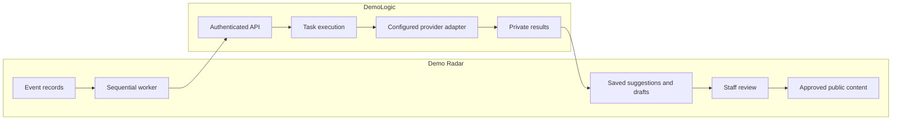

# Current architecture: a separate AI service with reviewer approval

**Status:** Implemented. Research rationale and current responsibilities.

## Context

Demo Radar makes public demonstration information searchable on a map. Its
back office needs to interpret slogans, maintain topic tags and repair incomplete
source information. DemoLogic tested whether learned methods could prepare part
of that work, then delivered a service alongside the application backend and frontend.

No tested candidate met every original quality target together. The
[methodology](methodology.md) and [aggregate results](results/README.md)
support an assisted workflow, with the reference and single-reviewer limitations
kept visible. They do not justify claiming autonomous tagging or proven time savings.

## Decision

Keep research in notebooks and expose the selected tagging configuration through
a small authenticated service. DemoLogic returns suggestions and private daily
drafts; Demo Radar controls event selection, jobs, staff review and publication.
The service uses explicit request identities, pinned configuration fingerprints
and a persistent journal so a missing response can be investigated without
blindly sending the same event again.

## Responsibilities

| Part | Owns |
| --- | --- |
| Demo Radar frontend | Public map, staff interface, translated display and explicit review actions |
| Demo Radar backend | Events, permissions, selection, job locks, reuse rules, DeepL translation and publication |
| DemoLogic service | Request validation, model payload, response validation, usage, replay and safe admission |
| Hosted provider | Remote inference; exposed identity and usage can be incomplete |
| Research notebooks | Data exploration, fitting, controlled comparisons and saved aggregate interpretation |

The implementation demonstrates separate frontend, backend and AI engineering
responsibilities. The API boundary makes it possible for a cross-disciplinary
team to change the application or model adapter without merging those concerns.

## Why this approach

- Rules and TF-IDF remain useful baselines and may be appropriate when their
  known boundaries fit a task. Their measured gaps did not disappear with a new name.
- Hosted LLMs improved agreement in the recorded comparisons but still omitted
  topics and depended on context and labeling policy. Review remains necessary.
- An explicit provider interface avoids a second orchestration framework for
  a single sequential inference task. Hetzner and disabled Gemini profiles have
  separate adapters and shared admission/spending checks;
  the current service does not promise arbitrary-model compatibility.
- Exact recurring-title/place matches and explicitly approved reuse belong in
  Demo Radar. Similarity alone is insufficient permission to apply tags to another event.

## Operational constraints

DemoLogic runs as one process on one host with a persistent local SQLite journal.
Demo Radar coordinates jobs through PostgreSQL. Multi-host replicas and
network-mounted SQLite are unsupported. Schedules and batch limits are deployment
settings; secrets stay in private runtime settings.

The main [task execution guide](task-execution.md) owns the execution diagram,
shared admission/recovery rules, retained profiles and upgrade/rollback procedure.
The [API reference](service-api.md) owns endpoint and request details.

## Evidence and related documentation

- [Public synthetic workflow](reproducibility.md)
- [Service API and recovery](service-api.md)
- [Original final comparison](plan/final-evaluation.md)
- [Fresh v4 confirmation](results/fresh-v4-confirmation.md)
- [Research lessons](presentation/insights.md)
- [Historical replay and original revision](research-replay.md)

Demo Radar maintains its application integration and operator guide in its own
repository. Personal approval histories, course registration, weekly plans and
release logs are maintained in the project’s issue tracker, not this architecture decision.

For the original alternatives, research constraints and dated technical decisions,
read the [historical ADR](adr/0001-capstone-backoffice-ml-vs-llm.md).
