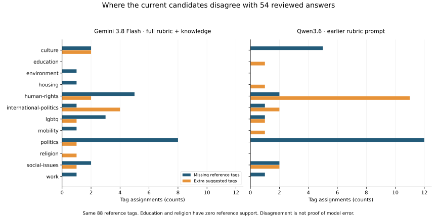

# DemoLogic tagging-quality audit

Historical research review. Read the [current methodology](../methodology.md) and [results index](../results/README.md) for the delivered conclusion. This is an AI-assisted technical review, not independent reference-label review or certification.

**Date:** 6 October 2026
**Status:** audit complete; recommendations await review
**Scope:** data, reference answers, evaluation, prompts, rubric delivery, context, model choice and operational failures through DR-63.

## Executive conclusion

**There is a credible opportunity to improve Gemini and Qwen, but no evidence that another prompt will reliably deliver 80% precision, 80% recall and 95% coverage.** The results do not demonstrate a model capability ceiling. They show a mixture of model mistakes, incomplete event information, inconsistent instructions and approved human answers that sometimes depart from the written rules.

Recommend **one bounded improvement cycle**, starting with a complete, current-rules-only rendering of the rubric. Keep every current definition and overlap rule; remove the need for a model to interpret project history. Before running it, resolve how documented human exceptions will be evaluated. Do not purchase a larger-model experiment, rewrite the whole taxonomy, relabel all 188 cases or turn on search for every event.

If a controlled improvement does not carry over to fresh cases, stop optimizing on the same examples. Continue to the service decision with an honest outcome: suggestions may warrant a small reviewed prototype, but automatic tagging and time savings remain unproven. Keeping manual tagging is also a successful capstone recommendation.

### Answers to the main questions

| Question | Audit answer |
|---|---|
| Can we increase precision and recall? | Plausibly. Missing tags are concentrated in a few boundaries, and the two-tag cap leaves substantial mathematical headroom. Improvement is not guaranteed. |
| Should we lower the targets? | No. Retain the agreed 80% precision, 80% recall and 95% coverage. These are project requirements, not universal community standards. A different assisted-workflow objective must be declared separately. |
| Better prompt or rubric? | Improve how complete current rules are delivered first. Resolve contradictions between rules and accepted exceptions before changing meaning. |
| More context or search? | Test verified event excerpts only where missing information is the problem. Previous search experiments do not support default search for all events. |
| Another model? | Not yet. Gemini 3.8 Flash and Qwen3.6 already expose different failure patterns. A larger model cannot resolve an unstated labeling policy. |
| When do we move on? | After one prompt comparison and, only if justified, one focused follow-up. Select the next step through DR-27; do not keep rerunning familiar failures until the numbers pass. |

## 1. How the audit was performed

Two independent AI reviewers examined the repository: one took the data science role, the other the LLM engineering role. Their findings were checked against saved data and requests by the coordinating reviewer. This is an AI-assisted technical audit, not a second independent reference-label review exercise.

Work included:

- Recomputing all four DR-63 reviewed comparisons from individual saved tag sets and checking precision, recall and F1 against scikit-learn.
- Checking all 376 new request payloads against their earlier versions, including rubric delivery, model aliases, generation settings and output parsing.
- Reading approved-reference history, source limitations, the rubric and the earlier model, search, tie-policy, confidence and practical-review results.
- Computing paired bootstrap intervals, tag-level error counts, the two-tag recall ceiling and illustrative model combinations without new inference.

No paid calls, reference changes, prompt changes or model training were performed. Existing notebooks and predictions remain intact. Private event details remain under `reports/`; this report contains aggregate findings.

## 2. What the results actually establish

### Comparable reviewed results

All rows below use the **same 54 accepted development cases and 88 reference tags**. They are repeatedly inspected, single-reviewer cases, not a fresh test set. “Extra” and “missing” mean disagreement with that reference, which itself has limitations.

| Model and configuration | Precision | Recall | F1 | Coverage | Fully matching tag sets |
|---|---:|---:|---:|---:|---:|
| Qwen/Qwen3.6-35B-A3B-FP8 — earlier rubric prompt | 77.1% | 72.7% | 74.9% | 100.0% | 23/54 |
| Qwen/Qwen3.6-35B-A3B-FP8 — full rubric + knowledge | 72.3% | 77.3% | 74.7% | 100.0% | 22/54 |
| Gemini 3.8 Flash — earlier rubric prompt | 82.9% | 65.9% | 73.4% | 92.6% | 27/54 |
| Gemini 3.8 Flash — full rubric + knowledge | **84.0%** | **71.6%** | **77.3%** | **96.3%** | **29/54** |
| Gemini 3.8 Flash — expanded Gem, search off | 87.0% | 68.2% | 76.4% | 92.6% | See saved report |
| Gemini 3.8 Flash — expanded Gem, search on | 89.4% | 67.0% | 76.6% | 90.7% | See saved report |

**84% precision does not mean 84% of demonstrations need no correction.** It means 63 of Gemini's 75 suggested tag assignments match the reference. Complete tag sets match on 29/54 events (53.7%). It still misses 25 reference assignments.

The Gem/search rows are separate configurations, not evidence that adding search to the latest full-rubric prompt has that effect. All headline comparisons must keep their model, prompt, reference version and case IDs attached.

Sources: [DR-63 comparison](../results/background-knowledge.md), [DR-61 reviewed comparison](../results/reviewed-outcome.md).

### Do not mix the different datasets

| Dataset | What it can tell us | What it cannot establish |
|---|---|---|
| 188 development event types | Broad diagnostics against historical labels; prompt development | Independently verified accuracy for all 188; a new untouched test |
| 54 accepted reviewed cases within those 188 | Paired comparisons under a common reviewed answer key | Population accuracy, independent human agreement or coverage of all 12 tags |
| Three unresolved cases in the 57-case review union | Where an answer remains uncertain | Correctness scores without a defensible reference |
| Existing 121-group final benchmark | Performance of configurations evaluated under that benchmark's recorded protocol | A fresh untouched test for later configurations chosen after results were examined |
| DR-58's 20-event practical pilot | Examples of correction work, context use and review effort | Reliable speed advantage; equivalent manual/model information access |

For perspective, original Qwen3.6 achieved **73.2% precision, 59.3% recall and 100% coverage** on the 121-group benchmark. The later Flash-Lite follow-up achieved **71.6%, 61.4% and 98.3%**. Gemini 3.8 Flash's latest 54-case result is not a same-cohort improvement over those numbers. Its latest configuration has not been established as a final-benchmark winner.

## 3. Data science findings

### High priority: the answer key and written rules sometimes describe different tasks

The approved reference explicitly retains cases whose tags depend on interpretation or unavailable context. Examples include a domestic-politics tag without a specific political subject, an LGBTQ tag inferred from a colorful-event description, and event evidence with a mismatched date. These limitations were already recorded; they are not accusations inferred from a model disagreement.

Meanwhile, the rubric says retained reviewer disagreements do not create unwritten exceptions. A model can therefore follow the written rule and lose points against an accepted exception. Conversely, a plausible model answer can still be unsupported.

**Action:** classify existing review notes into three groups: answers supported by the written rules and supplied title; answers requiring verified extra event evidence; and retained interpretation/source exceptions. Keep the current full-cohort scores visible. Any additional breakdown is diagnostic, not a new easier headline benchmark. Change an answer only through a recorded approval and new reference version, then rescore every candidate consistently.

This is a bounded task: 13 reference tags absent from both the latest Gemini and the earlier Qwen occur in 13 cases; 12 already have specific source or interpretation notes. These notes were created during targeted review, so this is not an unbiased study proving the labels are wrong. Start with the existing notes instead of reviewing all 188 from scratch. The private evidence index identifies those cases.

### High priority: sample composition limits the conclusion

Among the 54 accepted cases, politics and human-rights account for **40/88 reference assignments (45.5%)**. Education and religion have **zero reference support**. The sample combines a pilot with targeted review sets and a small random follow-up; their union is not a representative random sample.

The preparation also excludes some records, including untagged records and titles with fewer than two words. Those may be precisely the cases needing help in production. Report quality on scorable cases and behavior on unclear/unsupported inputs separately. Do not extrapolate 96.3% suggestion coverage to safe handling of every incoming event.

Coverage currently means **at least one suggested tag**, including an incorrect one. It is not “percentage of demonstrations correctly handled.”

### High priority: errors are concentrated, but their causes differ



| Latest Gemini missing tag | Reference support | Recovered | Missing |
|---|---:|---:|---:|
| politics | 23 | 15 | 8 |
| human-rights | 17 | 12 | 5 |
| lgbtq | 4 | 1 | 3 |

These three categories account for **16/25 missing tags**. Some of their references are among the exceptions above, so simply instructing Gemini to add more politics or rights tags would be a poor fix.

Expanded Qwen improves politics recovery from 11 to 18 of 23, but culture falls from 4 to 2 of nine and environment from 4 to 2 of four. Its human-rights extras rise from 11 to 12. Flat overall F1 hides these trade-offs. Keep the earlier Qwen as the practical baseline while retaining expanded Qwen as an experimental result.

### The target is possible arithmetically, not yet demonstrated empirically

The references contain 24 one-tag, 26 two-tag and four three-tag answers. An ideal two-tag predictor could recover **84/88 tags: 95.5% recall**. The cap cannot explain current recall of 71.6%.

Gemini needs **eight additional correct assignments** to reach 71/88 = **80.7% recall**. If it added those eight without adding errors or losing existing correct tags, precision would be 71/83 = **85.5%**. This shows compatibility of the targets on this sample; it does not promise a prompt can achieve it.

Correcting the one reviewed HTTP 503 case perfectly would recover only one tag: recall would become **72.7%**, still below target. Reliability improvements matter but will not close the semantic gap.

### Improvement is uncertain

Paired resampling of the 54 event rows gives these descriptive intervals:

| Change in F1 | Observed change | 95% bootstrap interval |
|---|---:|---:|
| Gemini, new minus earlier | +3.9 percentage points | −0.9 to +9.4 points |
| Qwen, new minus earlier | −0.2 points | −5.2 to +5.1 points |

Gemini's gain is promising, but these data are also compatible with no stable gain. The intervals describe variation inside this selected sample; they do not account for wrong references, targeted selection, repeated tuning or related topics across event types.

Method: 20,000 paired event resamples, NumPy seed `20261006`, same sampled indices for old/new predictions, percentile intervals. No individual tag assignments were resampled as though independent. The offline reproduction script and input fingerprints are saved privately.

Repeated development is legitimate if called development. Selecting instructions from the same cases and then presenting their score as independent confirmation is not. The standard separation of development and final evaluation remains applicable to prompt selection. [Scikit-learn evaluation guidance](https://scikit-learn.org/stable/modules/cross_validation.html)

## 4. LLM engineering findings

### High priority: provide the complete current rubric without requiring historical interpretation

The current Markdown combines definitions, exclusions, overlap rules, old approvals, pilot exceptions, final-labeling instructions and numeric tie policies. Earlier prompts omitted some later rules; DR-63 supplies everything but asks the model to decide which parts supersede others.

An example of imperfect teaching: the trans-rights synthetic example shows only `lgbtq`, while the overlap rule requires `lgbtq` plus `human-rights` for rights demands. It may be intended to illustrate a single category, but as an output example it teaches an incomplete answer. The anti-right-extremism politics rule also appears later than the main definition. Neither observation proves the cause of a particular prediction.

**Action:** create a current operational Markdown rubric retaining **all twelve definitions, exclusions, overlaps and later current decisions**. Keep the original document and its history as provenance. Review a rule-to-rule mapping before use. Make examples show complete answers, or explicitly label them as illustrating only one category. Any change in meaning must be separately approved and versioned.

This honors the requirement that models receive the rubric. It is not a return to an incomplete excerpt. Clear instructions and consistent examples are supported by Google's prompting guidance, but improvement must be measured locally. [Google prompt guidance](https://ai.google.dev/gemini-api/docs/prompting-strategies)

### Background knowledge helps interpretation; it does not verify event facts

DR-63 permits existing knowledge and delivers more rubric content at the same time. It cannot isolate those effects. Gemini's gain also includes cases where additional written rules may explain the change.

A possible later instruction should distinguish interpreting a known term from inventing a country, organizer, demand or event identity. Allegations can be classified by their stated subject without endorsing their truth. Neither “always use only literal words” nor “fill gaps freely from memory” resolves every case.

Keep such wording as a separate experiment. Do not retrospectively claim the model reasoned this way: tag-only responses contain no recorded justification, and a later explanation call does not recover the original reasoning.

### Search availability is not the same as useful event evidence

The experiments have tested different things:

- Gemini 2.5's initial search-enabled comparison made no actual search calls on the ten tagging cases.
- Required evidence in DR-49 produced search traces/citations for nine of ten cases, but did not improve Gemini 3.8 overall.
- Qwen's earlier external-search input contained result titles and URLs, without independently verified matching page excerpts.
- The expanded Gem later performed real search, but changed instructions and context together; its reviewed F1 was nearly unchanged and coverage fell.

These results argue against blanket search. They do **not** establish that correctly matched event descriptions cannot help. If context remains the main unresolved cause, use 8–10 cases chosen for information need, match evidence to the event/date, freeze short excerpts, and give both models the same material. Distinguish background-only sources from evidence about the specific event. Never include reviewer tags or notes in those packets. [Google grounding documentation](https://ai.google.dev/gemini-api/docs/google-search)

### Reliability and prompt quality are separate

The exact-request audit found no silent dropping of valid tags or input overflow. All 376 DR-63 requests preserve their earlier title payload and other settings; only system text changed. Qwen produced 188 valid results and Gemini 186. One Gemini call failed with HTTP 503; one exhausted its output allowance, with most tokens used for thinking.

A declared retry policy and an appropriate response budget can improve completion. Structured output can improve format compliance, not prove correct topic selection. Keep first-attempt and retry-inclusive measures distinct. These are operational fixes, not explanations for most missing tags.

Qwen used temperature zero and thinking disabled; Gemini used provider defaults. Record those settings instead of assuming they are equivalent. Do not change Gemini's sampling settings merely to match Qwen numerically. Fresh paired controls help distinguish a prompt effect from provider variation. Saved model names are aliases, not immutable model-weight revisions.

### Neither self-confidence nor model agreement is approval

DR-62's warning found only **8/27 disagreements**. Unflagged answers therefore cannot bypass review.

An additional offline diagnostic combines latest Gemini with **earlier Qwen**, the recommended retained configurations:

| Combination | Precision | Recall | Coverage |
|---|---:|---:|---:|
| Every tag proposed by either model | 73.5% | 85.2% | 100.0% |
| Only tags proposed by both models | 92.9% | 59.1% | 87.0% |

The first can exceed two tags; the second misses too much. Neither meets all targets. Models disagree on 30/54 events, while six of their 24 agreements still differ from the reference. Disagreement could help prioritize review, but this post-hoc diagnostic does not justify an automatic ensemble or approval rule.

## 5. Ranked options

| Priority | Change | Why it deserves attention | What would count against it |
|---|---|---|---|
| 1 | Resolve rule/evidence exceptions; deliver complete current rules clearly | Direct inconsistencies are documented; no additional model purchase needed | If consistent examples still fail after cleanup, the explanation must go beyond instruction ambiguity |
| 2 | One controlled current-rubric rendering test | Tests whether historical/procedural clutter matters | No useful paired improvement, or recall gained by adding unsupported tags |
| 3, conditional | A few complete contrastive examples | Targets subject-versus-format and overlapping-tag mistakes | Gains limited to copied patterns, loss on other tags, or no fresh-case gain |
| 3, alternative | Matched event evidence on 8–10 context-poor cases | Tests the missing-information hypothesis more directly | Evidence fails event matching or adds no useful correct tags |
| Later | Model-specific prompt variants or another model | Reasonable only after clear instructions and adequate evidence are shown insufficient | More configurations selected on the same cases without new confirmation |
| Later | Embedding-assisted grouping | Can improve sampling and detect related meanings; not directly a tag-quality fix | Treating semantic similarity as proof that events are identical |

Do not combine the two priority-3 experiments by default. Choose the one supported by the error audit. A meaning-changing rubric redesign, fine-tuning, a new agent architecture, Jev, and additional frontier models would widen scope before the current task is sufficiently defined.

## 6. Proposed plan and stopping rule

This is a recommendation, not an approved change to the benchmark or an instruction to spend remaining API credit.

### Step A — settle the evaluation contract offline

**Codex prepares:** one short table from the existing 13 shared-miss cases and their recorded limitations; a complete current-rule rendering and mapping; complete synthetic examples consistent with existing meaning.

**Human decision:** choose what to do only where the written rule and retained exception conflict. Either document a general rule change or retain the case as an explicit exception with separate interpretation. Source-dependent cases need matched evidence before being called verified. Do not repeat all prior reviews.

**Output:** approved operational instructions and an explicit reference-version decision. Original results remain available. If reference answers change, rescore every stored candidate before measuring a new prompt. Do not remove difficult cases to make the headline number rise. Prepare proposed example corrections for review, but do not introduce them into only one arm of Step B.

### Step B — one controlled prompt comparison

On the existing 54 cases, compare the raw full rubric with the complete current-rule rendering for **both Gemini 3.8 Flash and Qwen3.6**. Hold knowledge permission, search-off policy, output cap, parser and generation settings fixed. Do not add new examples or model-specific tuning in this first comparison. Use fresh controls close in time and alternate condition order; cache identities must distinguish deliberate control reruns from replay.

**Control requirement:** both arms must contain exactly the same approved normative rules and example answers. Only their organization and irrelevant historical/procedural material differ. If Step A changes meaning or corrects an example, apply that content to both arms before running them, or explicitly rename the experiment as a combined change. Do not compare old-v3 rules against new meanings and claim a presentation effect.

This design is at most **216 scheduled requests**: 54 × two models × two prompt conditions. Keep earlier Qwen results as a separate baseline reference. The experiment measures rubric presentation, not a new untouched score or a pure “model knowledge” effect. Publish all arms, including failures and regressions.

Before calls, reconcile DR-24, confirm the available balance, price a run ceiling and fit the batch to that ceiling. The last spending message is ambiguous; do not infer a €3.45 balance. Qwen's confirmed free hosted account is not the same as running locally. No new paid requests are made by this audit.

**Proposed advancement rule, to approve before inference:** at least +3 percentage points of paired F1, no precision or coverage loss greater than two points, and no unexplained concentration of harm in one supported tag. This is a practical screening rule, not statistical proof or a replacement for the 80/80/95 goals. Show uncertainty and errors even if it passes.

### Step C — at most one targeted follow-up

If Step B leaves a clear repair opportunity, choose **either** a small approved contrastive-example set **or** matched evidence for 8–10 information-poor cases. Declare the selection and comparison before running it. Do not use live model confidence as the selector: the current warning rule did not earn that role.

If the remaining disagreements mainly concern human exceptions or missing unverifiable facts, stop here. More prompting will not supply a coherent answer key or reliable evidence.

### Step D — fresh confirmation, then decide

Choose the configuration before collecting its outcomes on **30–50 fresh distinct event types**, with related recurring/semantically similar events checked during selection. Review answers before displaying predictions. Include context-poor and no-matching-topic examples. Report ordinary quality on defensible references and handling of unresolved cases separately; disclose exclusions.

Run the selected configuration **and its declared control on the same fresh events** before claiming that an improvement carries over. Select both configurations before inference and keep input evidence comparable. If only one configuration is run, report absolute fresh-case performance, not a confirmed gain over a different earlier cohort. If the reference uses source context, explicitly distinguish title-only prediction from prediction with that same frozen context. A small fresh check can expose major regressions; it cannot certify precise population thresholds across all 12 tags. Its labels must not become another tuning loop presented as final confirmation.

**Coverage and abstention contract:** before predictions, mark which cases have an in-taxonomy reference, which are clearly outside the taxonomy, and which are unresolved. Report overall suggestion coverage as before, plus in-scope coverage and unsupported-suggestion/correct-abstention rates for the other groups. Applying the 95% target specifically to in-scope cases is a proposed clarification requiring approval, not a silent change to the existing goal. Do not drop cases or change denominators after seeing responses.

**Time limit:** one focused development cycle, approximately two working days plus available review time, with at most one Step C follow-up. A failure to improve does not justify another model round automatically.

| Outcome | Decision |
|---|---|
| Improvement carries over and targets are met on fresh cases | Candidate for a small reviewed prototype; report uncertainty and limited sample coverage. No automatic approval claim. |
| Improvement carries over but targets remain unmet | Record the quality shortfall. DR-27 decides whether suggestion value justifies a limited prototype with every answer reviewed. |
| Improvement disappears, regresses or remains dominated by policy/evidence uncertainty | Stop model optimization for this phase; recommend manual tagging or a narrowly scoped demonstration of assisted review. |
| Review time or budget is unavailable | Finish the capstone comparison and recommendation with current limitations; do not lower targets or invent validation. |

DR-58 did not establish saved human time. If a prototype is pursued, measure correction effort, final reviewed quality and context-search time under a common workflow. Model precision alone does not prove service value.

## 7. Evidence and reproduction

| Claim area | Repository evidence |
|---|---|
| Latest exact prompts, predictions, failures and metrics | `reports/background-knowledge/v1/results.json`; [Notebook 20](../../notebooks/20_background_knowledge_comparison.ipynb) |
| Reviewed answers and recorded exceptions | `reports/error-analysis/2026-10-05/approved-reference-v1.json` |
| Same-reference earlier candidate comparison | `reports/reconciled-comparison/dr61-v1/results.json`; [reviewed outcome](../results/reviewed-outcome.md) |
| Third-tag trade-off | [DR-60 report](../results/tag-policy.md); Notebook 17 |
| Confidence and explanation limitations | [DR-62 report](../results/confidence-diagnostic.md); Notebook 19 |
| Context/search and wider model history | [Week 3 experiment history](../methodology.md#comparison-stages); Notebooks 08a, 11–15; [insights log](../presentation/insights.md) |
| Practical human-review limitations | [DR-58 report](../results/practical-trial.md); Notebook 18 |
| Metric definitions | [evaluation.py](../../src/demo_logic/evaluation.py) |
| Current complete rubric | [tagging-rubric.md](../tagging-rubric.md) |
| Audit calculation provenance | `reports/audit/2026-10-06/calculations.json`, `reproduce.py`, `evidence-index.json` |

For an authorized local checkout, reproduce the aggregate intervals and chart with:

```bash
uv run --locked --group notebooks python reports/audit/2026-10-06/reproduce.py
```

Private files are deliberately unavailable to public readers. Aggregate conclusions above are readable without them. The script uses saved predictions only. Source fingerprints are recorded in `calculations.json`; notebook outputs and event-level evidence remain private.

**Decision requested:** approve the bounded plan, modify its time/budget or advancement rule, or proceed directly to DR-27 with the current limitations. The audit recommends the bounded plan; it does not recommend lowering targets or indefinitely adding models.
