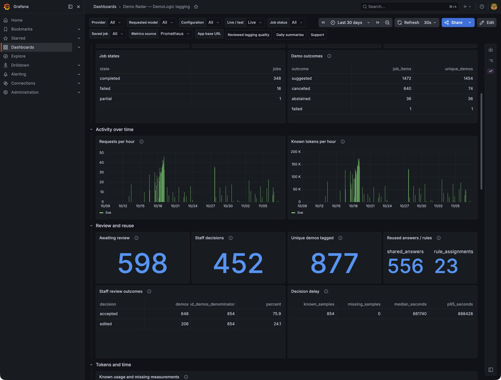

# How DemoLogic helps Demo Radar

Demo Radar makes Berlin's demonstration records easier to explore. DemoLogic
helps with the work behind that map: understanding slogans, suggesting topic
tags and drafting a daily briefing.

## From a slogan to useful tags

A title does not always explain what a demonstration is about. A translation
can help with the words, but choosing useful topic tags still takes judgment.

DemoLogic suggests tags from the available title. In Demo Radar's Support
page, I review those suggestions alongside the event record. I can keep them,
change them or reject them. Only approved tags appear on the public map.
The tags describe the topic; they do not confirm the claims in a slogan.

The answer and review decision are saved. For matching recurring events,
Demo Radar can reuse an eligible saved answer instead of asking the model
again. I can also explicitly approve a rule to apply tags to future matching
dates. Each date remains a separate demonstration.

## A daily briefing in two languages

DemoLogic drafts a short German briefing from the day's saved public event
records. It brings together the number of demonstrations, the day's main
themes and an event in focus. The main text stays below 200 words; a separate
**Getting around** section explains available route information. Recorded
routes do not confirm road closures. Demo Radar translates the draft into
English with DeepL.

### Reviewing the daily briefing

In Support, I choose a date and open its saved drafts. Generating a draft does
not publish it. Before readers can see it, I:

1. Read the German and English versions and check them against the day's
   source records, including the event in focus and the route information.
2. Edit any wording that needs attention and save it as a private draft.
   If I change the German text, the English version needs another check.
3. Confirm that I have checked both languages, then choose **Publish reviewed
   summary**.

Demo Radar keeps the edit and publication history. The public label explains
whether the text was AI-generated and reviewed, or AI-assisted and edited.

Readers open the briefing with the newspaper button on the map. It gives them
an overview before exploring individual events. They read the saved version;
opening it does not call the model or DeepL again.

The [daily-briefing design](plan/daily-summary.md) explains the writing rules,
worked example and review process in more detail.

## What the review numbers tell us

In a production snapshot taken on **7 November 2026 at 23:14 Berlin time**,
tags were kept as suggested for about three out of four reviewed event records.

| Review outcome | Event records | Share |
| --- | ---: | ---: |
| Tags kept unchanged | 648 | 75.9% |
| Tags changed before approval | 206 | 24.1% |
| Suggestions rejected | 0 | 0.0% |
| **Total reviewed** | **854** | **100%** |

The records contain reviews saved from **13 October to 7 November 2026** for
live Hetzner results. These totals count event records, not individual review
actions: reviewing a group can update several records, and the same saved
answer can support more than one event. They are also not a count of distinct
demonstrations, since an event can have more than one result. Pending reviews
and automatic applications of approved recurring rules are excluded.

### Reading the dashboard

*Production tagging dashboard, 7 November 2026. Live jobs, last 30 days;
browser tabs and address bar removed.*

The screenshot shows **598 saved suggestions awaiting review** and **452 saved
review actions**. One action can cover several events, so that is different
from the 854 reviewed records above. Tags were published for **877 different
demonstrations**. Reuse is tracked separately: **556 shared-answer reuses**
and **23 applications of approved tagging rules**.

The green charts show requests and known token usage over time. **Decision
delay** is the elapsed wait until a review was saved, not time spent actively
reviewing. These panels describe tagging; daily briefings have a separate
Grafana dashboard.

The time filter selects jobs by their creation date, then shows the latest
saved reviews for those jobs. That is different from selecting reviews by
the date they were saved.

The acceptance rate shows how often tags were kept in this workflow. It does
not establish model accuracy on new data, and we have not yet measured how
much review time it saves. Measuring that effort is a next step.

## Where the research fits

Before connecting the service, I compared rules, text classifiers, neural
language models and hosted language models using reviewed slogans. Those
experiments ask a different question: how well do suggestions match the
reference tags on a particular test set?

- [Methodology](methodology.md): how the comparisons were made and their limits.
- [Original final comparison](plan/final-evaluation.md): results across the methods.
- [Fresh-case check](results/fresh-v4-confirmation.md): a later check on new examples.

Together, the research and production reviews help me understand where the
suggestions are useful and where they still need attention.
