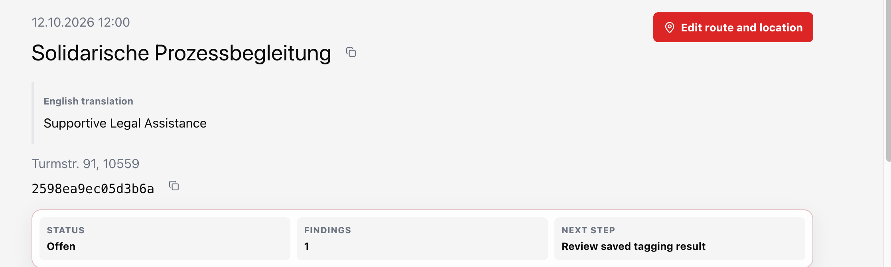
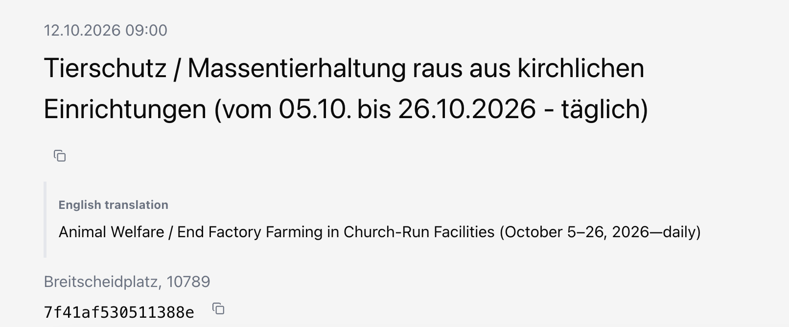
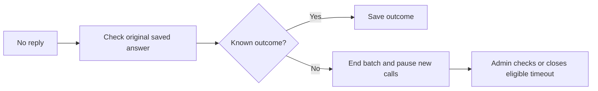
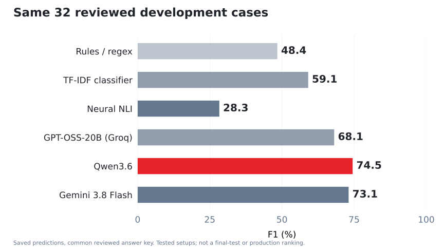
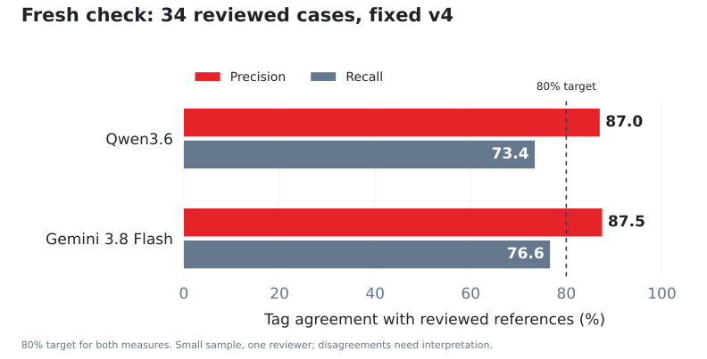
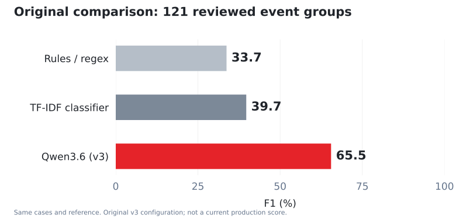

# DemoLogic final presentation — Draft 1: 10-minute version

**Author:** Roy Grossman  
**Event:** Friday 16 October 2026  
**Status:** Separate rehearsal draft, 14 October 2026. Original Draft 1 and PowerPoint remain unchanged.

**Confirmed slot:** 10 minutes for the presentation, followed by a 2-minute live demo. Q&A time has not been confirmed.

**Speaking plan:** 9:30 of planned explanations, with 0:30 for pauses and transitions. The demo has a separate 2:00 hard stop. These are rehearsal targets, not measured timings.

**Spoken core notes:** approximately 988 words, excluding demo directions and source citations.

## Focus

**Public purpose:** Make public information useful in everyday life.

**Question:** Can the methods learned in the course prepare Demo Radar’s topic-tagging work with less repeated staff effort and more consistent decisions?

**Conclusion:** DemoLogic now prepares suggestions in a live application. The experiments support keeping staff approval. Reduced staff effort remains an outcome to measure.

Demo Radar is the application. DemoLogic is its AI service and the capstone project. This version follows the agreed structure: business problem, data, method comparison, limitations, architecture and live demonstration.

## Changes from the longer version

- Keep the real screenshots, Protect Pigs example and the frontend/backend/AI engineering lesson.
- Replace the main-slide target table and score charts with short explanations. Retain the native charts in hidden Q&A answers.
- Move exact scores, sample counts and the guide revision comparison into the appendix.
- Finish the spoken conclusion before the dedicated two-minute demo.
- Keep Grafana, timeout recovery and detailed grouping outside the timed talk.
- Keep the original files available for comparison.

## Running order

| Slide | Topic | Target | Elapsed talk |
| --- | --- | ---: | ---: |
| 1 | DemoLogic | 0:40 | 0:40 |
| 2 | A slogan can leave questions open | 0:55 | 1:35 |
| 3 | Goals for useful tagging | 0:45 | 2:20 |
| 4 | Comparing the tagging methods | 1:10 | 3:30 |
| 5 | Protect Pigs | 0:55 | 4:25 |
| 6 | The written tagging guide | 1:00 | 5:25 |
| 7 | Why staff review stays in the workflow | 1:05 | 6:30 |
| 8 | Where DemoLogic fits | 1:15 | 7:45 |
| 9 | A suggestion becomes a staff decision | 1:00 | 8:45 |
| 10 | Frontend, backend and AI collaboration | 0:45 | 9:30 |
| | Pauses and transitions | 0:30 | **10:00 maximum** |
| 11 | Live workflow | **2:00** | Separate demo slot |
| 12 | Q&A menu | Only if invited | Outside confirmed slot |

## Visual design

Preserve the existing PowerPoint’s Demo Radar logo, light surfaces, typography, red accents and topic colors. Use its original screenshots and editable architecture. Keep a single clear idea on each main slide. Detailed charts and tables belong in the Q&A appendix, with the sample and study limitations visible.

## Slide 1 — DemoLogic

**Time:** 0:40

### On screen

Original DemoLogic title and slogan; Demo Radar map screenshot captured on 13 October; public-information purpose.

### Speaker notes

Demo Radar turns Berlin’s public demonstration records into a map people can use. They can explore causes, find gatherings or choose which areas to visit or avoid. Behind that map is staff work: reading titles, interpreting slogans and preparing useful topic tags. DemoLogic is the AI service I built to help with that work. My capstone asks whether the methods I learned can make those decisions more consistent and reduce repeated effort. I will show the experiments, what they taught me and the feature working in the real application.

### Evidence and limits

The public application and the production checkpoint support this opening. Describe routes as published event information. Do not promise confirmed closure alerts or safer travel.

## Slide 2 — A slogan can leave questions open

**Time:** 0:55

### On screen

Real court-solidarity screenshot; reading aid “Support in solidarity during a trial”; questions about the missing context.

### Speaker notes

This is a real title: “Solidarische Prozessbegleitung”. It describes accompanying or supporting someone during a trial, but it does not say which trial or cause. The displayed translation, “Supportive Legal Assistance”, can also suggest more than the title establishes. Translation helps us read the words; it cannot fill the missing context. Staff still have to decide what topic the event belongs to. I started with tags because this was repeated interpretation work in the back office. My aim was a common decision process, with room to leave an unclear case unresolved.

### Evidence and limits

Supplied screenshot (figures/examples/court-solidarity.png). The screenshot establishes the source title and displayed translation. It does not establish a final tag decision. No legal-service claim or further background lookup is made here.

## Slide 3 — Goals for useful tagging

**Time:** 0:45

### On screen

Product goal and plain-language quality requirements. Numerical acceptance limits move to B1.

### Speaker notes

The product goal was less repeated staff work, with consistent tags that a person can review. Before comparing models, we set requirements for correct suggestions, finding relevant topics and helping with most events. We also bounded the waiting time and spending. Those limits gave us a common way to judge the approaches rather than choosing a model first and adjusting the goal afterwards. The exact thresholds are in the appendix. One distinction matters throughout: good model scores do not establish that the current workflow saves staff time. That needs its own measurement.

### Evidence and limits

Agreed benchmark requirements (../methodology.md#question-and-scope). Precision, recall and coverage must hold together under one policy. F1 is a balancing measure, with no separate acceptance threshold. The project author’s initial 15–30-minute daily estimate concerned the combined back office, not measured tagging time.

## Slide 4 — Comparing the tagging methods

**Time:** 1:10

### On screen

Methods grouped into baseline, neural NLI and hosted LLM approaches; qualitative finding and final-test limitation. Score charts move to B3 and B12.

### Speaker notes

I built up the methods rather than starting with an LLM. Rules gave me a simple baseline. TF-IDF with logistic regression learned word patterns from historical labels. Pretrained neural language inference compared a title with topic descriptions. Then I tested hosted LLMs, including Qwen, Gemini and GPT-OSS on Groq. The data came from German demonstration titles. Recurring records stayed together during the split, and we reviewed the evaluation answers. Qwen performed better than the simpler methods in the original final test, but no candidate met every quality target. A later development comparison added the other methods. These are separate studies, not one continuous improvement curve. The matched scores and sample sizes are ready in Q&A.

### Evidence and limits

All-candidate intersection: 32 events (../results/reviewed-comparison.md#all-candidate-intersection). F1: regex 48.4%, word+character TF-IDF 59.1%, multilingual NLI 28.3%, GPT-OSS-20B on Groq 68.1%, simple-rubric Qwen 74.5%, simple-rubric Gemini 3.8 Flash 73.1%. These are rescored saved predictions on a repeatedly reviewed sample. See Protect Pigs review (insights.md#a-high-nli-score-can-hide-a-neutral-answer) for the recorded error and score meanings.

## Slide 5 — Protect Pigs

**Time:** 0:55

### On screen

Protect Pigs paraphrase; reviewed Environment chip versus NLI Human rights chip; neutral-output lesson. Values and formula move to B4.

### Speaker notes

One NLI error made the limits tangible. A demonstration about pig welfare received Human rights instead of Environment, the reviewed topic under our catalog. Looking at the selected score alone hid something important: the model’s neutral output. Our derived tag score removed neutral from its calculation, so a confident-looking number could overstate the support for a topic. I learned to inspect individual errors and understand what a score means before relying on a cutoff. This example does not prove political bias or that every neural model fails. The diagnostic values and formula are in the appendix.

### Evidence and limits

All-candidate intersection: 32 events (../results/reviewed-comparison.md#all-candidate-intersection). F1: regex 48.4%, word+character TF-IDF 59.1%, multilingual NLI 28.3%, GPT-OSS-20B on Groq 68.1%, simple-rubric Qwen 74.5%, simple-rubric Gemini 3.8 Flash 73.1%. These are rescored saved predictions on a repeatedly reviewed sample. See Protect Pigs review (insights.md#a-high-nli-score-can-hide-a-neutral-answer) for the recorded error and score meanings.

## Slide 6 — The written tagging guide

**Time:** 1:00

### On screen

Animal-welfare/church screenshot; Environment as a rubric interpretation; written guide explained before version 4. Paired guide scores move to B14.

### Speaker notes

The models also needed a clear policy. Our rubric is a written guide with tag definitions, examples and exclusions. This real title demands an end to factory farming in church-run facilities. Its purpose is animal welfare. Mentioning a church does not automatically make religion the topic. Reviewing cases showed that some distinctions I made were absent from the written rules. We revised the guide and recorded the changes. Its fourth agreed revision is version 4. It improved agreement on familiar examples, but those examples had helped us write the guide. We needed a separate check before making claims about new cases.

### Evidence and limits

Animal-welfare screenshot (figures/examples/animal-welfare-church.png) and public rubric (../rubrics/tagging-rubric-v4.md), which explicitly includes animal welfare under environment. Paired guide comparison (../results/rubric-v4-comparison.md). Definitions and examples changed together; no single rule’s effect is isolated. The places-of-worship screenshot is an illustrative contrast, not a newly adjudicated reference.

## Slide 7 — Why staff review stays in the workflow

**Time:** 1:05

### On screen

Plain-language finding: useful suggestions can still miss topics; staff approval before publication. Fresh-case chart moves to B13, comparison table remains on B8.

### Speaker notes

We kept the revised guide fixed and tested it on new reviewed cases. Both models produced useful suggestions, but they still missed relevant topics and did not always match the full tag set. That distinction matters: a suggested tag can be reasonable while the event’s overall classification remains incomplete. Some disagreement also involved missing context, the two-tag cap or the reviewed answer itself. The sample was small and had one reviewer. We therefore kept staff approval before publication. Qwen was a practical service choice; Gemini’s modest lead in that check did not establish a universal winner. The exact precision, recall and complete-match results are in the appendix.

### Evidence and limits

Evidence bank C. These are different cases from the 54-case development comparison. One reviewer, uneven topic coverage and references exceeding the two-tag cap limit the conclusion. Free account access is not a permanent provider-price claim.

## Slide 8 — Where DemoLogic fits

**Time:** 1:15

### On screen

Existing editable architecture with request/answer arrows, PostgreSQL and SQLite. Public map reads saved approved information.

### Speaker notes

DemoLogic runs beside the existing frontend and backend. Demo Radar owns the event records and staff decisions. Its background worker sends the title and tagging guide to DemoLogic. DemoLogic calls the hosted model, validates the answer and returns a result that the worker saves for later review. Application records live in PostgreSQL. DemoLogic keeps request history in SQLite so we can inspect what happened and recover saved outcomes. Public visitors read approved information; their page does not wait for a model call. This also gives frontend, backend and AI engineers clear responsibilities. Operational recovery and monitoring matter, but their detailed flows stay in Q&A.

### Evidence and limits

Service API and application workflow in evidence bank F. The provider is remote. Production tagging is manual at the documented checkpoint, with five events per batch and one inference attempt per event.

## Slide 9 — A suggestion becomes a staff decision

**Time:** 1:00

### On screen

Actual production Support review screenshot, with Read / Review / Save; no claim that the shown decision is already approved.

### Speaker notes

The useful result is a decision a staff member can understand. In Support, the reviewer reads the title and translation, compares approved tags with the suggestion, then accepts, adjusts or rejects it. The original answer and the review remain recorded. This screenshot shows a genuine saved animal-welfare suggestion; it is a different event from the church example. Repeated dates remain separate demonstrations. We can reuse eligible saved answers, and staff can explicitly approve recurring rules, instead of interpreting the same title every time. The interface prepares the decision, but the staff member determines which tags become public. We still need to measure whether this current workflow reduces active effort.

### Evidence and limits

Evidence bank F. Explicitly approved recurring reuse is distinct from an unreviewed model answer. Saved decision delay is not active staff work time. No measured time-saving claim belongs on this slide.

## Slide 10 — Frontend, backend and AI collaboration

**Time:** 0:45

### On screen

Existing frontend/backend/AI responsibility columns; working suggestion service; staff effort as the next measurement.

### Speaker notes

The project taught me how to compare methods and turn the evidence into a working service. It also let me practice the boundaries between frontend, backend and AI engineering, whether those responsibilities sit in different teams or one team. The delivered result is a live suggestion workflow with staff approval. The next measurement is whether it reduces staff effort. The wider purpose remains simple: make public information useful in everyday life. I will now show one prepared event, its review and the public result.

### Evidence and limits

This explains the architectural motivation and a view of future work, not a forecast proven by the project. Service ownership is documented in the application workflow and API guide. No demonstrated time-saving claim is added.

## Slide 11 — The live workflow

**Time:** 2:00

### On screen

Existing live workflow and clickable Support link. Up to five events and one inference attempt per event; no dependency on a new model answer.

### Speaker notes

0:00–0:20 Show the prepared public event. Say: “This is a real demonstration in Demo Radar.”
0:20–0:40 Open Support and show Start tagging and its status. Start one manual batch only if the queue and service are ready.
0:40–1:05 Open the saved suggestion. Say: “I prepared this result earlier; it is separate from the new batch.”
1:05–1:35 Explain the tags and save a genuine pending decision, or show its existing review if already approved.
1:35–2:00 Return to the public event and show the approved tags. Stop at two minutes.
If the provider is slow, continue with the prepared result. If the app is unavailable, use the prepared screenshots or recording. Never reset a decision to create a demonstration.

### Evidence and limits

One production batch and one saved approval are recorded in the checkpoint. Refresh the demonstration setup before Friday. This Markdown revision makes no new production check.

## Slide 12 — Pick a question

**Time:** Q&A only if invited

### On screen

Clickable menu with 14 hidden answer slides; every answer has a return link.

| | |
| --- | --- |
| [Why those targets?](#b1-why-those-targets) | [Did it save staff time?](#b2-did-it-save-staff-time) |
| [Which models were compared?](#b3-which-models-were-compared) | [What happened with Protect Pigs?](#b4-what-happened-with-protect-pigs) |
| [Did search help?](#b5-did-search-help) | [Can the human answer be wrong?](#b6-can-the-human-answer-be-wrong) |
| [How did you handle repeated events?](#b7-how-did-you-handle-repeated-events) | [Why use Qwen?](#b8-why-use-qwen) |
| [What happens after a timeout?](#b9-what-happens-after-a-timeout) | [Why separate the AI service?](#b10-why-separate-the-ai-service) |
| [What can you monitor in Grafana?](#b11-what-can-you-monitor-in-grafana) | [How did the broader comparison look?](#b12-how-did-the-broader-comparison-look) |
| [What happened on new cases?](#b13-what-happened-on-new-cases) | [Did the revised guide help?](#b14-did-the-revised-guide-help) |

### Speaker notes

“I have the detailed results and operational lessons ready here, if we have time for questions.” Click an answer and use Back to questions to return. Q&A time is not included in the confirmed 10-minute talk plus two-minute demo.

### Evidence and limits

Answers reuse saved evidence. The PowerPoint has a clickable question menu and a return link on each hidden answer. No new production check is claimed.

## Live demo preparation

Keep the provisional animal-welfare event concerning church-run facilities, or choose another genuine pending production example on Thursday. The existing Support screenshot shows a separate fur-trade suggestion; it does not establish that the church event has a saved result.

- Confirm production login, event date and pending review state.
- Prepare a saved result so the demo does not depend on provider speed.
- Show a manual batch only when it is ready; up to five events, one attempt per event.
- State when an answer was prepared earlier, and distinguish it from the newly started batch.
- Keep the matching public view and fallback recording or screenshots ready.
- End at two minutes. Do not add daily summaries or Grafana to this slot.

## Selectable Q&A appendix

Hidden answer slides remain outside the normal forward sequence. Select a question on Slide 12 and use Back to questions to return. The original evidence bank below preserves the measurement details.

### B1. Why those targets?

**Short answer:** They were project acceptance limits agreed before final evaluation, chosen to keep a reviewed support workflow useful and spending bounded.

**On screen**

| Goal | Meaning |
| --- | --- |
| 80% precision | Most suggested tags agree with the reference |
| 80% recall | Most reference topics are found |
| 95% coverage | Most events get a suggestion |
| Under five minutes | Whole attempt stays within the waiting limit |
| At most $1 per event | Calls, research, retries and failures count |
| $50 total experiment budget | Shared allowance across experiments |

**Speaker note:** They were project acceptance limits agreed before final evaluation, chosen to keep a reviewed support workflow useful and spending bounded.

**Evidence:** [Agreed requirements and measurement rules](../methodology.md#data-and-reference-labels).

[Back to questions](#slide-12--pick-a-question)

### B2. Did it save staff time?

**Short answer:** We have not established that yet. An earlier small trial showed why better suggestions alone do not prove a faster workflow.

**On screen**

| Earlier workflow | Cases | Median active time |
| --- | ---: | ---: |
| Manual | 7 | 61.4 s |
| Qwen-assisted | 7 | 107.1 s |
| Gemini-assisted | 6 | 69.2 s |

**Next measurement: current Support review time and correction needs.**

**Speaker note:** We have not established that yet. An earlier small trial showed why better suggestions alone do not prove a faster workflow.

**Evidence:** [Practical trial and sensitivity checks](../results/practical-trial.md), [ADR problem statement](../architecture.md#context).

[Back to questions](#slide-12--pick-a-question)

### B3. Which models were compared?

**Short answer:** Different studies answer different questions. Use a shared sample for a direct comparison and keep the original final test separate.

**On screen**

**B12 chart:** six methods on the same 32 reviewed development cases, including Gemini and GPT-OSS-20B on Groq.

**Original final test:** 121 groups, regex F1 33.7%, TF-IDF 39.7%, Qwen 65.5%.

**Later checks:** the guide comparison on 54 cases and fixed-guide confirmation on 34 new cases.

**Speaker note:** Different studies answer different questions. Use a shared sample for a direct comparison and keep the original final test separate.

**Evidence:** [Consistent reviewed comparison](../results/reviewed-comparison.md), [original final evaluation](../plan/final-evaluation.md), evidence banks B and C.

[Back to questions](#slide-12--pick-a-question)

### B4. What happened with Protect Pigs?

**Short answer:** The NLI setup suggested human-rights for a pig-welfare topic. Inspecting neutral output explained why the chosen score could look stronger than the actual support.

**On screen**

**Real reviewed example, paraphrased:** animal welfare and awareness of pig farming.

Reviewed topic: **environment**. NLI suggestion: **human-rights**.

Derived HR tag score **0.482**; neutral output **0.698**.

**Separate invented diagnostic:** pig-welfare title, revised HR description: support **0.0047**, neutral **0.9951**, derived score **0.9778**.

**Speaker note:** The NLI setup suggested human-rights for a pig-welfare topic. Inspecting neutral output explained why the chosen score could look stronger than the actual support.

**Evidence:** [Real example in insights](insights.md#a-high-nli-score-can-hide-a-neutral-answer), [separate diagnostic lesson](insights.md#a-high-nli-score-can-hide-a-neutral-answer), [Notebook 06](../../notebooks/06_semantic_models.ipynb).

[Back to questions](#slide-12--pick-a-question)

### B5. Did search help?

**Short answer:** It did not consistently improve these experiments. We also learned to verify that a model actually searched before interpreting the result.

**On screen**

| Saved experiment | F1 without search/evidence | F1 with search/evidence |
| --- | ---: | ---: |
| GPT-OSS-120B on Groq, 10 cases | 61.5% | 59.3% |
| Gemini 3.8 Flash, separate 10-case evidence study | 80.0% | 76.9% |

**Relevant evidence matters more than merely enabling search.**

**Speaker note:** It did not consistently improve these experiments. We also learned to verify that a model actually searched before interpreting the result.

**Evidence:** [Groq search lesson](insights.md#search-must-execute-and-earn-its-cost), [verified evidence lesson](insights.md#search-must-execute-and-earn-its-cost).

[Back to questions](#slide-12--pick-a-question)

### B6. Can the human answer be wrong?

**Short answer:** Yes. We need to inspect model errors, missing context and unclear rules without treating model agreement as ground truth.

**On screen**

**Same saved Qwen predictions, 23 reviewed cases:**

Precision against historical tags: **55.9%**.

Precision against reviewed tags: **76.5%**.

**The answer key changed. The model did not.**

**Speaker note:** Yes. We need to inspect model errors, missing context and unclear rules without treating model agreement as ground truth.

**Evidence:** [Reference-review insight](insights.md#the-answer-key-changes-the-measured-result), [rubric review comparison](../results/rubric-v4-comparison.md), Supplied screenshots. The guide is versioned because its definitions and examples evolved. On the 54 familiar cases, Qwen F1 changed 75.6% to 82.0% and Gemini 75.8% to 85.1%; this is development evidence.

[Back to questions](#slide-12--pick-a-question)

### B7. How did you handle repeated events?

**Short answer:** I grouped recurring records before splitting the data and treated each dated demonstration separately in the application.

**On screen**

**732 training groups · 188 development groups · 123 reserved final groups**

Two confirmed overlaps were excluded before final inference, leaving **121**.

One recurring group stays within one evaluation split.

**Speaker note:** I grouped recurring records before splitting the data and treated each dated demonstration separately in the application.

**Evidence:** [Data preparation](../data-preparation.md), [original evaluation exclusions](../plan/final-evaluation.md#reference-approval-and-duplicate-exclusions).

[Back to questions](#slide-12--pick-a-question)

### B8. Why use Qwen?

**Short answer:** Qwen was a practical service choice on the confirmed free hosted account, with useful suggestions and staff review. Gemini’s modest lead on the fresh cases did not eliminate the need for review.

**On screen**

| 34 new reviewed cases | Qwen | Gemini |
| --- | ---: | ---: |
| Precision | 87.0% | 87.5% |
| Recall | 73.4% | 76.6% |
| Complete tag match | 17/34 | 20/34 |

**Hosted on Hetzner. Free access was an account condition.**

**Speaker note:** Qwen was a practical service choice on the confirmed free hosted account, with useful suggestions and staff review. Gemini’s modest lead on the fresh cases did not eliminate the need for review.

**Evidence:** [Fresh check, timings and cost limitations](../results/fresh-v4-confirmation.md).

[Back to questions](#slide-12--pick-a-question)

### B9. What happens after a timeout?

**Short answer:** We check the original saved answer before making any new model call. If the outcome is still unknown, the batch ends and an admin checks or closes an eligible timeout with a recorded reason.

**On screen**

**Speaker note:** We check the original saved answer before making any new model call. If the outcome is still unknown, the batch ends and an admin checks or closes an eligible timeout with a recorded reason.

**Evidence:** [Operational lesson](insights.md#a-timeout-is-an-unknown-outcome), [service recovery contract](../service-api.md#what-happens-if-the-connection-drops).

[Back to questions](#slide-12--pick-a-question)

### B10. Why separate the AI service?

**Short answer:** It gives frontend, backend and AI engineers clear responsibilities and a shared contract, whether they are separate teams or specialisms in one team.

**On screen**

| Responsibility | Owner |
| --- | --- |
| Public UI and staff review experience | Frontend |
| Event records, workflows and decisions | Backend |
| Prompt versions, inference, output validation and request history | AI service |

**Separate service, shared product.**

**Speaker note:** It gives frontend, backend and AI engineers clear responsibilities and a shared contract, whether they are separate teams or specialisms in one team.

**Evidence:** [Service API](../service-api.md), tagging integration (Demo Radar repository: `docs/demologic-background-tagging.md`), daily summaries (Demo Radar repository: `docs/demologic-daily-summary.md`).

[Back to questions](#slide-12--pick-a-question)

### B11. What can you monitor in Grafana?

**Short answer:** Grafana shows operational measurements for tagging and daily summaries. It helps distinguish model activity from reuse, staff decisions and translation work.

**On screen**

- Tagging runs, outcomes and demonstrations processed.
- Known model calls, reused answers and approved recurring reuse.
- Model/configuration, known tokens, inference time and recorded errors.
- Staff review outcomes.
- Summary generation and publication, with DeepL translation measured separately.

**Speaker note:** Grafana shows operational measurements for tagging and daily summaries. It helps distinguish model activity from reuse, staff decisions and translation work.

**Evidence:** Tagging and daily-summary monitoring guide (Demo Radar repository: `docs/demologic-monitoring.md`).

[Back to questions](#slide-12--pick-a-question)

### B12. How did the broader comparison look?

**Short answer:** The six methods share 32 reviewed development cases and one answer key. These are rescored saved predictions on repeatedly inspected examples. Qwen and Gemini were close here. This broadens the methods comparison, but it is a different study from the frozen 121-group final test. Do not treat their score difference as model improvement.

**Evidence:** [Shared reviewed development comparison](../results/reviewed-comparison.md#all-candidate-intersection). Same six chart candidates and fixed shared answer key. F1 is a balance of precision and recall.

[Back to questions](#slide-12--pick-a-question)

### B13. What happened on new cases?

**Short answer:** The guide stayed fixed on 34 new reviewed cases. Both models reached the precision target, but neither reached the recall target. Complete tag sets matched on 17 cases for Qwen and 20 for Gemini. A small sample, one reviewer and some references exceeding the two-tag output cap limit the conclusion.

**Evidence:** [Fresh-case confirmation](../results/fresh-v4-confirmation.md). Qwen precision 87.0%, recall 73.4%; Gemini precision 87.5%, recall 76.6%. Both coverage 97.1%.

[Back to questions](#slide-12--pick-a-question)

### B14. Did the revised guide help?

**Short answer:** On the same 54 familiar reviewed cases, the revised guide increased F1 for both Qwen and Gemini. Those cases helped shape the guide, so this is development evidence. Definitions and examples changed together; this cannot identify which single rule helped. That is why we checked different cases afterwards.

| Model | Previous guide F1 | Revised guide F1 | Change |
| --- | ---: | ---: | ---: |
| Qwen3.6 | 75.6% | 82.0% | +6.4 percentage points |
| Gemini 3.8 Flash | 75.8% | 85.1% | +9.3 percentage points |

**Evidence:** [Paired guide comparison](../results/rubric-v4-comparison.md). Qwen F1 75.6% to 82.0%; Gemini 75.8% to 85.1%. Familiar development cases, not a fresh final test.

[Back to questions](#slide-12--pick-a-question)

## Detailed evidence bank

Use these tables to build the eventual charts. Do not combine these experiments into one rising “accuracy over time” line: the cases, references and configurations differ.

### A. Original model comparison: the same 121 reviewed event groups

| Candidate | Precision | Recall | F1 | Coverage |
| --- | ---: | ---: | ---: | ---: |
| Production regex | 50.0% | 25.4% | 33.7% | 64.5% |
| Word + character TF-IDF with logistic regression | 60.2% | 29.6% | 39.7% | 60.3% |
| Qwen3.6, original v3 title-only configuration | 73.2% | 59.3% | 65.5% | 100.0% |

Source: [original final evaluation](../plan/final-evaluation.md). All methods used the same 121 eligible groups. Two confirmed overlaps were excluded from the original 123 before inference. This is the original frozen comparison, not the current production configuration’s score. Its bootstrap F1 intervals are available in the report if asked.

### A2. Expanded methods comparison: the same 32 reviewed development cases

| Candidate | Precision | Recall | F1 | Coverage |
| --- | ---: | ---: | ---: | ---: |
| Production regex | 55.0% | 43.1% | 48.4% | 75.0% |
| Word + character TF-IDF | 70.3% | 51.0% | 59.1% | 84.4% |
| Multilingual NLI | 31.7% | 25.5% | 28.3% | 90.6% |
| GPT-OSS-20B on Groq, definitions prompt | 77.5% | 60.8% | 68.1% | 100.0% |
| Qwen3.6, simple rubric | 74.5% | 74.5% | 74.5% | 100.0% |
| Gemini 3.8 Flash, simple rubric | 81.0% | 66.7% | 73.1% | 90.6% |
| Gemini 3.5 Flash-Lite, simple rubric | 75.5% | 72.5% | 74.0% | 96.9% |

Source: [all-candidate intersection](../results/reviewed-comparison.md#all-candidate-intersection). The six main-chart candidates share these same 32 cases and one reviewed answer key. Flash-Lite is available in the appendix but omitted from the main chart to keep it readable. This is repeatedly inspected development evidence. It must not be merged with the original 121-case final comparison, the 54-case guide comparison or the later 34-case check.

### B. Rubric comparison: the same 54 familiar development cases

| Candidate | v3 F1 | v4 F1 | Change |
| --- | ---: | ---: | ---: |
| Qwen3.6 | 75.6% | 82.0% | +6.4 percentage points |
| Gemini 3.8 Flash | 75.8% | 85.1% | +9.3 percentage points |

Source: [paired rubric comparison](../results/rubric-v4-comparison.md). Fresh paired calls used one shared 89-tag reference. These cases helped shape v4. Definitions and examples changed together, so this cannot isolate one rule’s effect. Qwen’s descriptive interval for the F1 change includes no gain. This is development evidence, not a fresh final test.

### C. Fixed v4 on 34 fresh reviewed cases

| Candidate | Precision | Recall | F1 | Coverage | Complete tag-set agreement |
| --- | ---: | ---: | ---: | ---: | ---: |
| Qwen3.6 | 87.0% | 73.4% | 79.7% | 97.1% | 17/34 |
| Gemini 3.8 Flash | 87.5% | 76.6% | 81.7% | 97.1% | 20/34 |

Source: [fresh-case confirmation](../results/fresh-v4-confirmation.md). Forty cases were reviewed. Two remained unclear and four resolved cases had familiarity or possible overlap flags, leaving 34 in the primary fresh subset. One reviewer, a small sample and uneven category coverage limit the conclusion. Some reference answers contain more tags than the two-tag output allows.

**Metric explanations:** Precision asks how many suggested tags match the reference. Recall asks how many reference tags the model finds. F1 balances the two. Coverage asks how many events receive any tag. Complete agreement asks whether all suggested tags match the full reference set. None is a direct measure of staff time saved.

**Project targets:** At least 80% precision, 80% recall and 95% coverage. Both models missed the recall target on the fresh sample. Keep the original targets visible.

### D. Staff effort remains an open outcome

| Workflow in the earlier practical trial | Cases | Median active time |
| --- | ---: | ---: |
| Manual | 7 | 61.4 seconds |
| Qwen-assisted | 7 | 107.1 seconds |
| Gemini-assisted | 6 | 69.2 seconds |

Source: [practical trial](../results/practical-trial.md). These are small, different batches in an earlier workflow. Familiarity and related topics affected the comparison. They do not establish a causal time saving, nor do they measure the current Support UI. The correct claim is that reducing staff work is the product goal and still needs measurement.

### E. Data preparation and model scope

- The saved representative split contains 732 training event groups, 188 development groups and 123 reserved final groups. Historical training labels and reviewed evaluation references serve different purposes.
- Grouping recurring events reduces leakage between training and evaluation. Dated demonstrations remain separate in the application.
- The prepared data excludes untagged source records. This limits what the evaluation can tell us about the incoming untagged queue.
- Regex is the simple baseline. TF-IDF with logistic regression is the trained classical text model. NLI uses a pretrained neural model to compare a title with topic descriptions. Hosted LLMs receive the rubric and title. We did not train a foundation model.
- V4 tagging allows the model’s learned knowledge, with search off. English translation helps the reviewer; it was not an extra input to the fresh v4 tagging comparison.

Sources: [data preparation](../data-preparation.md), [original evaluation](../plan/final-evaluation.md), [experiment insights](insights.md), [fresh-case confirmation](../results/fresh-v4-confirmation.md).

### F. Application evidence and current limits

The production checkpoint (Demo Radar repository: `docs/operators/README.md#production-checkpoint--13-october-2026`) records a live five-event tagging batch and one saved staff approval. It records manual operation, five demonstrations per batch, one inference attempt per event, and tagging/summary schedules off. Use this dated checkpoint as evidence, then check the current screen before presenting. Do not turn one successful batch into a reliability percentage.

The tagging workflow (Demo Radar repository: `docs/demologic-background-tagging.md`) describes saved suggestions, in-place staff review, recurring-event reuse and timeout recovery. The monitoring guide (Demo Radar repository: `docs/demologic-monitoring.md`) separates model calls, demonstrations, staff decisions and translation usage. Grafana’s production visual review was still assigned to the reviewer at the checkpoint.

The [service API guide](../service-api.md) explains the separate inference service and saved request journal. The daily-summary guide (Demo Radar repository: `docs/demologic-daily-summary.md`) explains the second use case. Keep summaries as an optional extension unless they are needed for the main story.

## Rehearsal checklist

- Reach the conclusion by 9:30; use the remaining 0:30 for pauses and the switch to the demo.
- Keep exact percentages, diagnostic values and split counts for Q&A.
- Rehearse the two-minute demo once with the saved result and once with the fallback.
- Confirm the same language and date filter before switching to the browser.
- Test selecting a Q&A answer and returning to the menu in PowerPoint Slide Show.
- Treat staff time saved, unbiased labels and general model superiority as unproven.
