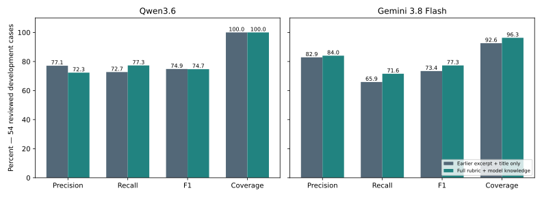

# Full rubric and model background knowledge

**6 October 2026 · 188 development titles · search off**

The user requested a rerun permitting existing model knowledge, then clarified that the complete current rubric Markdown must also be provided. The original calls used an excerpt and a title-only instruction. The new calls change both context completeness and knowledge permission; their effects cannot be separated in this comparison. Model settings and the two-tag output policy remain fixed. No rubric definitions or reference labels changed.

## Agreement with 54 accepted reviewed references

| Model | Configuration | Precision | Recall | F1 | Coverage |
|---|---|---:|---:|---:|---:|
| Qwen/Qwen3.6-35B-A3B-FP8 | Earlier excerpt + title only | 77.1% | 72.7% | 74.9% | 100.0% |
| Qwen/Qwen3.6-35B-A3B-FP8 | Full rubric + model knowledge | 72.3% | 77.3% | 74.7% | 100.0% |
| gemini-3.8-flash | Earlier excerpt + title only | 82.9% | 65.9% | 73.4% | 92.6% |
| gemini-3.8-flash | Full rubric + model knowledge | 84.0% | 71.6% | 77.3% | 96.3% |

## Changes and regressions

| Model | Changed / 188 | Changed / 54 | Improved / 54 | Worse / 54 | Same error count / 54 |
|---|---:|---:|---:|---:|---:|
| Qwen/Qwen3.6-35B-A3B-FP8 | 63 | 18 | 6 | 9 | 39 |
| gemini-3.8-flash | 23 | 11 | 7 | 4 | 43 |

Improved means fewer missing plus extra tags against the same accepted reference. A changed answer can retain the same error count. Reviewed references are single-reviewer development decisions with recorded limitations; disagreement is not automatically a confirmed model error.

## Historical agreement across 188 cases

| Model | Configuration | Precision | Recall | F1 | Coverage |
|---|---|---:|---:|---:|---:|
| Qwen/Qwen3.6-35B-A3B-FP8 | old | 66.0% | 70.2% | 68.1% | 99.5% |
| Qwen/Qwen3.6-35B-A3B-FP8 | new | 63.3% | 78.2% | 70.0% | 99.5% |
| gemini-3.8-flash | old | 75.4% | 67.1% | 71.0% | 89.9% |
| gemini-3.8-flash | new | 73.3% | 68.7% | 70.9% | 93.6% |

These scores use historical production labels, including potentially incorrect assignments. Within the 188, 54 have accepted reviewed references, three have unresolved reviewed status, and 131 have no accepted reference in that review. The historical table is an agreement diagnostic, not independently verified accuracy. The three unresolved cases do not enter the reviewed 54-case table.

## Failures, time and cost

- **Qwen/Qwen3.6-35B-A3B-FP8:** 1 old failures; 0 new failures. Median new request time: 1.31 seconds.
- **gemini-3.8-flash:** 0 old failures; 2 new failures. Median new request time: 7.84 seconds.
  Conservative usage estimate: $3.253048, plus $0.030176 reserved for unresolved failed-call charges. These are not invoices.

Hetzner uses the previously confirmed free tier. The latest user-reported dashboard total before this run was €2.32; do not add USD estimates directly to that figure. Failed answers remain empty predictions in end-to-end measures. Invalid/incomplete responses are not silently repaired. HTTP 503 attempts are not retried, and their full reservations and accounting-stop markers remain for DR-24 reconciliation.

The first Gemini requests were sequential; the resumed batch used up to four independent requests. Qwen requests were sequential. Compare request latency with this scheduling limitation in mind; cached replay duration is not inference latency.

## Interpretation limits and next decision

- The rubric document is unchanged, but the model sees more of it than before. Any improvement cannot be attributed solely to prior knowledge.
- Earlier and current calls occurred at different times; provider/model variability can contribute.
- The 188 are familiar development cases. Do not describe this as an untouched final test.
- Correct tags do not demonstrate that any background facts inferred by a model were accurate; no search evidence was collected.
- Keep all earlier predictions and references. Decide the next step from reviewed gains and regressions, without changing labels merely to agree with either model.

## Reproduce

Notebook: `notebooks/20_background_knowledge_comparison.ipynb`. Default is offline replay. The complete rubric fingerprint, exact old/new requests, responses and per-event changes remain private under `reports/background-knowledge/v1/`. The notebook source contains no saved outputs.

## Recommendation

On the **54 accepted reviewed cases**, Gemini 3.8 Flash improved from **73.4% to 77.3% F1** (+3.9 percentage points). Precision is **84.0%**, recall **71.6%**, and coverage **96.3%**. It meets the precision and coverage targets on this familiar sample, but misses the 80% recall target. Four of the eight previously discussed zero-overlap cases now include a reference tag.

Gemini improved seven reviewed cases. Three tag sets became worse against the reference, and one further case failed with HTTP 503. These are different problems: inspect the three tag regressions for interpretation issues; reconcile the failed request separately. Across all 188 attempts, Gemini returned 186 valid answers and Qwen returned 188. Failures remain empty predictions in the reported scores.

Qwen3.6 found more reference tags but also added more extra tags. Its reviewed F1 changed from **74.9% to 74.7%**, so this does not support replacing its earlier configuration. Gemini's historical-label F1 was also almost unchanged (**71.0% to 70.9%**). The reviewed improvement is useful evidence, but it does not establish an improvement across all events or prove that the historical labels are wrong.

**Interpretation:** both the full rubric and permission to use background knowledge changed. We cannot say which caused the difference. Search stayed off, and no definitions or reference answers changed. These are development results, not a fresh final test.

**Recommended next steps:**
1. Keep full-rubric Gemini as a development candidate and retain the previous Qwen baseline.
2. Inspect the three Gemini tag regressions in Notebook 20 section 4. Change a rubric rule only if that review identifies a real ambiguity; do not change labels merely to match predictions.
3. Before claiming general improvement, compare the old and new Gemini configurations on a small fresh set of 20–30 distinct event types, selected and reviewed before predictions are shown.
4. Finish DR-24 cost reconciliation and discuss DR-27's prototype recommendation. This experiment does not automatically approve service work.

No new labeling is required to review DR-63. Review the results and proposed next steps first.

## Regression review — 6 October 2026

The three tag regressions were checked against the current rubric and the approved reference history. This was a review of saved evidence, not a new web search or inference run. No labels, rubric definitions, prompts, or scores were changed.

| Case type | Finding | Recommended handling |
|---|---|---|
| Named-person commemoration | The model retained culture and added politics. The approved human-rights answer uses previously collected background evidence. The title alone does not establish that background or a domestic political demand. | Keep the approved reference and its source limitations. Treat this as a context-dependent disagreement; the model's exact reasoning was not recorded. |
| Antisemitism / anti-Zionism in Berlin | The model added international-politics. The rubric explicitly says antisemitism in Germany is not automatically international politics. However, the accepted politics label is itself a documented reviewer exception to the written rule. | Separate the model's unsupported international inference from the reference's domestic-politics exception. Do not count this as unambiguous proof that either answer fully follows the rubric. |
| Solidarity with political prisoners | The model added international-politics. The title does not identify a foreign country, and the earlier review explicitly removed that tag for lack of supporting context. | Keep human-rights as the accepted answer. The model may be making a plausible association, but its output provides no evidence identifying this event's international subject. |

**The separate failed case:** the road-safety event received no usable answer because of HTTP 503. This is an infrastructure failure, not a rubric interpretation or deliberate abstention. Keep it in end-to-end scores, retain its cost reservation, and do not silently retry or remove it to improve the comparison.

**Decision for the next step:** retain the full-rubric Gemini setup as an experimental development candidate and keep the earlier Qwen configuration as baseline. Do not rewrite the rubric from these three cases. First separate explicit written rules, approved reviewer exceptions, and cases needing background evidence. The next evaluation should report these limitations alongside quality, rather than calling every mismatch a confirmed model mistake. If a fresh comparison is approved, choose and label its cases before showing model predictions and give both model configurations the same search policy. DR-24 accounting and DR-27's prototype decision remain open.

The model responses contain tags, not explanations. The interpretations above describe evidence gaps and rule conflicts; they do not establish why the model generated a tag. Detailed event-level notes remain private in `reports/background-knowledge/v1/regression-review.md`.
