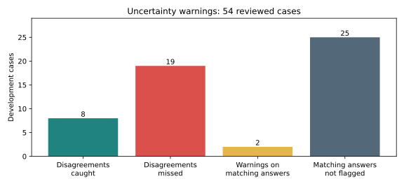

# Can uncertainty warnings guide review?

**6 October 2026 · Gemini 3.8 Flash · 54 reviewed development cases**

The warning found some difficult answers, but missed most disagreements. Keep it as an experimental review aid; do not use “high confidence” to skip review or use this rule as the automatic search trigger.

## What we tested

We asked Gemini to assess its saved v1 tags using the title and unchanged rubric excerpt. It answered two questions: **are the suggested tags supported?** and **are important topics missing?** Medium or low certainty on either question produced a warning. Reference answers were not sent to the model. Predictions and reference labels were not changed.

This was a separate assessment call after the original prediction. It does not show that the original model response knew it was uncertain. These cases have been reviewed repeatedly by one person; they are not a new test set. “Disagreement” means different from the accepted reference, not a proven model error.

## Results

| Measure | Result |
|---|---:|
| Completed assessments | 54/54 |
| Saved answers differing from the reference | 27/54 |
| Disagreements flagged | 8/27 — 29.6% |
| Disagreements missed | 19/27 — 70.4% |
| Total answers flagged for review | 10/54 — 18.5% |
| Flags on matching answers | 2/10 |
| Unflagged answers still differing from the reference | 19/44 — 43.2% |

Eight of ten warnings pointed to a disagreement, so a warning was often worth inspecting. But 19 disagreements received no warning. **An unflagged answer was not a reliable sign that the tags were complete and correct.** Matching answers can also reasonably receive warnings when their evidence is weak; the two flags on matches are not necessarily useless.

Missing tags remain important: 24 cases omitted at least one reference tag, and the warning caught seven of them. Ten cases contained an extra tag, and the warning caught four. These groups overlap. Four references have more than two tags while saved predictions allow only two; the diagnostic was explicitly asked to assess completeness beyond that limit.

## Why targeted search did not run

Before inference, we required warnings to catch at least half of disagreements, flag fewer than 80% of cases, concentrate disagreements more than unflagged answers, and include missing-context cases. The rule failed the first requirement: **29.6% caught, below the 50% exploratory threshold**. We did not change that rule after seeing results.

The model gave six rubric-boundary warnings and four missing-context warnings. All four missing-context warnings differed from their references, but that does not establish that search would fix them. No search requests were made. This result rejects this particular trigger for the planned next stage; it does not establish that search is ineffective.

## Cost and reproducibility

- 54 new assessment calls succeeded; no retries or search calls.
- Conservative usage estimate: **$0.565635**, not an invoice. Every token is priced at the output rate by the existing guard.
- Median additional request time: **6.82 seconds**. This is assessment latency, not review time or cached replay time.
- The user's latest dashboard observation remains **€2.10** before this run. Do not add USD estimates directly to that euro figure.
- Prompt: `notebooks/prompts/confidence-diagnostic-v1.json`.
- Private evidence: `reports/confidence-review/v1/contract.json`, `warning-results.json`, `search-selection.json`, `run-summary.json`, and request/response caches.
- Notebook 19 replays those private results by default; its committed source contains no saved outputs.

## Decision checkpoint

Steps 1–2 are complete. Step 3's precondition failed, so targeted search was not run. Discuss next steps before closing step 4, DR-24 accounting or DR-27's service recommendation.

**Recommendation:** finish the cost/latency summary, then decide whether to build a small reviewed prototype. Keep approval with the reviewer for every suggestion. Search could be an explicit reviewer action for missing context; automatic confidence-triggered search has not earned support here. If another search experiment is wanted first, define it separately around the four missing-context cases and treat it as exploratory—not a continuation that passed this gate. Embedding-assisted grouping stays future NLP work.

## Eight-case decision-explanation follow-up

At the user's request, rerun the eight cases with no shared tags between the accepted reference and the saved prediction, including four abstentions. Gemini 3.8 Flash receives the same title-only rubric and two-tag limit, with search off. The output instruction adds concise explanations, abstention reasons and any reported rubric ambiguity. Neither the old prediction nor reviewed tags enter the request.

**Result:** 8/8 requests succeeded. Seven predictions stayed the same; one changed and gained a shared reference tag. All four original abstentions remained abstentions. The new explanations cannot recover the original calls' unrecorded reasoning, and requesting explanations can influence classification. Do not mix this targeted follow-up into the original 54-case scores.

The explanations identify different possible causes:

- **Missing information:** a short request for justice gives no incident details; a person's memorial title gives no rights or political context. Context-rich reviewed answers and title-only predictions can therefore differ for understandable reasons.
- **Participation versus subject:** the model explicitly applies the LGBTQ rule excluding participation in another cause. Whether identity-specific cuts are central cannot always be determined from the title.
- **Narrow politics boundary:** opposition to political movements or a rightward shift is rejected because the model sees no named party, election, institution or law. Decide whether the intended category includes those subjects, rather than silently changing labels.
- **Peace and commemoration:** the model treats singing as a protest format and remembrance as culture. Clarify generic peace versus international conflict and commemoration versus a rights/accountability demand.
- **Possible model misapplication:** the model rejects alleged stalking and violence as outside the taxonomy even though social-issues includes protection from violence. This warrants checking whether it applied the existing rule correctly; it does not by itself justify expanding the catalog. Topic classification does not establish that a protester's allegations are true.

Keep these possibilities separate. An explanation can expose a rule the model used, but it does not prove that the interpretation is correct or that the rubric caused the disagreement. Reference corrections, wording changes and inference variability remain different questions.

**Evidence:** Notebook 19 sections 6–7, `notebooks/prompts/decision-explanation-v1.json`, and private `reports/confidence-review/v1/decision-explanation-v1/results.json`. Conservative additional usage estimate **$0.104131**; no search or retries. The user's dashboard observation **€2.32** is the reported total before this follow-up, not a converted USD ledger balance. DR-24 and DR-27 remain open for the agreed decision checkpoint.
