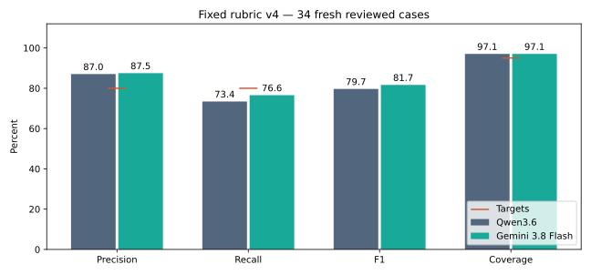

# Rubric v4 on fresh reviewed demonstrations

**7 October 2026 · Fixed prompts · Search off · Reviewed references**

Notebook 23 checks whether the fixed v4 configurations work beyond the 54 familiar development cases. No prompt, model setting or reference answer changed after inference began. These scores measure agreement with one reviewer, including recorded interpretation limitations.

## Main result — 34 fresh cases

| Model | Precision | Recall | F1 | Coverage | Complete tag match |
|---|---:|---:|---:|---:|---:|
| Qwen3.6 | 87.0% | 73.4% | 79.7% | 97.1% | 50.0% |
| Gemini 3.8 Flash | 87.5% | 76.6% | 81.7% | 97.1% | 58.8% |

Targets: **80% precision, 80% recall and 95% coverage**. F1 is reported for balance; it has no separate acceptance threshold.

## What was compared

- Gemini: `gemini-3.8-flash`, hosted by Google; provider-default sampling, 4,096 output-token limit.
- Qwen: `Qwen/Qwen3.6-35B-A3B-FP8`, hosted by Hetzner; temperature 0, thinking disabled, 4,096 output-token limit.
- Both received the original German title and complete public v4 rubric. Learned knowledge was allowed; search was off. Neither received English translations, separate date/location fields, reference tags or private notes.
- One call per model per event; a strict two-tag response. This was a v4 confirmation, not a new v3/v4 experiment. Hosted aliases are not immutable model weights.

## Which cases count

All 40 selected event types were reviewed before model predictions. The answer key has **38 resolved cases and two unclear**. The main fresh subset excludes four resolved cases with familiarity or possible overlap flags. Those four still appear in the broader resolved comparison. Two unclear cases remain in raw coverage reporting, without turning tentative human tags into scoring answers.

Nine resolved cases needed extra context; 29 were marked title-sufficient. Some title-sufficient reviews also recorded source checks. These subsets are descriptive; they do not form a controlled search experiment.

| Model | Group | Cases | Precision | Recall | F1 | Coverage |
|---|---|---:|---:|---:|---:|---:|
| Qwen3.6 | all resolved | 38 | 85.2% | 74.3% | 79.4% | 97.4% |
| Qwen3.6 | title sufficient | 29 | 84.8% | 78.0% | 81.2% | 100.0% |
| Qwen3.6 | context needed | 9 | 86.7% | 65.0% | 74.3% | 88.9% |
| Gemini 3.8 Flash | all resolved | 38 | 85.7% | 77.1% | 81.2% | 97.4% |
| Gemini 3.8 Flash | title sufficient | 29 | 87.5% | 84.0% | 85.7% | 100.0% |
| Gemini 3.8 Flash | context needed | 9 | 80.0% | 60.0% | 68.6% | 88.9% |

## Which tags need attention

Counts below use the same 34 fresh cases. “Missing” is a reference tag not suggested; “extra” is a suggestion outside the reference. Neither count alone proves which party made a mistake.

| Tag | Reference count | Qwen missing | Qwen extra | Gemini missing | Gemini extra |
|---|---:|---:|---:|---:|---:|
| culture | 6 | 4 | 1 | 3 | 2 |
| education | 1 | 1 | 0 | 0 | 0 |
| environment | 6 | 0 | 0 | 0 | 0 |
| housing | 1 | 0 | 0 | 0 | 1 |
| human-rights | 19 | 5 | 0 | 8 | 0 |
| international-politics | 11 | 2 | 1 | 0 | 0 |
| lgbtq | 0 | 0 | 0 | 0 | 0 |
| mobility | 1 | 0 | 0 | 0 | 0 |
| politics | 5 | 1 | 1 | 2 | 0 |
| religion | 3 | 1 | 0 | 0 | 1 |
| social-issues | 5 | 2 | 3 | 2 | 3 |
| work | 6 | 1 | 1 | 0 | 0 |

## Limits that matter

- This is a small, filtered sample with one reviewer. It cannot certify quality for all twelve tags or establish a statistically reliable winner from a small difference.
- Two retained reviewer references omit politics where the written v4 rule is broader. Those cases are in the broader comparison, not the primary fresh subset. Their disagreements must be described as policy differences rather than automatically as model reasoning errors.
- Some accepted answers rely on background sources, previous-year events or interpretation. Acceptance does not mean independent verification of event details. No answers were changed to favor either model.
- Three references contain three tags and one contains four. A two-tag model can recover at most **59/64 tags (92.2% recall)** in the fresh subset and **65/70 (92.9%)** in the broader subset. All supported reference tags remain included.
- Coverage means at least one suggestion, not a correct suggestion. Complete tag-set matches and correction needs matter for a service.
- The earlier 54 cases helped shape v4. Comparing their scores with this new cohort is descriptive, not a paired estimate of improvement or decline.

## Reliability, speed and cost

| Model | Valid responses | Empty valid answers | Raw coverage / 40 | Median seconds | P95 seconds | Maximum seconds | Conservative USD total | USD/event |
|---|---:|---:|---:|---:|---:|---:|---:|---:|
| Qwen3.6 | 40/40 | 2 | 95.0% | 0.97 | 1.54 | 9.91 | $0.0000 | $0.0000 |
| Gemini 3.8 Flash | 40/40 | 2 | 95.0% | 7.82 | 34.09 | 38.29 | $0.8424 | $0.0211 |

Original API request times are reported, including the response generation. Replay time and review/search time are excluded. Qwen used the confirmed free Hetzner account; this is hosted inference, not local compute.

Gemini prices were checked on 7 October: $0.75 per million input tokens and $3.75 per million output tokens including thinking. [Official pricing](https://ai.google.dev/gemini-api/docs/pricing). The ledger conservatively charges all reported tokens at the output rate, ignoring discounts. These estimates are not invoices. Account balances and invoice reconciliation are maintained in private operational records. Do not add usage estimates to account totals.

The follow-up audit also calculated **$0.298692** using separate input/output rates, including thinking. This is a usage-based estimate, not an invoice. The $0.842444 guard remains deliberately conservative; see the [run audit](../audits/2026-10-07-fresh-v4-run-audit.md).

The highest Gemini per-event conservative estimate was $0.031740, below the $1/event ceiling. Every request finished below five minutes.

The preflight allowance was $1.373457, below the $2 run ceiling. All 80 saved requests and decoded answers were checked outside the notebook, with metrics confirmed using scikit-learn; the run ledger matches $0.842444.

## What we learned and recommended next step

**Both models meet the precision and coverage targets on the 34 fresh cases, but neither reaches 80% recall.** Gemini 3.8 Flash scores **87.5% precision, 76.6% recall, 81.7% F1 and 97.1% coverage**. Qwen3.6 scores **87.0%, 73.4%, 79.7% and 97.1%**. Gemini finds two more reference tags with the same seven extra suggestions. That is a small descriptive lead, not proof that it is always better.

**The remaining gap is incomplete agreement with the reviewer reference.** Gemini misses 8/19 human-rights reference tags and 3/6 culture tags; Qwen misses 5/19 and 4/6. Both find all six environment references, without extra environment suggestions. Gemini also finds all eleven international-politics references. These small counts do not certify category-level performance; LGBTQ has no reference examples here. The follow-up audit found shared omissions involving historical-remembrance boundaries, event format versus purpose, weak event-specific evidence and the output cap. Do not count every disagreement as a confirmed model mistake or proof of reviewer bias.

**Context and reference limits matter.** Both models abstain on one resolved, three-tag case whose reference uses earlier-event/organizer background. Those three misses stay in the score. Across nine context-needed cases, Gemini recall is 60.0% and Qwen recall is 65.0%; across the 29 title-sufficient cases, it is 84.0% and 78.0%. Different cases and unequal information access prevent attributing this gap to search alone. The known politics exceptions also produce disagreement in the broader comparison: both models suggest politics on both cases, following the broader written rule.

**The output cap explains only part of the gap.** At least five reference tags cannot be returned under a two-tag cap, but the fresh comparison has 15 Gemini omissions and 17 Qwen omissions. The cap alone cannot account for all missing tags. Complete reference sets match on only **20/34 Gemini cases and 17/34 Qwen cases**.

**Service implication:** retain mandatory reviewer approval, with Gemini as the provisional quality candidate and Qwen as the fast free hosted alternative. Neither has met every agreed quality target, so this is not approval for automatic tagging or a production rollout. Keep v4 and the targets fixed; do not keep tuning this confirmation sample. Any further experiment should address a specific operational gap and use a separately agreed evaluation. No new labeling is required to review DR-69.

## Follow-up audit

The [7 October run audit](../audits/2026-10-07-fresh-v4-run-audit.md) confirms the numbers and separates model errors from reference, context and output-limit disagreements. Original labels and scores remain unchanged.

## Review and reproduce

1. Use [the original research revision](../research-replay.md), then open [Notebook 23](../../notebooks/23_fresh_v4_confirmation.ipynb). Keep `NOTEBOOK23_RUN_LIVE=false` and run it to replay saved responses. Private inputs are required.
2. Read the main comparison and the conclusion. Then inspect per-tag misses and extras.
3. Open the private `reports/fresh-confirmation/2026-10-07/comparison-v1/comparison.md` for original/English titles, human tags, each model’s tags and disagreement hints. Its JSON companion supports further analysis.
4. Read the [service recommendation](../plan/service-recommendation.md) and preserve the separation between this study and deployment acceptance.

The [public configuration](../../notebooks/prompts/fresh-v4-confirmation-v1.json) pins the inputs and settings. The private contract, raw responses, reference and audit preserve the evidence. Notebook source outputs remain empty.
