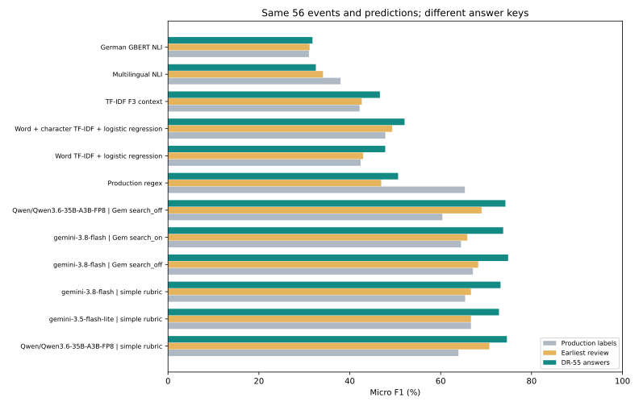

# Consistent reviewed comparison

5 October 2026. Saved predictions rescored against `dr55-reviewed-v1`. No new API calls.

## What was compared

56 unique development events have accepted answers; one unresolved event is excluded. Earlier answers and results remain intact. This is a repeatedly reviewed, partly targeted sample with one reviewer, not a blind test.

## Same 56 events

| Candidate | Precision | Recall | F1 | Coverage |
|---|---:|---:|---:|---:|
| Qwen/Qwen3.6-35B-A3B-FP8 — simple rubric | 77.6% | 71.7% | 74.6% | 100.0% |
| gemini-3.5-flash-lite — simple rubric | 77.8% | 68.5% | 72.8% | 98.2% |
| gemini-3.8-flash — simple rubric | 83.3% | 65.2% | 73.2% | 92.9% |
| gemini-3.8-flash — Gem search_off | 85.9% | 66.3% | 74.8% | 92.9% |
| gemini-3.8-flash — Gem search_on | 86.8% | 64.1% | 73.8% | 91.1% |
| Qwen/Qwen3.6-35B-A3B-FP8 — Gem search_off | 82.7% | 67.4% | 74.3% | 100.0% |
| Production regex | 60.6% | 43.5% | 50.6% | 76.8% |
| Word TF-IDF + logistic regression | 56.7% | 41.3% | 47.8% | 80.4% |
| Word + character TF-IDF + logistic regression | 70.4% | 41.3% | 52.1% | 69.6% |
| TF-IDF F3 context | 44.6% | 48.9% | 46.6% | 98.2% |
| Multilingual NLI | 36.5% | 29.3% | 32.5% | 89.3% |
| German GBERT NLI | 30.1% | 33.7% | 31.8% | 96.4% |

The chart changes only the answer key. Coverage stays the same. Gains are changes in measured agreement, not improvements to the models.

## All-candidate intersection

All candidates share 32 accepted events. These scores must not be ranked against the 56-event table.

| Candidate | Precision | Recall | F1 | Coverage |
|---|---:|---:|---:|---:|
| Qwen/Qwen3.6-35B-A3B-FP8 — simple rubric | 74.5% | 74.5% | 74.5% | 100.0% |
| gemini-3.5-flash-lite — simple rubric | 75.5% | 72.5% | 74.0% | 96.9% |
| gemini-3.8-flash — simple rubric | 81.0% | 66.7% | 73.1% | 90.6% |
| gemini-3.8-flash — Gem search_off | 83.3% | 68.6% | 75.3% | 90.6% |
| gemini-3.8-flash — Gem search_on | 84.6% | 64.7% | 73.3% | 90.6% |
| Qwen/Qwen3.6-35B-A3B-FP8 — Gem search_off | 77.3% | 66.7% | 71.6% | 100.0% |
| Production regex | 55.0% | 43.1% | 48.4% | 75.0% |
| Word TF-IDF + logistic regression | 61.9% | 51.0% | 55.9% | 87.5% |
| Word + character TF-IDF + logistic regression | 70.3% | 51.0% | 59.1% | 84.4% |
| TF-IDF F3 context | 49.2% | 56.9% | 52.7% | 100.0% |
| Multilingual NLI | 31.7% | 25.5% | 28.3% | 90.6% |
| German GBERT NLI | 28.8% | 33.3% | 30.9% | 96.9% |
| openai/gpt-oss-20b — Notebook 07 definitions | 77.5% | 60.8% | 68.1% | 100.0% |
| Qwen/Qwen3.6-35B-A3B-FP8 — Notebook 07 examples | 74.5% | 68.6% | 71.4% | 100.0% |

## What this means

- **Qwen/Qwen3.6-35B-A3B-FP8 | simple rubric:** does not meet all three quality targets on these development answers.
- **gemini-3.8-flash | simple rubric:** does not meet all three quality targets on these development answers.
- Within the adapted Gemini Gem, search changes F1 by -1.1 percentage points and coverage by -1.8 points. This is the paired search comparison; it does not isolate context or prompt effects.
- Two newly reviewed politics assignments retain evidence/rubric caveats. Notebook 16 shows the same comparison excluding only those two cases; other reference limitations remain. Do not interpret that sensitivity check as a verified clean dataset.
- Per-tag support and errors are available in Notebook 16. Rare tags and missing context still limit interpretation. Differences from references are not automatically confirmed model mistakes.

## Operations on the same 56 events

| Candidate | Response failures | Median original seconds | Max original seconds | Mean USD upper/event |
|---|---:|---:|---:|---:|
| Qwen/Qwen3.6-35B-A3B-FP8 — simple rubric | 0 | 1.2543 | 3.2108 | 0.0 |
| gemini-3.5-flash-lite — simple rubric | 0 | 0.7571 | 1.9937 | 0.0049 |
| gemini-3.8-flash — simple rubric | 0 | 3.7365 | 18.8721 | 0.0106 |
| gemini-3.8-flash — Gem search_off | 0 | 3.5321 | 22.8347 | 0.016 |
| gemini-3.8-flash — Gem search_on | 2 | 8.5708 | 31.6508 | 0.0702 |
| Qwen/Qwen3.6-35B-A3B-FP8 — Gem search_off | 0 | 4.8383 | 9.2764 | 0.0 |
| Production regex | Not recorded | Not recorded | Not recorded | Not recorded |
| Word TF-IDF + logistic regression | Not recorded | Not recorded | Not recorded | Not recorded |
| Word + character TF-IDF + logistic regression | Not recorded | Not recorded | Not recorded | Not recorded |
| TF-IDF F3 context | Not recorded | Not recorded | Not recorded | Not recorded |
| Multilingual NLI | Not recorded | Not recorded | Not recorded | Not recorded |
| German GBERT NLI | Not recorded | Not recorded | Not recorded | Not recorded |

Saved request durations are not cache replay times. Local computation was not priced. USD estimates are conservative, not invoices. The last reported Google total (€1.85, including €0.76 on 3 October before later continuation) is an account observation, not a cost for this subset. DR-24 still needs final reconciliation.

## Next steps

Review Notebook 16 and this summary. Keep Qwen3.6 and Gemini3.8 simple-rubric configurations as the practical comparison. Complete DR-24 accounting, then DR-60’s separate third-tag experiment and DR-58’s human-effort trial before DR-27’s service decision. Do not lower the targets based on this selected sample.

## Reproduce

Run `notebooks/16_reconciled_reference_comparison.ipynb` with the private pinned inputs. It verifies input fingerprints, saves `reports/reconciled-comparison/v2/results.json`, and regenerates this aggregate summary and SVG. The original final benchmark and later follow-up remain separately labeled in section 6; neither is changed here.
