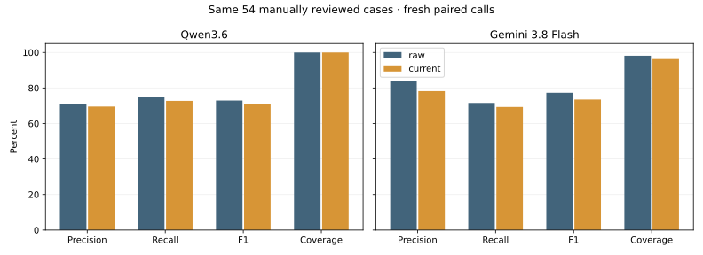

# Rubric delivery on manually reviewed demonstrations

**6 October 2026 · 54 accepted manual reviews · search off · same reference answers**

This experiment implements the audit's first prompt comparison with the user's reviewed-only requirement. It makes no calls or quality comparisons against the unreviewed historical portion of the 188-record dataset. Three unresolved reviews remain excluded; previously recorded reference exceptions remain visible and unchanged.

Earlier DR-63 headline scores already used these 54 reviewed answers. This run restricts provider calls as well as scoring to that cohort; a score change is not caused by replacing the 188 historical labels.

Both conditions contain the same current rules and unchanged examples. The raw condition includes the whole rubric document and its history; the current-rule condition retains current normative sections verbatim and removes historical/procedural material. Both retain the same wrapper, background-knowledge permission, strict two-tag cap and model-specific generation settings. Fresh controls avoid relying solely on old cached predictions. Conditions alternate order by event.

## Paired results

| Model | Rubric delivery | Precision | Recall | F1 | Coverage | Exact match |
|---|---|---:|---:|---:|---:|---:|
| Qwen/Qwen3.6-35B-A3B-FP8 | Current rules | 69.6% | 72.7% | 71.1% | 100.0% | 38.9% |
| Qwen/Qwen3.6-35B-A3B-FP8 | Full document | 71.0% | 75.0% | 72.9% | 100.0% | 38.9% |
| gemini-3.8-flash | Current rules | 78.2% | 69.3% | 73.5% | 96.3% | 48.1% |
| gemini-3.8-flash | Full document | 84.0% | 71.6% | 77.3% | 98.1% | 53.7% |

## Predeclared screen

Advance only for at least +3 percentage points F1, no precision or coverage decrease greater than two points, and a review of per-tag harm. This is a development screen, not proof of generalization or a replacement for the 80/80/95 targets.

- **Qwen/Qwen3.6-35B-A3B-FP8:** F1 -1.8 points; precision -1.4; recall -2.3; coverage +0.0. Numeric screen: **does not pass**.
- **gemini-3.8-flash:** F1 -3.8 points; precision -5.8; recall -2.3; coverage -1.9. Numeric screen: **does not pass**.

## Calls, time and cost

| Model | Completed valid / scheduled | Median request time | Conservative usage estimate |
|---|---:|---:|---:|
| Qwen/Qwen3.6-35B-A3B-FP8 | 108/108 | 0.97 s | $0.0000 |
| gemini-3.8-flash | 108/108 | 8.55 s | $1.6294 |

Qwen uses the confirmed free hosted Hetzner account. USD estimates are not invoices or converted euro dashboard totals. Cached replay time is not inference latency. Invalid completed responses remain empty predictions.

## Interpretation limits

- The same 54 accepted manual answers are used for every condition. Higher scores do not prove that all accepted exceptions follow the written rubric.
- These familiar, selected development cases cannot establish production quality or an untouched final result.
- No label, rubric meaning, example answer or output-policy change was introduced. Some human-review instructions remain verbatim; this is conservative history removal, not an optimized paraphrase.
- Hosted aliases and default settings can vary. Original earlier results stay separate from this fresh paired comparison.

## Reproduce and review

Run [Notebook 21](../../notebooks/21_reviewed_rubric_delivery.ipynb) with `NOTEBOOK21_RUN_LIVE=false`. Read the cohort checks, results, tag-level changes and recorded conclusion. No additional CSV labeling is required. Private contract, exact responses and results are in `reports/rubric-delivery/v1/`; the public [rule mapping](../../notebooks/prompts/rubric-v3-operational-v1-map.json) identifies preserved sections.

## Recorded conclusion

**Do not adopt the shorter rendering as a quality improvement.** Both models failed the predeclared screen. Each model changed ten tag sets. Qwen recovered two additional environment tags, but missed three additional politics tags; Gemini missed two additional international-politics tags and one additional human-rights tag, while recovering one LGBTQ tag. Some extra tags also increased. This was not a uniform simplification benefit.

Keep full-document Gemini as the experimental candidate and the earlier Qwen configuration as the baseline. The fresh Qwen full-document score differs from its earlier run, so avoid attributing differences between run dates entirely to a prompt. All 216 responses were valid; outages did not explain these paired results.

The reviewed-only requirement is implemented. The next audit step is to resolve the documented rule/reference exceptions before selecting at most one further examples-or-context intervention. Do not silently change accepted answers or optimize toward their exceptions. No further paid experiment or new labeling was started automatically. Existing historical comparisons remain archived; none enter this benchmark.
