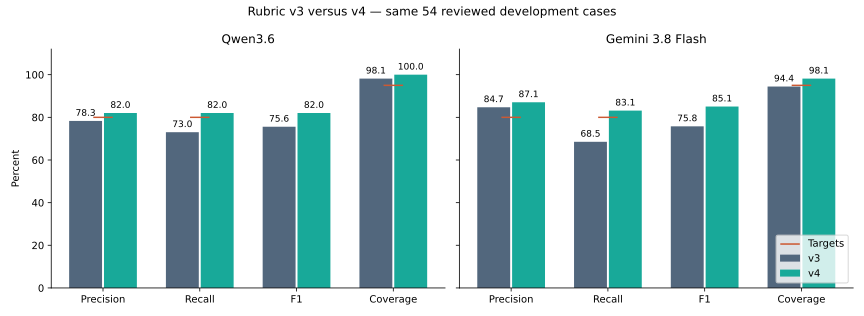

# Does rubric v4 improve tagging?

**6 October 2026 · Completed paired development comparison · 54 manually reviewed demonstrations**

**Rubric v4 improved both models on these 54 reviewed development cases. Both now meet the three quality targets on this sample.** Gemini 3.8 Flash reaches **87.1% precision, 83.1% recall and 98.1% coverage**; Qwen3.6 reaches **82.0%, 82.0% and 100%**. F1 rises by **9.3 percentage points for Gemini** and **6.4 points for Qwen** against fresh v3 controls scored with the same answers.

**What improved:** Gemini recovered six more politics tags, three more LGBTQ tags and two more human-rights tags. Qwen recovered five more culture tags and three more politics tags. These gains are consistent with the revised boundaries, but this combined experiment cannot identify the effect of each individual rule.

**What still needs care:** Qwen lost three previously matched social-issues tags; Gemini lost one, on a case with a retained interpretation limitation. One Qwen housing loss swaps housing for another accepted topic in a three-tag reference under the two-tag limit. Broader politics rules also add extra suggestions: three more for Qwen and two more for Gemini. Keep those tradeoffs visible. We did not change reference answers to remove the disagreements.

**Reliability:** 215 of 216 scheduled responses were valid. One Gemini v3 response exhausted its output allowance and counts as no tags. On the same 53 cases with valid answers in both Gemini arms, F1 still improves from **76.3% to 85.4% (+9.1 points)**. The overall gain is not explained by that single failure. All 108 Qwen responses and all 54 Gemini v4 responses were valid.

**Recommendation:** retain v4 for both as development candidates, with Gemini leading on agreement and Qwen offering a fast, free hosted alternative. Complete-tag agreement is still only **35/54 for Gemini and 29/54 for Qwen**, so these results support review, not automatic approval. Stop tuning this familiar set for now. Finish DR-24 accounting and use DR-27 to decide a small reviewed prototype or a separate confirmation on other manually reviewed cases. No fresh labeling or extra run is required to review this result; any later comparison must respect the reviewed-only requirement and be described honestly if its cases were previously examined.

## Same cases, same answers, different rubric

Both models receive the complete v3 or v4 Markdown, the same title and permission to use learned knowledge. Search is off. Within each model, generation settings and the two-tag output policy remain identical. Half the titles receive v3 first; half receive v4 first. Both arms use fresh calls in separate caches. The common wrapper names the correct version and separates human-review statuses from the tags-only response.

The answer key is the approved DR-66 revision: **54 cases, 89 reference tags**, including the D6 addition. All three unresolved reviews stay excluded. No unreviewed historical records enter calls or scores. No labels changed during this run.

## Paired results

| Model | Rubric | Precision | Recall | F1 | Coverage | Exact match |
|---|---|---:|---:|---:|---:|---:|
| Qwen3.6 | v3 | 78.3% | 73.0% | 75.6% | 98.1% | 46.3% |
| Qwen3.6 | v4 | 82.0% | 82.0% | 82.0% | 100.0% | 53.7% |
| Gemini 3.8 Flash | v3 | 84.7% | 68.5% | 75.8% | 94.4% | 53.7% |
| Gemini 3.8 Flash | v4 | 87.1% | 83.1% | 85.1% | 98.1% | 64.8% |

Coverage means at least one suggested tag, even if wrong. Exact match means the whole suggested set equals the reference. Precision is agreement per suggested tag, not the fraction of events requiring no correction.

## Predeclared screen

Require at least **+3 percentage points F1**, without losing more than **2 points precision or coverage**, then inspect per-tag harm. Targets remain **80% precision, 80% recall, 95% coverage**. All changes below are percentage points, not relative percentages.

| Model | Precision change | Recall change | F1 change | Coverage change | Numeric screen |
|---|---:|---:|---:|---:|---|
| Qwen3.6 | +3.7 | +9.0 | +6.4 | +1.9 | Pass |
| Gemini 3.8 Flash | +2.3 | +14.6 | +9.3 | +3.7 | Pass |

| Model | Changed tag sets | Became exact | Lost exact match | Descriptive 95% interval for F1 change |
|---|---:|---:|---:|---:|
| Qwen3.6 | 25/54 | 9 | 5 | -0.4 to +13.6 |
| Gemini 3.8 Flash | 20/54 | 9 | 3 | +2.0 to +17.2 |

Intervals use 20,000 paired event-row bootstrap resamples, seed 20261006. They describe variation within this selected sample; they do not account for repeated tuning, single-reviewer judgment or related topics. Qwen’s interval includes no gain, so its improvement is less certain even within this sample. A passing screen is not independent confirmation of improvement.

## Where tags improved or deteriorated

Lower missing/extra counts mean closer agreement with the reference. A disagreement can be a model mistake, missing context or a retained interpretation; these counts alone cannot identify the cause.

### Qwen3.6

| Tag | Reference support | Missing: v3 → v4 | Extra: v3 → v4 |
|---|---:|---:|---:|
| culture | 9 | 7 → 2 | 0 → 0 |
| education | 0 | 0 → 0 | 1 → 0 |
| environment | 4 | 1 → 0 | 0 → 0 |
| housing | 5 | 0 → 1 | 1 → 2 |
| human-rights | 18 | 3 → 2 | 7 → 5 |
| international-politics | 10 | 2 → 2 | 2 → 2 |
| lgbtq | 4 | 1 → 0 | 2 → 1 |
| mobility | 3 | 0 → 0 | 1 → 1 |
| politics | 23 | 8 → 5 | 2 → 5 |
| religion | 0 | 0 → 0 | 1 → 0 |
| social-issues | 7 | 1 → 4 | 1 → 0 |
| work | 6 | 1 → 0 | 0 → 0 |
### Gemini 3.8 Flash

| Tag | Reference support | Missing: v3 → v4 | Extra: v3 → v4 |
|---|---:|---:|---:|
| culture | 9 | 2 → 1 | 3 → 0 |
| education | 0 | 0 → 0 | 0 → 0 |
| environment | 4 | 1 → 1 | 0 → 0 |
| housing | 5 | 1 → 1 | 0 → 1 |
| human-rights | 18 | 7 → 5 | 2 → 1 |
| international-politics | 10 | 2 → 0 | 2 → 4 |
| lgbtq | 4 | 3 → 0 | 1 → 1 |
| mobility | 3 | 0 → 0 | 0 → 0 |
| politics | 23 | 9 → 3 | 1 → 3 |
| religion | 0 | 0 → 0 | 1 → 1 |
| social-issues | 7 | 2 → 3 | 1 → 0 |
| work | 6 | 1 → 1 | 0 → 0 |

Education and religion have zero reference support, so recall for those categories is untested. Five references contain three tags; a two-tag answer can recover at most **84/89 = 94.4% recall**. Those five cases remain in the headline score and are shown separately in the private notebook table.

## Reference sensitivity

These are the **same new predictions**, scored against each answer-key version. The main comparison always uses the revised reference for both rubric arms.

| Model | Rubric | F1: revised answers | F1: original answers |
|---|---|---:|---:|
| Qwen3.6 | v3 | 75.6% | 74.9% |
| Qwen3.6 | v4 | 82.0% | 81.4% |
| Gemini 3.8 Flash | v3 | 75.8% | 76.2% |
| Gemini 3.8 Flash | v4 | 85.1% | 85.5% |

## Calls, time and cost

| Model | Rubric | Valid answers / scheduled | Median original request | Conservative usage estimate | Estimate per demonstration |
|---|---|---:|---:|---:|---:|
| Qwen3.6 | v3 | 54/54 | 1.21 s | $0.0000 | $0.0000 |
| Qwen3.6 | v4 | 54/54 | 1.12 s | $0.0000 | $0.0000 |
| Gemini 3.8 Flash | v3 | 53/54 | 8.58 s | $0.9764 | $0.0181 |
| Gemini 3.8 Flash | v4 | 54/54 | 8.96 s | $1.1201 | $0.0207 |

Qwen uses the confirmed free hosted Hetzner account; it is not local inference. USD usage estimates are not invoices or converted euro dashboard totals. Gemini estimates conservatively charge all reported tokens at the output rate. Prices were rechecked against the [official pricing page](https://ai.google.dev/gemini-api/docs/pricing) on 6 October. The initial whole-batch reservation bound was $3.493515 within a $5 run ceiling and the shared project/per-event limits. Earlier uncertain charges remain reserved.

Replay time is not inference latency. Invalid completed responses count as no tags in the main score, with no automatic retry for a better answer. Read the interpretation above for their impact.

## Review and reproduce

Open [Notebook 22](../../notebooks/22_rubric_v4_comparison.ipynb), leave `NOTEBOOK22_RUN_LIVE=false`, and run the saved comparison. Read the headline results, per-tag changes and conclusion. No new CSV review is required. A public checkout can read this summary but lacks the private data needed to execute the notebook.

The [public configuration](../../notebooks/prompts/rubric-v4-comparison-v1.json) pins rubric/reference hashes, exact model settings and the shared request wrapper. Private `reports/rubric-policy/v1/` holds the immutable request contract, responses, results, audit and changed-case details. Metrics were independently checked against scikit-learn and the paid usage total against the ledger. Notebook outputs remain empty in Git.

## Limits

These familiar cases helped shape v4. Scores measure development agreement, not performance on unseen events. V4 changes meaning, wording and examples together; this run cannot isolate which change caused a difference. Approved references preserve recorded interpretation/context limitations. Hosted model aliases and default settings can vary, and each condition has one response per case. Earlier notebooks and results remain unchanged.
