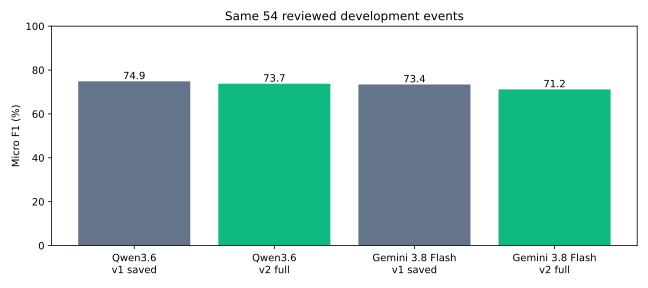

# Two tags or a third tied tag?

## Comparison

Both policies use the same 54 accepted DR-61 development events and complete reviewed answers. Qwen runs on Hetzner; Gemini runs through the Google API. Search is off. V1 reuses saved predictions; v2 makes new requests with the unchanged rubric and allows a third equally central, title-supported tag.

| Model | Policy | Precision | Recall | F1 | Coverage |
|---|---|---:|---:|---:|---:|
| Qwen/Qwen3.6-35B-A3B-FP8 | v1 saved | 77.1% | 72.7% | 74.9% | 100.0% |
| Qwen/Qwen3.6-35B-A3B-FP8 | v2 first two | 73.0% | 73.9% | 73.4% | 100.0% |
| Qwen/Qwen3.6-35B-A3B-FP8 | v2 full | 72.5% | 75.0% | 73.7% | 100.0% |
| gemini-3.8-flash | v1 saved | 82.9% | 65.9% | 73.4% | 92.6% |
| gemini-3.8-flash | v2 first two | 78.9% | 63.6% | 70.4% | 92.6% |
| gemini-3.8-flash | v2 full | 77.3% | 65.9% | 71.2% | 92.6% |

**V2 first two** removes the third tag from each new response without another model call. Comparing this with v2 full shows what the added third tags contribute. Comparing saved v1 with v2 also includes changes to the first two suggestions and possible provider/inference-date variation.

## Third tags

| Model | Three-tag answers | Third tags matching reference |
|---|---:|---:|
| Qwen/Qwen3.6-35B-A3B-FP8 | 2 | 1 |
| gemini-3.8-flash | 4 | 2 |

Matching a reference does not prove the model’s explanation is sound. Notebook 17 shows the private titles and tie reasons for review. An uncertain choice between tags is not a valid tie.

## Runtime and cost

| Model | Median original request time | Upper cost estimate for 54 calls |
|---|---:|---:|
| Qwen/Qwen3.6-35B-A3B-FP8 | 2.02 seconds | $0.0000 |
| gemini-3.8-flash | 3.68 seconds | $0.5994 |

Costs are conservative USD estimates from recorded usage, not the invoice. Hetzner is the confirmed free account. The new Gemini run has a $3 ceiling inside the shared $50 capstone guard. The user reported **€1.86 monthly spending before this run** on 5 October; that separate EUR observation is not converted or added to the USD ledger. Cached replay is not new inference time.

## Limits

- This small, targeted development sample has been reviewed repeatedly by one person. It cannot establish general production accuracy.
- Three unresolved cases remain excluded consistently. Reference labels and the final benchmark were not changed.
- The changed instruction includes a tie flag and reason; this is a policy comparison, not a clean estimate of tag-count effects alone.
- Historical v1 requests and the default two-tag parser are preserved. No production save limit changed.

## Recommendation

Keep **v1 (up to two tags)** as the default for the next practical trial unless the reviewer explicitly prefers the three-tag trade-off. Keep v2 available as an experimental configuration. Neither new result meets all three quality targets, and this run does not support presenting v2 as an accuracy improvement. A human can still record every supported topic in the reference; the reference is not limited to two.

- Qwen: F1 falls from **74.9% to 73.7%**. Recall rises from **72.7% to 75.0%**, while precision falls from **77.1% to 72.5%**.
- Gemini 3.8 Flash: F1 falls from **73.4% to 71.2%**. Recall stays **65.9%**, while precision falls from **82.9% to 77.3%**.
- Third tags themselves match the reference in **1 of 2 Qwen cases** and **2 of 4 Gemini cases**. Their direct contribution improves v2 F1 slightly compared with v2 truncated to two; it does not explain the entire difference from v1.
- Six model answers concern five unique events. Review only these five if needed. Some disagreements may still concern the reference or rubric boundaries; a mismatch is not automatically a confirmed model error. Existing approved references remain unchanged.

## Review steps

1. Read the quality table in Notebook 17 section 3.
2. Check each three-tag answer and explanation in that section. Decide whether all three are central and title-supported.
3. Accept the recommended trial policy below, or identify a specific case/rule to change. No new CSV labeling is required.

Private evidence: `reports/tag-policy/v1/contract.json` and `results.json`. Full notebook execution requires authorized local inputs. Public readers can use this aggregate summary.

