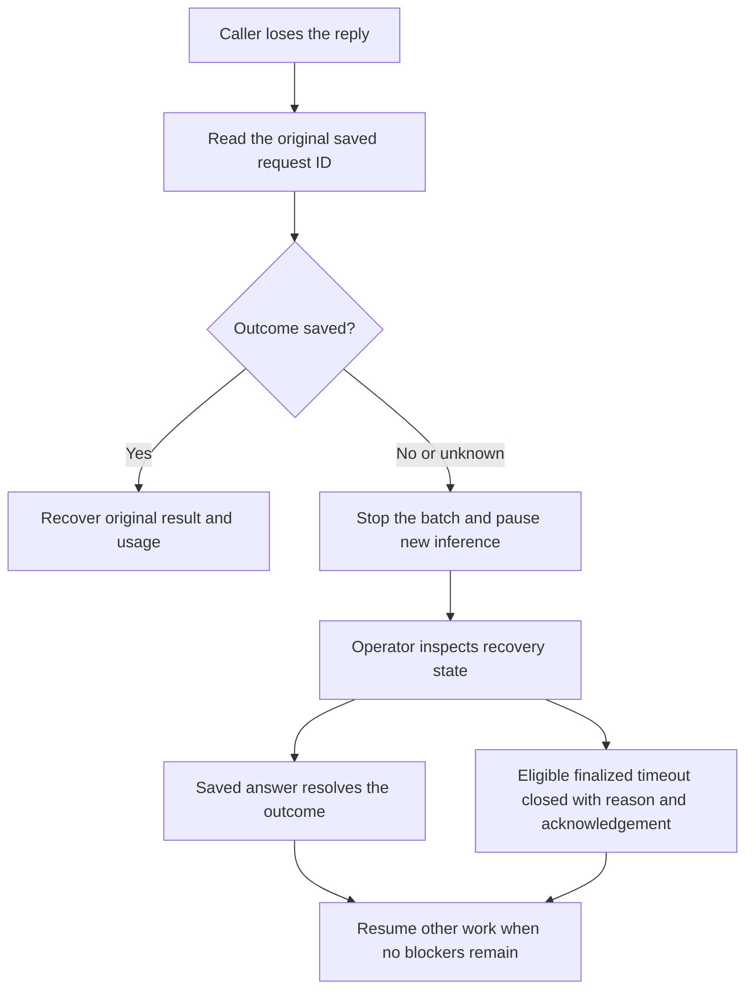

# DemoLogic service API

DemoLogic accepts one tagging request or daily-snapshot request, validates the
configured model’s answer and saves its outcome. Demo Radar owns background
jobs, staff decisions and publication. No service response approves event tags.
Use the [synthetic walkthrough](reproducibility.md) before configuring live inference.

## Local synthetic service

From the repository root, preserve any existing private settings. For a new setup:

```bash
cp -n service/.env.example service/.env
export DEMOLOGIC_SERVICE_TOKEN="$(python3 -c 'import secrets; print(secrets.token_urlsafe(32))')"
export DEMOLOGIC_MODE=demo
docker compose --env-file service/.env up --build -d
```

Keep that terminal open so Compose and curl use the same token. The root `.env`
belongs to notebooks. Compose uses only the listed service variables from
`service/.env`; shell variables override the file. Keep credentials out of Git,
images, browser code and pasted logs. This fresh setup must not replace a running
deployment’s token or create a second journal beside it.

Check readiness and send the invented public request:

```bash
curl -sS -H "Authorization: Bearer $DEMOLOGIC_SERVICE_TOKEN" \
  http://localhost:8000/health/ready
curl -sS -H "Authorization: Bearer $DEMOLOGIC_SERVICE_TOKEN" \
  -H 'Content-Type: application/json' \
  --data-binary @examples/synthetic/tag-request.json \
  http://localhost:8000/v1/tag-suggestions
```

Expect `tags: ["mobility"]`, `mode: "demo"`,
`returned_model: "synthetic-fixture-not-qwen"`, `requires_staff_review: true`
and `new_provider_calls: 0`. Missing usage is null. Repeating the identical
request returns `replayed: true`; changing its input under the same request ID
returns 409. Demo mode accepts only event IDs beginning `synthetic-`.

`docker compose --env-file service/.env down` retains the journal volume. Do not
use `down -v` to resolve uncertain work. For automated startup, auth, replay and
restart checks, run `python3 scripts/smoke_service.py <built-image>`.

## Authentication and endpoints

Use `Authorization: Bearer <service-token>`. Only `/health/live` is unauthenticated.
The service token is not a staff session; Demo Radar separately checks staff permissions.

| Method and path | Purpose |
| --- | --- |
| `GET /health/live` | Process liveness; no provider request |
| `GET /health/ready` | Authenticated admission/readiness state |
| `GET /v1/openapi.json` | Implemented request and response schemas |
| `GET /v1/task-profiles` | Read-only supported task/profile catalog and client contracts |
| `GET /v1/attempts/{id}/spending` | Private reservation and charge evidence |
| `POST /v1/attempts/{id}/spending` | Audited operator reconciliation after verified account evidence |
| `GET /v1/attempts/{request_id}/execution` | Private saved configuration and measured phase facts |
| `POST /v1/tag-suggestions` | One event’s topic suggestions |
| `GET /v1/daily-summary-contract` | Summary configuration, model metadata and fingerprint |
| `POST /v1/daily-summary-drafts` | One saved public snapshot’s private German draft |
| `GET /v1/attempts/{request_id}` | Saved result or unresolved marker; no inference |
| `GET /v1/recovery` | Inspect unresolved work |
| `POST /v1/attempts/{request_id}/close` | Audited closure of an eligible finalized unknown attempt |
| `POST /v1/maintenance` | Block admission and drain local work |
| `DELETE /v1/maintenance` | Resume admission when recovery permits |

The main [task execution guide](task-execution.md) explains the request flow,
retained profiles, saved execution records and upgrade/rollback procedure.

## Tagging contract

```json
{
  "request_id": "synthetic-request-001",
  "job_id": "synthetic-job-001",
  "model_id": "qwen-v4-v1",
  "taxonomy_version": "v2",
  "source_version": "synthetic-source-v1",
  "input_variant": "F0",
  "event": {"id": "synthetic-demo-001", "title": "Für sichere Radwege"}
}
```

Both tagging and summary requests accept an optional `execution` object:

* `task`: `tagging` or `daily-summary`, matching the endpoint.
* `profile_sha256`: the exact hash returned by the approved profile catalog.
* `origin`: `manual_api` or `scheduled`.

The existing `model_id` selects the profile. Incompatible task/hash combinations
are rejected before dispatch. Environment comes from `DEMOLOGIC_ENVIRONMENT`.
Older callers can omit `execution` and keep their original request fingerprints.

Stable request IDs support recovery. The caller supplies batch identity and
source/configuration versions; it must not invent new versions to bypass limits.
Unsupported parameters, extra context, blank or invalid Unicode titles and
titles longer than 4,000 characters are rejected before inference.

Results retain event/job/request IDs, source/taxonomy/configuration/rubric hashes,
suggested tags, staff-review requirement and mode. Statistics retain requested
and returned model identities, provider request ID when supplied, original UTC
timestamps, duration, attempt number and raw/normalized usage. Missing values
remain null. Cached/reasoning counts are subsets, not extra totals.

Replay returns original measurements with zero new provider calls. A failed
attempt can retain usage too; retrieving it is not a new send. Structured errors
contain a stable code and locally defined message without raw provider bodies
or database text. Display them as escaped text in staff interfaces.

| Status | Meaning |
| --- | --- |
| 200 `suggested` | Valid suggestions awaiting staff review |
| 200 `abstained` | Valid empty tag list; manual handling may be needed |
| 401 / 422 | Authentication or input rejection before inference |
| 409 | Conflicting identity, active/unresolved work or duplicate completed input |
| 429 | Pacing, provider cooldown or attempt/batch limit |
| 502 / 503 | Provider/validation failure, unavailable configuration or maintenance |
| 504 `unknown` | Remote outcome not established; investigate saved work |

`inference_admitted: false` explicitly identifies a confirmed refusal before
inference. A missing response or bare HTTP status is not equivalent evidence.

## Evaluated configuration and limits

The [tagging catalog](../configs/inference/catalog.json) registers `qwen-v4-v1`.
Its [configuration](../configs/inference/qwen-v4-v1.json) pins the complete v4
rubric and request wrapper: Qwen/Qwen3.6-35B-A3B-FP8 on Hetzner, temperature zero,
thinking disabled, search off, JSON output and a 4,096-token cap. Learned model
knowledge is permitted. Only the title and instructions are model context;
review notes, earlier events and historical reference labels are not appended.

Hetzner live mode requires private settings and explicit free-tier confirmation.
Gemini has separately approved profiles and is disabled until operator activation.
See [provider settings and spending](provider-settings.md) for the monetary guard,
pricing revision, keys and release checklist. There is no automatic fallback.

The service admits one provider attempt at a time across processes sharing the
same journal. Tagging has hard batch ceilings of 40 distinct event IDs and 120
attempts, and a configurable persistent per-event-input attempt allowance
(default three). A deployed Radar batch may be more conservative: five events
and one attempt. Requests cannot override the service’s limits.

Provider cooldowns, maintenance and attempt counts survive restart. A total live
deadline is at most 60 seconds, alongside bounded I/O and response size. Each
accepted request sends at most one model attempt; the caller controls deliberate
later retries. A failed or unknown attempt is not free allowance for another call.

## What happens if the connection drops?



Demo Radar performs at most three bounded lookups, with five-second intervals and
five-second lookup deadlines. A saved unknown result stops those checks immediately.
Lookups never call the provider. Stop prevents dispatch of another event while an
admitted request drains and saves. A restarted worker first resolves its original
request ID; it does not resend it as new work.

A finalized unknown timeout may be closed after at least 15 minutes, with a
trimmed operator identity/reason and `accept_unknown_outcome: true`. The server
also checks that no local inference is active. Unfinished crash markers remain
blocked for investigation. The exact closed input is not silently retried, and
original attempt records and unknown usage are retained. Waiting does not prove
that the remote provider stopped or cancel remote inference. Closure is neither
a successful answer nor staff approval of tags.

## Persistence and maintenance

The private SQLite journal coordinates admission and preserves request identity,
outcomes, usage and recovery. It does not store input titles, but its IDs and
results are still private operational data. Deploy one service process on one
host with a persistent local journal; multi-host replicas or network-mounted
SQLite are unsupported. Independent journals cannot exclude each other’s calls.

Maintenance persists across restart and blocks new dispatch. Saved answers can
still be replayed. Graceful shutdown drains admitted work; forced termination
leaves a started marker to investigate. Uvicorn allows 75 seconds and Compose
allows 90 seconds to stop. Back up the entire journal directory after draining;
do not delete history to make readiness green.

## Daily drafts

`hetzner-daily-v1` names the product contract. Fetch its authenticated metadata
and send `config_sha256` with a canonical snapshot and its hash. Snapshot fields
include the Berlin date, public titles, recorded times/locations/routes, approved
public tags and explicit uncertainty. Private notes and arbitrary settings are
rejected. See [summary design](plan/daily-summary.md).

The [worked example](../configs/summary/examples/news-brief-v1.json) is sent as
separate input/output messages before the actual snapshot. The service validates
supporting identities, structured output and word limits; it cannot prove that
prose is accurate or natural. Staff review remains necessary. German generation
and DeepL translation are separate stages owned by the service and Radar respectively.

## Code map and checks

`app.py` assembles the service; `lifecycle.py` manages resources. `api/` handles
auth/routes, `inference/` admission/results/recovery, `providers/` transport,
`persistence/` durable state and `summary/` the daily contract. Request/response
schemas and safe errors remain shared at the service root.

Public CI checks lint/format, synthetic tests and the publication boundary, then
builds the image and runs the isolated Docker smoke script. These checks require
no private dataset or provider key. Image publication uses a separate manual
workflow; publishing an image is not deployment acceptance. See the
[ARM64 release guide](release-images.md) for digest records and pull commands.
