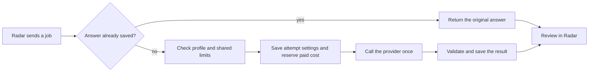

# How tasks run

DemoLogic handles tagging and daily summaries. A **profile** fixes the provider,
model, instructions and output format. Its ID and hash identify the exact version.

Demo Radar chooses jobs and handles permissions, review and publication. DemoLogic
checks profiles, calls the provider and saves results. Route execution remains
disabled. Radar stores independent tagging and summary defaults with an audit trail.
See [provider setup and spending](provider-settings.md) for activation requirements.

## The flow

Tags and summaries share one execution lane. Only one call runs at a time.
Duplicate requests return the saved answer without another call. Jobs keep their
original settings; changing profiles does not reset classifier or summary retry limits.

**An unknown outcome blocks new calls, including after a restart or profile
change.** Use the [recovery procedure](service-api.md#what-happens-if-the-connection-drops)
before continuing. Saved suggestions still need review before publication.

## Inspect the service

The [API reference](service-api.md#authentication-and-endpoints) lists the
authenticated profile catalog and attempt lookup endpoints. These inspection
endpoints make no model calls or settings changes. The optional request fields
are documented in the [tagging contract](service-api.md#tagging-contract).

An `enabled` profile has configured execution requirements; it does not prove
that a live call succeeded or that spending allowance remains.
Summary profiles appear only when summaries are enabled.

## Run a Gem through Radar

Open a demonstration in Support and expand **6. Gems → Suggest topic tags**.

1. Choose **Copy Gem** to use your own chat, or sign in as an admin and choose
   **Send to DemoLogic** to use the API. Both use the instructions and demo facts
   shown under **View Gem**.
2. For Send, choose a provider and click once. The status appears below the button.
3. When the reply is saved, open **View Gem reply**. It shows the tags, explanation,
   model and confidence. Confidence is the model's estimate, not measured accuracy.
4. Choose **Review suggested tags**, check the selection, and confirm it in the
   existing review section. Sending a Gem never publishes tags by itself.

Admins can ask again for an already-tagged demo. Each new Send allows one model
attempt. Previous tagging attempts and the automatic batch cooldown do not prevent
it. Provider waiting periods, spending limits and other active work still apply.
Copying or viewing a reply makes no model call.

If Send is not confirmed, use **Check or retry Gem request**. Radar checks whether
the original request was saved before retrying it. If the provider outcome remains
unknown, an admin must complete [recovery](service-api.md#what-happens-if-the-connection-drops) before new
inference can start. Closing an unknown attempt keeps its history and reserved cost.

Gem instructions have their own version, such as `tagging-gem-v1`, independent of
the provider. A new instruction or reply format needs a new version. The Gem factory
loads approved versions from `configs/gems/catalog.json` and checks the file hash.
Radar keeps a matching copy; different instructions prevent Send.

For endpoint names, authentication and request fields, see the
[Gem API reference](service-api.md#manual-tagging-gem-contract).

## Keep older profiles

Outstanding jobs may need a previous profile after an upgrade. Keep its approved
assets and add its ID to the appropriate comma-separated startup setting:

* `DEMOLOGIC_RETAINED_TAG_CONFIGS`
* `DEMOLOGIC_RETAINED_SUMMARY_CONFIGS`

Gemini profiles are included automatically; the summary profile requires summaries
to be enabled. Empty retention settings add no other profiles. Retention does not
change Radar's defaults.
Summary retention requires summaries enabled. Unknown or altered assets stop startup.

Removing a profile stops new work using it. Saved answers remain available through
attempt lookup; identical requests can also replay while that task is enabled.
Restore compatible versions for unfinished work instead of replacing its settings.

## Upgrade and rollback

| Versions | Behaviour |
| --- | --- |
| Old Radar, new Logic | Existing requests remain compatible. |
| New Radar, old Logic | A missing catalog (404/405) uses the existing pinned readiness check. Other catalog errors stop work. |
| Both new | Radar checks the exact profile ID and hash, including retained profiles. |
| Older Logic after rollback | Older service versions cannot read the updated request database (schema 3). Restore a service version that supports it and keep the current database intact. |

For an upgrade:

1. Pause new jobs, finish active calls and resolve unknown outcomes.
2. Back up the private journal and required profile assets.
3. Test with synthetic inputs and retain profiles needed by saved jobs.
4. Upgrade Logic and restart both the Radar API and its separate worker with
   matching code; check catalog/readiness before resuming Radar.

For rollback, pause and drain again, preserve the current journal, and restore
a compatible service image with its approved profile files. Keep the current request
database: it records saved answers, unresolved calls and money already reserved.
Use a service version that understands those records. Do not delete the database,
change providers to bypass an unresolved call, or restore an old backup over newer records.

## Saved history and timing

The journal adds an execution table while preserving original answers, usage and
recovery records. New attempts save their settings before execution. Older records
recover only known facts; missing context or timing stays unavailable.

Private logs record execution and outcomes. `provider_seconds` measures one adapter
call, including failures and parsing—not provider-reported inference time. Replay
adds no calls or usage. Public metric labels exclude source text, credentials and
request IDs.
