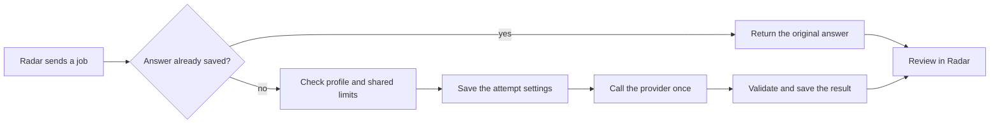

# How tasks run

DemoLogic handles tagging and daily summaries. A **profile** fixes the provider,
model, instructions and output format. Its ID and hash identify the exact version.

Demo Radar chooses jobs and handles permissions, review and publication. DemoLogic
checks profiles, calls the provider and saves results. Route execution remains
disabled. Provider settings, Gemini and paid spending controls come later.

## The flow

Tags and summaries share one execution lane. Only one call runs at a time.
Duplicate requests return the saved answer without another call. Jobs keep their
original settings; changing profiles does not reset retry limits.

**An unknown outcome blocks new calls, including after a restart or profile
change.** Use the [recovery procedure](service-api.md#what-happens-if-the-connection-drops)
before continuing. Saved suggestions still need review before publication.

## Inspect the service

The [API reference](service-api.md#authentication-and-endpoints) lists the
authenticated profile catalog and attempt lookup endpoints. These inspection
endpoints make no model calls or settings changes. The optional request fields
are documented in the [tagging contract](service-api.md#tagging-contract).

An `enabled` profile is loaded; it does not prove that a live call succeeded.
Summary profiles appear only when summaries are enabled.

## Keep older profiles

Outstanding jobs may need a previous profile after an upgrade. Keep its approved
assets and add its ID to the appropriate comma-separated startup setting:

* `DEMOLOGIC_RETAINED_TAG_CONFIGS`
* `DEMOLOGIC_RETAINED_SUMMARY_CONFIGS`

Empty values add no extra profiles. Retention does not change Radar's defaults.
Summary retention requires summaries enabled. Unknown or altered assets stop startup.

Removing a profile stops new work using it. Saved answers remain available through
attempt lookup; identical requests can also replay while that task is enabled.
Restore compatible versions for unfinished work instead of replacing its settings.

## Upgrade and rollback

| Versions | Behaviour |
| --- | --- |
| Old Radar, new Logic | Existing requests remain compatible. |
| New Radar, old Logic | A missing catalog (404/405) uses the existing pinned readiness check. Other catalog errors stop work. |
| Both new | Radar checks the exact profile ID and hash, including retained profiles. |
| Older Logic after rollback | Saved results remain readable; older code cannot enforce the new cross-profile rules. |

For an upgrade:

1. Pause new jobs, finish active calls and resolve unknown outcomes.
2. Back up the private journal and required profile assets.
3. Test with synthetic inputs and retain profiles needed by saved jobs.
4. Upgrade Logic and check catalog/readiness before resuming Radar.

For rollback, pause and drain again, preserve the current journal, and restore
compatible images/assets. Keep new-profile and multi-profile work disabled with
an older controller. Never delete the journal, switch profiles to clear an unknown
outcome, or overwrite newer attempts with an old backup.

## Saved history and timing

The journal adds an execution table while preserving original answers, usage and
recovery records. New attempts save their settings before execution. Older records
recover only known facts; missing context or timing stays unavailable.

Private logs record execution and outcomes. `provider_seconds` measures one adapter
call, including failures and parsing—not provider-reported inference time. Replay
adds no calls or usage. Public metric labels exclude source text, credentials and
request IDs.
